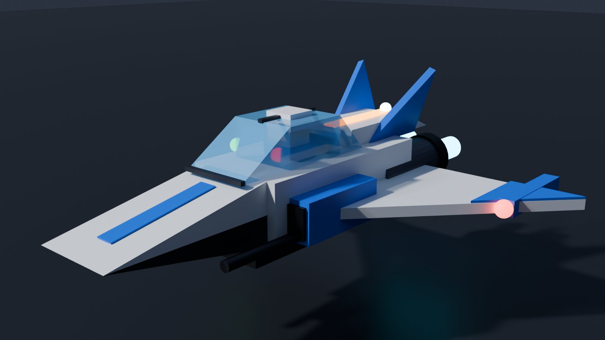
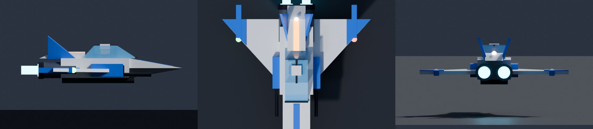
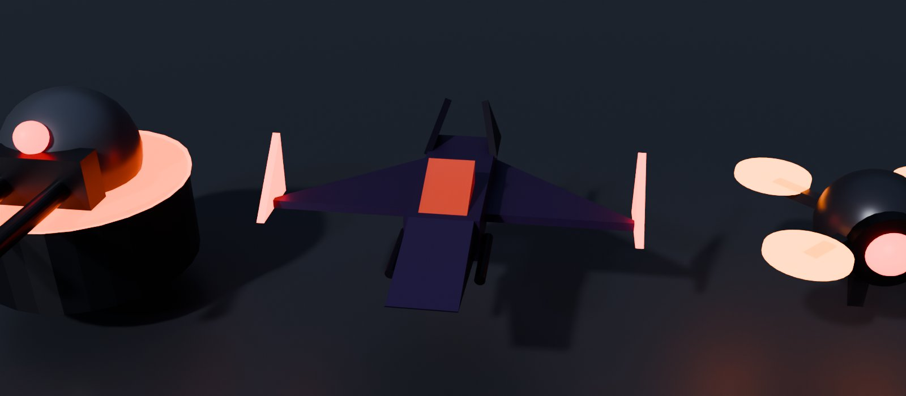
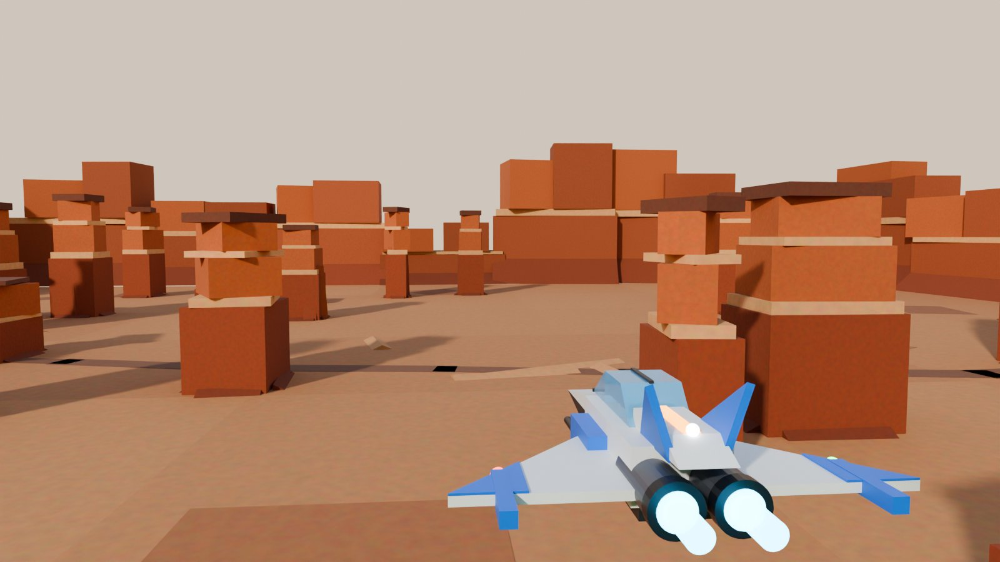
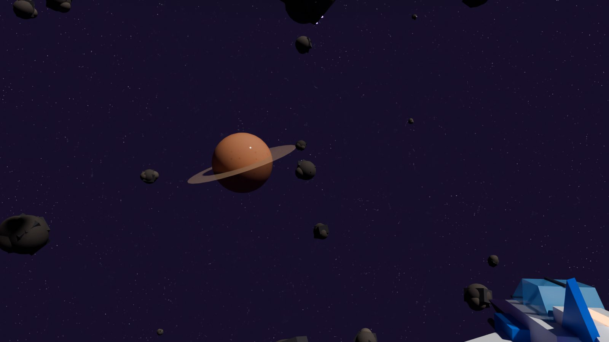

# Combate aéreo y espacial (núcleo para la Saga 2)

Naves de combate arcade para la Saga 2: vuelo en atmósfera y en el espacio, láser, misiles con fijación,
escudos, oleadas de enemigos con IA y un panel compacto. Ahora se prueba en una **arena de pruebas** del
Modo pruebas; el juego normal de Valmar no cambia.

> **El espacio encima de Valmar** (puerto espacial, estaciones, asteroides, patrullas y los 7 planetas)
> usa este mismo núcleo con `World = "Cosmos"`: ver `docs/espacio.md`. La arena de pruebas sigue aquí,
> aparte.

## Cómo probarlo

1. Entra como tester (Studio, el dueño o `Config.Testers`) y escribe **`/pruebas`** en el chat.
2. Sección **COMBATE AÉREO** → **«🚀 Arena de combate aéreo»** (o «Empezar en el espacio», «Arena fácil»,
   «Arena difícil»). Apareces sentado en tu nave en el punto de control.
3. A los 5 s llega la primera oleada. Sube por los **anillos azules** del centro para pasar al espacio.
4. Para volver a Valmar: botón **Salir** (móvil), tecla **B**, botón **B** del mando o «🏠 Salir de la
   arena» en el panel. Vuelves exactamente a donde estabas.

### Mandos

> **Espacio AAA** (docs/espacio-aaa/diseno.md): las teclas cambiaron y están en una tabla reasignable
> (`shared/AirCombat/ShipKeys`). Espacio ya no dispara (sube), F ya no lanza misiles (interactúa) y X ya
> no sale (salto cuántico; salir es **B**). Mientras escribes en el chat la nave no coge ninguna tecla.

| | Móvil | Ordenador | Mando |
|---|---|---|---|
| Dirigir | **palanca** (mitad izquierda) + arrastrar el pulgar derecho para afinar | ratón (apártalo del centro) o flechas | joystick izquierdo |
| Motor | automático (crucero) | W / S | cruceta ↑ / ↓ |
| Lateral / subir y bajar | — | A / D · Espacio / Alt | joystick derecho |
| Alabeo | automático (se inclina y nivela sola) | Q / E | — |
| Disparar (cañones o láser) | **DISPARO** (mantener) | clic izquierdo | RT |
| Precisión (mira fina y zoom) | — | clic derecho | — |
| Misil | **MISIL** (con blanco fijado) | 2 o rueda | RB |
| Impulso | **IMPULSO** (mantener) | Shift | LB |
| Freno / freno de emergencia | **FRENO** (mantener; > 0,6 s = emergencia) | Ctrl / doble Ctrl | LT / LT a fondo |
| Esquiva | **ESQUIVA** | C (hacia A/D/Espacio/Alt) | A |
| Cañones / láser | ranuras 1 / 3 | 1 / 3 | cruceta → |
| Recargar | — | R | cruceta ← |
| Hipervelocidad | ranura 7 | 7 o mantener Shift fuera de combate | R3 |
| Salto cuántico | ranura 6 | X | Select |
| Modo combate/crucero · asistencia | — | T · Y | — |
| Salir | **Salir** | B | B |

Los botones del móvil van en la esquina de abajo a la derecha (HudLayout.Fly: `Fuego` (DISPARO), `Misil`, `Turbo` (IMPULSO),
`FrenoNave`, `EsquivaNave`, `SalirNave`) y miden **≥ 44 pt** en el móvil del dueño; el FUEGO es el más grande.

- **Palanca táctil** (`UI/FlightStick`): pon el pulgar en **cualquier sitio de la mitad izquierda** (debajo
  de tu estado) y arrastra; el aro aparece donde tocas. En reposo se ve abajo a la izquierda con
  «ARRASTRA PARA DIRIGIR». Zona muerta pequeña y respuesta suave en el centro. Sin giroscopio (no hay que
  inclinar el móvil). No depende del joystick de andar, del Humanoid ni del PlayerModule.
- **Al volar, el HUD de Valmar se aparta** (`UI/FlightFocus`): fuera el GPS («Gira a la derecha en…»), la
  tarjeta de misión, el minimapa (en su sitio va el **radar** de la nave), la barra rápida, el ValPhone,
  las notas, los marcadores de misión en 3D y los globos del chat. Tu estado (compacto) y la hora se
  quedan; el panel de la nave va justo debajo de la hora. Al salir vuelve todo como estaba.

- **Fijar:** mantén a un enemigo dentro del recuadro del centro; el recuadro se cierra, suenan pitidos y
  se pone **rojo** («FIJADO · MISIL»). Entonces el misil lo persigue.
- **Ayuda a apuntar:** el láser se desvía un poco hacia el enemigo más centrado (y se adelanta a su
  movimiento). En el móvil el cono es más ancho.
- **Turbo:** gasta energía; si la vacías entera tiene que enfriarse unos segundos («ENFRIANDO»).
- **Cañones:** disparar sin parar los recalienta; deja de disparar un momento.
- **Escudo y casco:** el escudo para los disparos y se recarga solo a los 3 s sin recibir; lo que pasa
  va al casco. Casco a 0 o chocar con el suelo, una roca o un asteroide: tu nave estalla y a los 3 s
  reapareces en el punto de control con todo lleno.
- **Enemigos:** drones en enjambre (te rodean y ametrallan), cazas que se baten contigo (persiguen,
  esquivan cuando les das o te les pones detrás) y torretas en las rocas y los asteroides. Cada
  oleada trae más y más duros (con tope: nunca más de 12 a la vez). Derribados, estallan de verdad:
  explosión, trozos, humo y restos en llamas que caen (sin sangre).

## Dónde está la arena y por qué

En el **mismo lugar** del juego, pero muy lejos: centro en X = Z = 24 000 (Valmar y el aeroclub acaban en
±5600) y por encima (la meseta a Y = 1200; el espacio desde Y = 3400 hasta 6400).

- El proyecto publica **un solo lugar** (`scripts/publish.sh` sube un `ROBLOX_PLACE_ID`), así que otro
  lugar exigiría crear y publicar otro place y teletransportar (TeleportService), cosa que aún no existe
  en el proyecto. La arena dentro del mismo lugar se puede probar ya, en Studio y en el juego publicado.
- **No afecta a nadie:** se construye la primera vez que alguien entra (nunca al arrancar el servidor),
  el servicio no tiene bucle mientras no hay nadie dentro y sus modelos son
  `ModelStreamingMode = PersistentPerPlayer`: solo se mandan a quien está en la arena. Solo pueden entrar
  los testers.
- Al entrar se guarda el atributo `AirArenaReturn`: PositionService guarda ese sitio de Valmar (no la
  arena) si te desconectas dentro.

## Cómo está hecho (para reutilizar)

Lo puro (sin Roblox, igual en cliente y servidor, probado con Lune) va en `src/shared/AirCombat/`:

| Módulo | Qué hace |
|---|---|
| `ShipFlight` | Modelo de vuelo arcade: motor, cabeceo/guiñada/alabeo con autonivelación, turbo con energía y enfriamiento, freno con giro cerrado, modos `Atmos` (gravedad, se hunde despacio) y `Space`, choques (`Crash`), límites y la comprobación del servidor (`plausible`). |
| `Shields` | Escudo + casco, perforación de los misiles, regeneración con retraso. |
| `ShipWeapons` | Láser (cadencia, calor), misiles (munición, recarga, guiado), segmento del proyectil, cono máximo del servidor. |
| `Lock` | Fijación (cono, alcance, tiempo, margen al salir), adelanto y ayuda a apuntar. |
| `EnemyAI` | Dron (enjambre en círculo), Caza (persigue / esquiva / se aleja), Torreta; elegir blanco. |
| `Waves` | Oleadas por sección y dificultad, escala por oleada, máquina de oleadas, anillo de salida, texto del objetivo. |
| `Arena` | La arena de pruebas: sitio, puntos de control, rocas y asteroides (repetibles), choques. |
| `FxBudget` | Topes de efectos por nivel gráfico (Bajo / Medio / Alto) y colores. |

Servidor: `src/server/Services/AirCombatService.luau` (sesiones, validación, disparos, daño, IA, oleadas)
y `src/server/World/AirArena.luau` (piezas de la arena, la nave y los enemigos).
Cliente: `src/client/Controllers/AirCombatClient.luau` (mandos, predicción del vuelo, cámara, fijación),
`AirCombatFx.luau` (efectos), `src/client/UI/AirCombatHud.luau` (panel, radar, flechas, recuadro) y
`ShipButtons.luau` (botones táctiles). Sonidos en `Config.Sounds` (`Nave*`, control 🔔 Efectos, 3D).

**Quién manda:** la nave la mueve el ordenador del piloto (predicción sin retraso) **por CFrame, anclada**
(nada de física ni de dueño de red): el cliente pone el CFrame del Root cada fotograma y manda «Pose» 20
veces por segundo; el servidor comprueba cada una (que el salto sea posible con el tiempo de verdad y que
siga en la arena) y mueve la nave ahí para los demás, y en su vuelta mira que no esté dentro de una roca. Disparos, misiles, daño, escudos, munición, enemigos y oleadas son del servidor: el cliente solo
pide «disparo hacia aquí» (con cadencia, calor y un cono máximo) y «misil a este blanco» (tiene que estar
delante).

### Para un planeta de la Saga 2 (otro lugar)

1. Copia `src/shared/AirCombat/`, `AirCombatService`, `World/AirArena`, `AirCombatClient`, `AirCombatFx`,
   `AirCombatHud`, `ShipButtons`, las entradas `Nave*` de `Config.Sounds` y los huecos `Fuego…SalirNave`
   de `HudLayout.Fly` (o reutiliza todo el proyecto Rojo como base del nuevo place).
2. Sustituye `Arena` por la geometría del planeta: hace falta `checkpoint(sección)`, `center(sección)`,
   `modeAt(pos)`, `bounds(pos)`, `contains(pos, margen)`, `collide(pos, radio)`, `segmentBlocked(a, b)` y
   `turretSpots(sección)`. Para un terreno de verdad, `collide` puede consultar un mapa de alturas.
3. Desde la misión: `AirCombatService.enter(jugador, { Section = "Space", Difficulty = "Normal",
   MaxWaves = 5, Trusted = true })` y escucha `AirCombatService.onEvent(function(jugador, nombre, datos)
   … end)` con `"Kill"`, `"WaveCleared"`, `"Done"`, `"Down"` y `"Exit"`.
4. Nuevos enemigos: una entrada en `EnemyAI.Kinds` + `Shields.Specs` + su modelo en `AirArena.enemy`;
   nuevas oleadas en `Waves` (o pásale tus propios grupos).

### El fallo del móvil (v114) y el arreglo

El dueño, en el móvil: «la nave no se mueve, el joystick no sirve». Causas:

1. **La nave leía el joystick de andar** (`Controllers/Joystick`), que solo existe si el cliente consigue
   poner `DevTouchMovementMode = Scriptable`; si no (en su captura no hay joystick abajo a la izquierda),
   se queda el joystick de Roblox, que aparece al tocar, pero la nave **no lo leía** (ni
   `ControlModule:GetMoveVector`): el pulgar no hacía nada. Ahora la nave tiene su propia palanca
   (`UI/FlightStick`), que lee los toques directamente; si faltara, se lee el joystick de andar y, en
   último caso, el de Roblox. El control de Roblox se aparta mientras vuelas (`Controls.disable`).
2. **La nave dependía de la física**: Root sin anclar con `SetNetworkOwner` y el streaming en
   `MinimumRadiusPause` (a 24 000 studs y a 150-340 studs/s, el cliente pausa su física mientras carga
   alrededor) más la validación del servidor con el tiempo de su vuelta. Ahora va anclada y por CFrame (ver
   «Quién manda»), así que se mueve siempre.
3. **Consola**: todo sale con «[AirCombat] …» (F9): al empezar (mundo, sentado, anclada, qué mandos),
   el primer toque de la palanca, si algo mueve la nave por su cuenta, si el servidor rechaza posiciones
   o deja de recibirlas, y al acabar (cuántas veces se usó la palanca). Los problemas del cliente llegan
   también a la consola del servidor («Diag»).

### Cómo se ve

- **Nave** (`shared/AirCombat/ShipModel`, «Caza», ≈ 40 piezas): caza ligero de ala en delta, morro afilado,
  burbuja de cristal con el **piloto sentado dentro** (asiento hundido en el fuselaje: se ven la cabeza y
  los hombros; las piernas, dentro, se esconden), dos derivas inclinadas, dos motores con tobera, brillo y
  llama (más fuerte con el motor y blanca con el turbo: `AirCombatFx.shipStep`), luces de navegación
  (roja izquierda, verde derecha, blanca que parpadea en la cola) y estelas en los motores y las puntas de
  las alas. Se inclina al girar (alabeo del modelo de vuelo). La misma en la arena, en el espacio encima de
  Valmar y en el puerto espacial.
- **Enemigos**: dron en X (núcleo oscuro, ojo rojo y cuatro rotores naranjas que brillan), caza enemigo
  morado de alas en flecha invertida con púas rojas (silueta en W) y torreta con cúpula, dos cañones y
  sensor rojo. Fogonazos, trazadoras y explosiones como antes (`FxBudget`).
- **Arena** (`World/AirArena`): cañón del desierto: suelo de arenisca con manchas, dunas bajas y un cauce
  seco; mesas y agujas por capas (roca rojiza, franjas claras, sombrero de pizarra y lajas giradas: cada
  una dentro de su caja de choque), paredes del cañón alrededor, manto de nubes a media altura (no en
  gráficos Bajo), los anillos de subida y, arriba, asteroides con bultos, caras de pizarra y cristales que
  brillan, con un planeta anillado de fondo. El cliente le pone su cielo y su luz (atardecer cálido con
  bruma; en el espacio, la Vía Láctea, estrellas y nebulosa), sin la Grieta de Valmar ni la lluvia.
- Vistas previas (Blender, con las piezas de verdad; no son capturas de Roblox: materiales, cielo y bruma
  aproximados): `scripts/aircombat/preview-export.luau` + `preview_render.py`.

  
  
  
  
  

## Límites conocidos

- Un piloto = una sesión con sus propios enemigos; varios testers a la vez ven los disparos de los
  demás, pero cada uno pelea su oleada (la IA ya admite varios pilotos para el cooperativo).
- Los enemigos los mueve el servidor (30 vueltas por segundo, piezas ancladas): se ven bien, pero no
  tan suaves como tu nave; los impactos los decide el servidor con su posición de tu nave (con mucho
  retraso de red, un disparo esquivado en tu pantalla puede darte).
- El cielo de la arena usa los cielos de fotos que ya carga el juego (`SkyLibrary`: «Day» abajo, «Night» o
  «Asteroides» en el espacio; si no están, el del archivo), con la luz y la bruma propias de la arena.
- Los demás pilotos ven tu nave a 20 posiciones por segundo (sin suavizar).
- Sonidos: sin ids nuevos sin comprobar; son los de Roblox retocados y nuestros `motor`/`choque_*`.
  Cuando haya audios de láser y explosión subidos y comprobados (`audio-biblioteca`), basta con cambiar
  las entradas `Nave*`.
- Solo hay un tipo de nave (`Caza`) y la arena es de pruebas: sin recompensas, ni guardado de puntos.

## Pruebas

```
lune run scripts/test-aircombat.luau      # vuelo, daño, escudos, armas, fijación, IA, oleadas, arena, botones, panel, servidor («Pose»),
                                          # modelos (cabina con asiento), palanca táctil, HUD al volar y sitios a 932x430, 844x390 y 640x360
lune run scripts/test-compile.luau
lune run scripts/test-clientboot.luau     # ordenador y móvil
```
