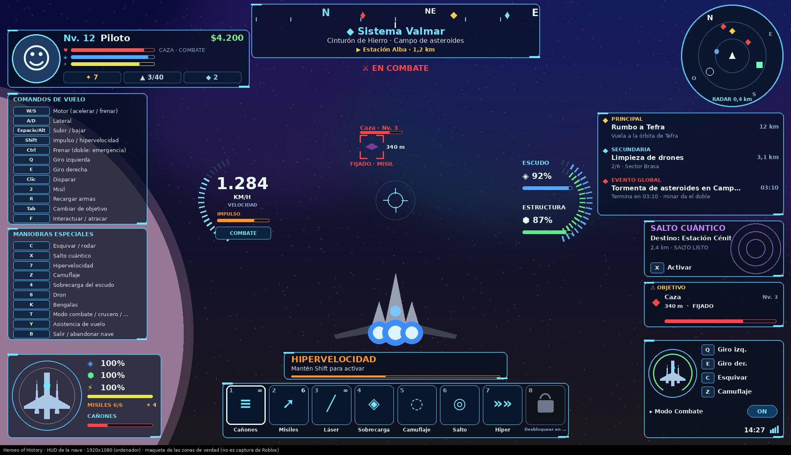
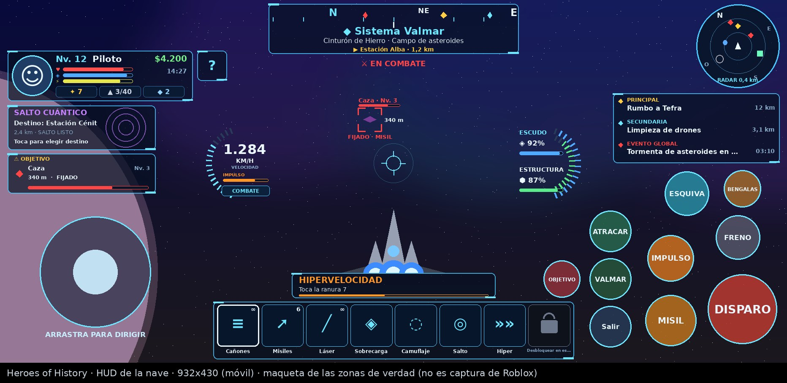
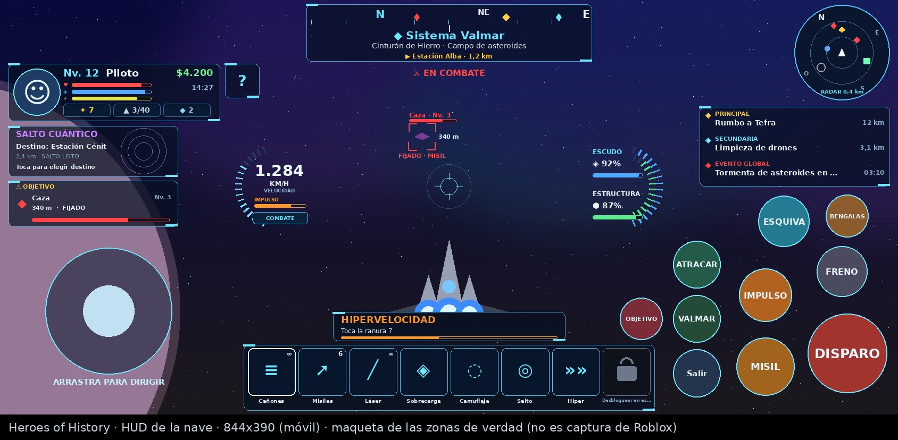
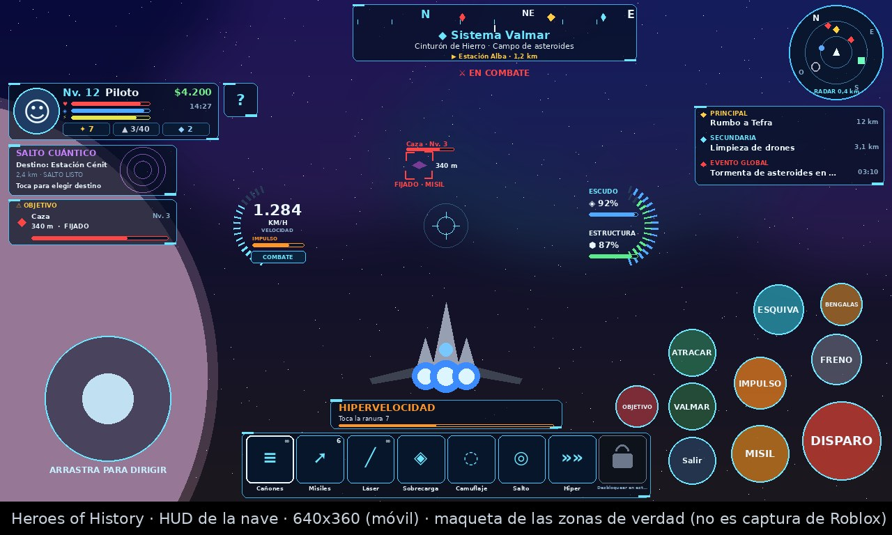
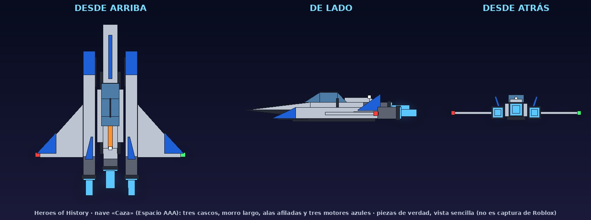

# Espacio «AAA»: auditoría y diseño técnico (fases 1 a 11)

Encargo: `encargo.md`. Referencia visual: `referencia-hud.png` (en el juego **nunca** salen los nombres de la
imagen ni de su sistema: el sistema es el **Sistema Valmar**, con los planetas Tefra, Siroco, Tálasa, Nivalis,
Umbría, Miasma y Vértice y las estaciones Alba y Cénit).

La primera tanda hizo las fases **1 a 6** (auditoría, vuelo, HUD y mandos, impulso/freno/esquiva,
hipervelocidad y salto cuántico); la segunda, las fases **7 a 11** (combate, camuflaje, sobrecarga del
escudo, modos, drones, taller y guardado, efectos y pulido: ver §10). Lo que no funciona del todo sale en
el HUD **bloqueado** y dice qué falta, nunca como un botón que no hace nada.

## 1. Lo que ya existía (auditoría)

| Pieza | Qué hace | Estado |
|---|---|---|
| `shared/AirCombat/ShipFlight` | Modelo de vuelo arcade: motor, cabeceo/guiñada/alabeo con autonivelación, turbo con su energía y enfriamiento, freno con giro cerrado, modos Atmos/Space, choques, límites y `plausible` (servidor). | Funciona. Faltaba: lateral, vertical, freno de emergencia, modos combate/crucero, asistencia apagable, inercia, choques «suaves» y recuperación, choques barridos (a mucha velocidad se podía saltar un asteroide entre dos fotogramas). |
| `shared/AirCombat/Shields` | Escudo + casco, regeneración. | Funciona (sin cambios). |
| `shared/AirCombat/ShipWeapons` | Láser (cadencia, calor), misiles (munición, recarga, guiado). | Funciona. Faltaba: segundo modo (láser de precisión) y recargar a mano. |
| `shared/AirCombat/Lock`, `EnemyAI`, `Waves`, `Arena`, `FxBudget` | Fijación, IA, oleadas, arena, topes de efectos. | Funcionan (sin cambios de fondo). |
| `shared/AirCombat/ShipModel` | Caza de ala en delta, 2 motores, cabina con el piloto dentro. | Funciona; silueta distinta de la referencia → se rehace (ver §6). |
| `shared/Cosmos/*` | Capas de altura, zona (asteroides, sectores, estaciones), estaciones, misiones, minería, planetas (cuerpos y registro), entrada en la atmósfera, Tefra. | Funcionan. Las estaciones no eran sólidas (solo apartaban). |
| `AirCombatService` | Sesión de la nave: «Pose» validada (CFrame anclado), disparos, misiles, daño, enemigos, `relocate` (pasar de sitio sin cortar el vuelo). | Funciona. Sin recurso de energía ni habilidades. |
| `SpaceService` / `PlanetService` | Subir/bajar, estaciones, minería, patrullas, misiones, tienda, planetas (Tefra). | Funcionan. Las Chispas y las misiones no llegaban al cliente (solo en la línea del objetivo). |
| `AirCombatClient` | Mandos, predicción, cámara, fijación. | Funciona. Teclas: X salía (choca con «X salto» del encargo), F misil (choca con «F interactuar»), Espacio disparaba (choca con «Espacio acelerar/subir»), 1-8 equipaban la barra rápida aunque estuviera escondida. |
| `AirCombatHud` | Panel VEL/TURBO/ESCUDO/CASCO/MISILES + radar (solo enemigos) + mira y fijación. | **Solo visual en parte**: el radar no enseñaba estaciones, planetas ni objetivos; no había brújula, perfil, misiones ni barra de habilidades. |
| `ShipButtons` | FUEGO, MISIL, TURBO, FRENO, Salir (móvil). | Funcionan; faltaban ESQUIVA y los de habilidades. |
| `UI/FlightStick`, `UI/FlightFocus`, `UI/TopStack`, `HudLayout` | Palanca táctil propia, HUD de Valmar apartado al volar, letreros de arriba, colocación. | Funcionan (se amplían, no se sustituyen). |
| Datos | `data.Space`: Chispas, Ore, Missions, Mined, Kills, Done, Planets. | Se añade `data.Space.Found` (puntos de interés descubiertos); con valor por defecto, las partidas viejas no pierden nada. |
| Sonidos | `Config.Sounds` `Nave*` (sonidos de Roblox y nuestros `motor`/`choque_*`). | Se reutilizan: ningún id nuevo. |

**Arquitectura que se mantiene:** un solo controlador mueve la nave (el cliente, por CFrame, anclada,
`ShipFlight`), y el servidor valida cada «Pose» (`ShipFlight.plausible` + geometría). Nada de física ni de
dueño de red. Disparos, daño, munición, energía, recargas, habilidades y saltos los decide el servidor.

## 2. Diseño por fases

### Fase 2 · Vuelo (`ShipFlight`, ampliado y compatible)

- Entradas nuevas: `Strafe` (lateral), `Lift` (vertical), `EBrake` (freno de emergencia).
- Estado nuevo: `Drift` (velocidad aparte del morro: lateral, vertical, esquiva e inercia), `FlightMode`
  (`"Combat"` | `"Cruise"`), `Assist` (asistencia de vuelo), `RecoverUntil`.
- **Combate**: velocidad normal, gira mejor, lateral entero. **Crucero**: +45 % de velocidad máxima, gira
  peor, poco lateral.
- **Asistencia** encendida: la deriva se frena sola y la nave se nivela. Apagada: **inercia controlada**
  (al girar, parte de la velocidad sigue en la dirección de antes y se pierde despacio).
- **Freno de emergencia**: en el espacio la nave se puede quedar quieta (flotando); en la atmósfera, a la
  velocidad mínima (se hunde, como antes).
- **Choques barridos**: cada paso se comprueba el segmento entero (muestras cada radio de la nave), así
  que a la velocidad de la hipervelocidad tampoco se atraviesa nada.
- **Choques suaves y recuperación**: despacio contra algo (estaciones, ahora sólidas; asteroides; suelo),
  la nave rebota, pierde velocidad y durante un momento la asistencia la endereza («Bump»); deprisa,
  estalla como siempre («Crash»).
- Servidor: `plausible` admite un margen extra (esquiva, hipervelocidad) solo cuando el servidor ha
  aprobado esa habilidad.

### Fase 3 · HUD por zonas y mandos

> La fase 11 rehízo el HUD con **todo** lo de la imagen de referencia y por vehículo: ver §11 (las zonas
> C, G e I de esta tabla ya no existen; sus datos están en Speed, Defense, Ship, Keys/Moves y Quick).

Un HUD nuevo para la nave (`UI/AirCombatHud`, mismo nombre y API; las cuentas puras en
`UI/ShipHudLayout`), colocado sin pisarse en 1920x1080, 932x430, 844x390 y 640x360:

| Zona | Qué | De dónde salen los datos |
|---|---|---|
| A | Perfil: foto del avatar (miniatura de Roblox), nombre, nivel, dinero, ✨ Chispas | atributos `Level`/`Money` y «Nav» del servidor |
| B | Brújula que gira con el rumbo de la nave, sistema/zona/planeta, distancia al destino, estado del salto | rumbo del Root; zona y destino del servidor |
| C | Velocidad, impulso, energía, escudo, casco, misiles, recarga del arma, alertas | simulación local + «State» del servidor (10/s) |
| D | Radar con icono y color por tipo, solo lo que está dentro del alcance (combate 1400, crucero 4000) | enemigos, estaciones, planetas, campos, balizas, objetivo de misión, otros pilotos |
| E | Misiones: principal (historia), secundarias del tablón con progreso y distancia, eventos | `Hud.objective()` + «Nav» |
| F | Mira, fijación, distancia y amenaza del blanco, marcas de impacto, flechas en el borde | como antes, ampliado |
| G | Palanca táctil (solo táctil); en el ordenador, una tarjeta pequeña de teclas; con mando, sus botones | `UI/FlightStick` |
| H | Barra de 8 ranuras: cañones, misiles, láser, sobrecarga del escudo, camuflaje, salto cuántico, hipervelocidad, dron (🔒 «Desbloquear en estación» hasta comprar uno) | estado del servidor |
| I | Botones grandes (táctil): DISPARO (el mayor), MISIL, IMPULSO, FRENO, ESQUIVA, BENGALAS, OBJETIVO | `UI/ShipButtons` en `HudLayout.Fly` |
| J | Avisos solo cuando hacen falta: modo combate, daño, proximidad, motor, hipervelocidad, salto | eventos |

- Panel oscuro semitransparente azul/negro con bordes cian, impulso en naranja y lo hostil en rojo.
- El HUD se actualiza por eventos y a ritmo limitado (panel 10/s, radar 10/s, brújula 30/s), no cada
  etiqueta en cada fotograma.
- En el móvil, versión compacta (sin listas de teclas); en el ordenador, teclas; con mando, sus botones.

**Teclas** (tabla reasignable `shared/AirCombat/ShipKeys`; con el chat o un cuadro de texto escribiendo,
la nave no coge ninguna tecla):

| Acción | Ordenador | Mando | Móvil |
|---|---|---|---|
| Dirigir | ratón / flechas | stick izq. | palanca izquierda + arrastrar a la derecha (sensibilidad en ⚙️) |
| Motor + / − | W / S | cruceta ↑ / ↓ | crucero automático |
| Lateral | A / D | stick der. X | — |
| Subir / bajar | Espacio / Alt izq. | stick der. Y | — |
| Alabeo | Q / E | LB+stick / RS | automático |
| Disparar | clic izq. | RT | DISPARO |
| Precisión (mira fina y zoom) | clic der. | L3 | — |
| Misil | 2 (o clic central) | RB | MISIL |
| Impulso | Shift (mantener) | LB | IMPULSO |
| Hipervelocidad | 7, o mantener Shift fuera de combate | R3 | ranura 7 |
| Freno / freno de emergencia | Ctrl / doble Ctrl | LT / LT a fondo | FRENO / mantenerlo |
| Esquiva | C (con A/D/Espacio/Alt) | A (según el stick) | ESQUIVA |
| Salto cuántico | X (abre el selector) | Select | ranura 6 |
| Sobrecarga del escudo | 4 | — | ranura 4 |
| Camuflaje | Z (o 5) | — | ranura 5 |
| Dron | 8 (otra vez: recogerlo) | — | ranura 8 |
| Bengalas (contra misiles) | K | cruceta ← | BENGALAS |
| Cambiar de objetivo | Tab | cruceta → | OBJETIVO |
| Recargar | R | — | ranura del arma |
| Cañones / láser | 1 / 3 | — | ranuras 1 / 3 |
| Modo combate / crucero / exploración | T | — | chip del HUD (se toca) |
| Asistencia de vuelo | Y | — | chip del HUD |
| Interactuar (atracar, viajar) | F (o G) | X | ATRACAR/VIAJAR |
| Volver a Valmar | V | Y | VALMAR |
| Bajarse / aterrizar | B | B | Salir |

Cambios respecto a antes (conflictos resueltos): Espacio ya no dispara (sube), F ya no lanza misiles
(interactúa), X ya no sale (salto cuántico; salir pasa a B, como en la referencia). Mientras pilotas, la
nave se queda 1-8 (no equipan la barra rápida, que está escondida).

### Fase 4 · Impulso, freno y esquiva

- **Energía** de la nave (nueva, del servidor): 100, se recarga sola tras 1,5 s sin gastar. La gastan la
  esquiva, la hipervelocidad y el salto. El impulso sigue con su medidor de calor (como antes).
- **Esquiva** (`shared/AirCombat/ShipAbilities`): izquierda, derecha, arriba o abajo según la entrada;
  desplazamiento real de ~38 studs en 0,28 s (estela), recuperación corta, recarga 1,6 s, 18 de energía.
  El servidor la aprueba (recarga, energía, estado), da **0,18 s de invulnerabilidad** y un margen en la
  comprobación del movimiento. Como la nave se aparta de verdad, los disparos que iban a su sitio fallan.
  Si no se puede: aviso visual (la ranura tiembla en rojo) y sonido seco, sin gastar nada.
- **Freno** y **freno de emergencia** (ver fase 2). **Impulso** con su color naranja en el HUD.

### Fase 5 · Hipervelocidad (`shared/AirCombat/Hyperspeed`)

1. **Preparación** (1 s): el cliente la pide; el servidor comprueba energía, estado, combate, estaciones,
   tráfico, atmósfera y obstáculos delante. El brillo de los motores sube. Si no, explica el motivo.
2. **Activación** (1 s): la velocidad sube poco a poco hasta 1500 studs/s, estelas, temblor suave,
   el campo de visión se abre, distorsión y HUD especial.
3. **Viaje**: gasta energía (la cuenta el servidor), avisa de obstáculos y se corta con Ctrl, 7 o la
   ranura; se corta sola sin energía, con un obstáculo delante, al llegar al borde del espacio, a una
   estación o a la atmósfera de un planeta.
4. **Desaceleración** (1,2 s): baja poco a poco, la cámara vuelve, efecto de salida.

Bloqueada: en combate (daño hace < 6 s o enemigos a < 1500), cerca de estaciones (< 830), con tráfico
(otro piloto a < 250), en la atmósfera (de Valmar o de un planeta, y en la superficie), sin energía (< 30)
o en recarga. Los choques se miran **barridos y por adelantado** (2,5 s de recorrido delante): nunca
atraviesa un asteroide, una estación ni un planeta. Distinta del impulso (otra tecla, otra velocidad,
gasta energía y tiene fases).

### Fase 6 · Salto cuántico (`shared/Cosmos/QuantumJump`)

- **Destinos** (del registro de navegación de verdad): baliza de Valmar, estaciones Alba y Cénit, órbita
  de los 7 planetas (`PlanetBodies`; los que aún no tienen episodio, solo órbita), campos de asteroides y
  sectores **descubiertos** (`data.Space.Found`, se descubren al entrar volando) y el punto de las
  misiones activas (carga → estación; drones → Sector Brasa…).
- **Selector** (X o la ranura 6): lista con distancia, coste y estado; los que no se pueden, con el motivo.
- **Validación (servidor)**: estado (no derribado, no en hipervelocidad ni otro salto), mundo (espacio de
  Valmar), combate, energía, alcance (máx. 60 000), distancia mínima (1500), recarga (12 s) y llegada
  segura (`safeArrival`: se busca un sitio libre de geometría alrededor del destino).
- **Secuencia**: carga (3 s: anillos y distorsión, el motor sube) → portal → `AirCombatService.relocate`
  al sitio seguro (el servidor, no el cliente) → salida con destello. La energía **solo se gasta al
  saltar**: si falla (te dan durante la carga, cancelas, el sitio deja de ser seguro…), explica el motivo,
  no gasta nada y la nave sigue volando. Un salto a la vez (`Charging`), y se puede reintentar.

### Nave (silueta de la referencia)

`ShipModel` «Caza» rehecho con piezas: fuselaje largo central, dos cascos laterales (multicasco), alas
afiladas hacia atrás y **tres motores** con brillo azul intenso. Misma API (`build`, `specs`, `Root`,
`ShipSeat`, `Escape`, `Llama`, tren de aterrizaje, luces de navegación).

## 3. Archivos

| Nuevo | Para qué |
|---|---|
| `src/shared/AirCombat/ShipKeys.luau` | Tabla de teclas reasignable (teclado, mando) y textos de las pistas. |
| `src/shared/AirCombat/ShipAbilities.luau` | Energía, recargas, esquiva y las 8 ranuras (puro). |
| `src/shared/AirCombat/Hyperspeed.luau` | Fases, comprobaciones y barrido (puro). |
| `src/shared/Cosmos/QuantumJump.luau` | Destinos, validación, coste y llegada segura (puro). |
| `src/client/UI/ShipHudLayout.luau` | Zonas del HUD, brújula y radar (puro, probado en 4 pantallas). |
| `src/client/UI/AimDrag.luau` | Zona de arrastre para apuntar con el pulgar derecho (móvil). |
| `src/server/Services/ShipSystems.luau` | Energía, esquiva, hipervelocidad y salto en el servidor (ayudante de AirCombatService). |
| `scripts/test-espacio-aaa.luau` | Pruebas de las fases 2 a 6. |

Se cambian: `ShipFlight`, `ShipWeapons`, `ShipModel`, `Zone`, `AirCombatService`, `SpaceService`,
`AirCombatClient`, `AirCombatFx`, `AirCombatHud`, `ShipButtons`, `HudLayout` (`Fly`), `Hud`
(`setShipFocus`), `SpaceClient` (F interactúa), docs.

## 4. Riesgos

- **Red**: la hipervelocidad y la esquiva mueven mucho en poco tiempo; el servidor solo da margen cuando
  las ha aprobado (si no, «Reset» al último sitio bueno, como siempre).
- **Teclas**: cambian X, F y Espacio. Se documentan y se enseñan en el HUD; la tabla es reasignable.
- **Móvil**: muchos elementos; el HUD compacto se comprueba con pruebas de solape en las 4 pantallas.
- **Rendimiento**: efectos dentro de `FxBudget`; el HUD a ritmo limitado.
- **Sin probar en Roblox de verdad** (Lune no dibuja): ver la lista de comprobación a mano.

## 5. Orden

1. Este documento. 2. Vuelo. 3. HUD y mandos (y la nave nueva). 4. Impulso, freno y esquiva.
5. Hipervelocidad. 6. Salto cuántico. Un commit por fase; el juego sigue jugable en cada una.

Nuevos también (además de la tabla de §3): `src/shared/Cosmos/NavInfo.luau` (zona, misiones con sitio,
puntos de interés que se descubren, rumbo) y `src/client/Controllers/ShipHudClient.luau` (llena el HUD
a ritmo limitado).

## 6. Lo que ya está hecho (fases 1 a 6)

| Fase | Hecho | Dónde |
|---|---|---|
| 2 · Vuelo | Lateral, vertical, freno de emergencia, modos combate/crucero (T), asistencia (Y) con inercia, choques barridos, rebote y recuperación, estaciones sólidas. | `ShipFlight`, `Stations.hulls`, `Zone.collide` |
| 3 · HUD | Zonas A-J, brújula real, radar con iconos y alcance, misiones reales (historia + tablón + eventos), barra de 8 ranuras con estados, teclas en el ordenador, botones grandes en el móvil, zona de apuntar con el pulgar derecho y su sensibilidad (⚙️), nave de tres cascos. | `AirCombatHud`, `ShipHudLayout`, `ShipHudClient`, `ShipButtons`, `AimDrag`, `ShipModel` |
| 4 · Impulso, freno, esquiva | Energía del servidor; esquiva en 4 direcciones con estela, recarga, aviso al no poder e invulnerabilidad de 0,18 s del servidor; recargar (R); láser de precisión (3). | `ShipAbilities`, `ShipSystems` |
| 5 · Hipervelocidad | 4 fases con efectos (brillo de motores, rayas, campo de visión, temblor, letrero), gasto, corte (Ctrl, 7, la ranura), salida sola (energía, obstáculo, ataque), bloqueos con motivo, barrido por delante y en el servidor. | `Hyperspeed`, `ShipSystems`, `AirCombatClient`, `AirCombatFx` |
| 6 · Salto cuántico | Selector con destinos reales (estaciones, 7 órbitas, baliza, descubiertos, misiones), validación, carga con portal, salto real del servidor a un sitio seguro, sin gasto si falla, sin doble salto, reintento. | `QuantumJump`, `NavInfo`, `ShipSystems`, `SpaceService` |

Datos: `data.Space.Found` (nuevo, con valor por defecto: las partidas viejas no pierden nada). La energía,
las recargas y el estado de las habilidades viven en la sesión del servidor (no se guardan).

### Lo que quedaba bloqueado tras la primera tanda

Escudo especial (4), camuflaje (5) y drones (8) salían con candado: los hace la segunda tanda (§10).

## 7. Imágenes

Maquetas dibujadas con las zonas de verdad (`scripts/espacio/hud-layout-dump.luau` +
`scripts/espacio/hud_mockup.py`; **no son capturas de Roblox**: el contenido es de ejemplo y en el móvil
el juego además agranda los textos) y la nave con sus piezas de verdad (`scripts/espacio/ship-dump.luau`
+ `ship_preview.py`):

(rehechas en la fase 11: ranuras 4 y 5 activas, la 8 «Desbloquear en estación», BENGALAS y OBJETIVO,
la fila del objetivo y las teclas nuevas)







## 8. Pruebas

```
lune run scripts/test-espacio-aaa.luau   # fases 2-11: vuelo, teclas, HUD (zonas en 4 pantallas, brújula, radar,
                                         # ranuras, valores del servidor), esquiva, hipervelocidad, salto,
                                         # fijación y misiles enemigos, bengalas, sobrecarga, camuflaje, modos,
                                         # escáner, drones, taller y guardado, varios pilotos y topes
lune run scripts/test-aircombat.luau     # (la nave nueva: tres motores)
lune run scripts/test-space.luau ; lune run scripts/test-planetas.luau ; lune run scripts/test-flight.luau
lune run scripts/test-compile.luau ; lune run scripts/test-clientboot.luau ; lune run scripts/test-serverboot.luau
lune run scripts/test-hud.luau
```

## 9. Comprobar a mano en Roblox (Lune no dibuja ni tiene red)

1. **Teclas en el ordenador**: W/S, A/D (lateral), Espacio/Alt (subir/bajar), Q/E, clic, clic derecho
   (zoom de precisión), 2 (misil), Shift (impulso; mantenido fuera de combate, hipervelocidad), doble
   Ctrl (freno de emergencia), C (esquiva), 1/3 (cañones/láser), R, 7, X (selector), T, Y, B, F (atracar),
   V. Que **escribiendo en el chat** ninguna haga nada y que 1-8 no equipen nada de la mochila.
2. **Mando**: sticks, RT/LT/RB/LB, A (esquiva), R3, Select (el selector se recorre con la cruceta).
3. **Móvil** (932x430, 844x390 y uno pequeño): la palanca y el pulgar derecho a la vez (varios dedos),
   DISPARO + IMPULSO + palanca a la vez, FRENO mantenido = emergencia, ESQUIVA, tocar las ranuras 6 y 7;
   las bloqueadas dicen «Próximamente»; la sensibilidad en ⚙️; que nada se pise ni tape el centro.
4. **HUD**: la foto del avatar sale (miniatura de Roblox), nivel/dinero/Chispas reales, la brújula gira con
   la nave, el radar enseña estaciones, campos, enemigos y otros pilotos dentro del alcance (más lejos en
   crucero), las misiones del tablón con su distancia y el aviso «EN COMBATE».
5. **Esquiva**: que se vea el desplazamiento y la estela, la recarga en el botón y que con la red real el
   servidor no devuelva la nave atrás («Reset») al esquivar.
6. **Hipervelocidad**: en espacio abierto (lejos de estaciones y enemigos): preparar → activar (rayas,
   campo de visión, temblor) → viaje → Ctrl para salir; que se corte sola ante un asteroide o el borde y
   que no se pueda junto a una estación, en combate, con otra nave al lado o cerca de un planeta. Con la
   red real, que no haya «Reset» durante el viaje.
7. **Salto cuántico**: X → lista; saltar a Cénit, a la órbita de Tefra y a un campo ya descubierto; que
   te den durante la carga (falla sin gastar); cancelar con X; que la llegada no quede dentro de nada y
   que el radar, la brújula y las misiones se pongan al día.
8. **Choques**: rozar despacio una estación y un asteroide (rebote, no estalla); deprisa, estalla.
9. **Rendimiento en el móvil** (gráficos Bajo): rayas de la hipervelocidad y portal sin tirones.
10. **La nave nueva** en el puerto espacial, en el espacio y en Tefra (tren de aterrizaje, piloto dentro
    de la cabina, tres motores que brillan).

## 10. Segunda tanda (fases 7 a 11)

| Fase | Hecho | Dónde |
|---|---|---|
| 7 · Combate | Fijación con reglas (alcance, ángulo y línea de visión: un asteroide la corta), cambiar de objetivo (Tab / cruceta → / OBJETIVO, por ángulo), fila OBJETIVO en el HUD (tipo, nivel, salud, distancia), misiles de los cazas enemigos con las mismas reglas que buscan tu nave, aviso de misil con su dirección y pitido, bengalas (K: 4 cargas que se reponen; el misil va al señuelo), la esquiva hace fallar. | `ShipCombat`, `Lock`, `AirCombatService` (`stepEnemyMissiles`), `ShipHudClient` |
| 8 · Habilidades | Sobrecarga del escudo (4: +60 % de escudo 6 s y luego se recalienta), camuflaje (5/Z: gasta energía, máx. 12 s, disparar o lanzar lo rompe; los enemigos solo te ven a menos de 300 y los demás pilotos te pierden en el radar), modos combate / crucero / exploración (T: exploración = radar 6000, pulso del escáner que descubre puntos de interés, sin misiles y armas a media cadencia), drones (8: explorador, defensa, reparación y combate; uno a la vez, con vida y tiempo; los pueden destruir). | `ShipCombat`, `ShipSystems`, `EnemyAI.sees`, `AirCombatFx` |
| 9 · Taller y guardado | «🛠 Taller» en las estaciones: blindaje, baterías y lanzabengalas por niveles, y desbloquear drones, con dinero de Valmar y ✨ Chispas (nada de Robux; no da ventaja de pago). Se guarda en `data.Space.Upgrades`, `Drones` y `DroneKind` (partidas viejas: valores por defecto); los puntos que descubre el escáner van a `Found` (destinos del salto). | `SpaceService` (`workshop`, `buyUpgrade`, `buyDrone`, `loadoutFor`, `scanFor`), `DataService` |
| 10 · Efectos | Cada habilidad con su efecto y sonido: bengalas que caen y brillan, burbuja de sobrecarga, nave que se desvanece y brillo al camuflarse, pulso del escáner, misiles enemigos rojos con estela, dron con su color, distorsión de la imagen en hipervelocidad (azul) y al cargar el salto (violeta). Todo dentro de `FxBudget` (en gráficos Bajo, sin desenfoque ni luces de más). | `AirCombatFx`, `AirCombatClient` |
| 11 · Pulido | Topes (abajo), pruebas con varios pilotos, este documento y las maquetas nuevas. | `test-espacio-aaa` |

**Precios del taller** (`ShipCombat.Upgrades` y `ShipCombat.Drones`): blindaje +20 de casco por nivel
(3 niveles), baterías +15 de energía (3), lanzabengalas +1 bengala (2); el primer nivel cuesta 800 / 700 /
500 $ y 4 / 4 / 3 ✨ (sube con el nivel). Drones: explorador 300 $ + 6 ✨, defensa 600 $ + 10 ✨, reparación
700 $ + 12 ✨, combate 900 $ + 15 ✨.

**Rendimiento y red (topes)**:
- Misiles enemigos: como mucho 6 a la vez por piloto, aunque haya muchos cazas (probado con 10).
- Un dron por piloto; las bengalas tienen cargas y recarga corta; el escáner, su ritmo (cada 4 s).
- Los efectos de las habilidades solo se envían a los pilotos a menos de 2500 studs (`FxRadius`).
- Las rayas de la hipervelocidad y los disparos usan piezas reutilizadas; el HUD a ritmo limitado (panel
  y radar 10/s, estados de las demás naves 5/s); desenfoque y luces solo con gráficos altos.
- El servidor manda en todo: energía, recargas, fijación de los misiles (línea de visión), cadencia en
  exploración, camuflaje y daños; el cliente solo pide.

**Sigue bloqueado**: la ranura 8 hasta comprar un dron en el taller de una estación («Desbloquear en
estación»). No hay más candados en la nave.

### Comprobar a mano (segunda tanda)

11. **Misiles enemigos**: que un caza te lance uno, el aviso con la flecha y el pitido; K suelta bengalas
    y el misil se va tras ellas; esquivar en el último momento también funciona.
12. **Objetivo**: Tab (cruceta →, OBJETIVO) cambia de blanco; la fila OBJETIVO enseña tipo, nivel, salud
    y distancia; detrás de un asteroide no se fija.
13. **Sobrecarga (4)**: la burbuja se ve y el escudo pasa de su máximo; luego no regenera un rato.
14. **Camuflaje (5/Z)**: tú te ves a medias y otro jugador casi no te ve ni te tiene en el radar (salvo muy
    cerca); disparar lo rompe; los enemigos te pierden de lejos.
15. **Modos (T o tocar el chip)**: exploración amplía el radar, escanea solo y descubre campos (salen en el
    selector del salto); no deja lanzar misiles.
16. **Taller**: comprar blindaje, baterías, lanzabengalas y un dron con dinero y Chispas; salir, volver a
    entrar (guardado) y que la nave salga con todo. Con poco dinero o Chispas, que no cobre.
17. **Drones (8)**: cada tipo hace lo suyo (escanea, para misiles, repara, dispara); otra vez 8 lo recoge;
    lo pueden destruir; otro jugador lo ve.
18. **Efectos**: distorsión en hipervelocidad y al cargar el salto; en gráficos Bajo, sin tirones.
19. **Varios jugadores**: dos en la misma zona ven los efectos del otro; uno muy lejos no recibe nada.

## 11. HUD completo como la referencia (fase 11, por orden del dueño)

«Debe aparecer TODA la información que hay en esta imagen; solo cambia según lo que vayas a volar.»
Auditoría elemento por elemento de `referencia-hud.png` (sin el pie con el nombre de la imagen: aquí no hay
pie, o «Heroes of History» en las maquetas):

| Elemento de la referencia | En el juego | Zona / función |
|---|---|---|
| Avatar, nivel, nombre, dinero | Miniatura de Roblox, `Level`, nombre, dinero | A · `setProfile` |
| 3 contadores de recursos | ✨ Chispas, ⛏ mineral en la bodega (n/40), 💎 cristales solares | A · `setResources` (datos de `SpaceService.infoFor`) |
| Barras pequeñas de vida/escudo/energía | Casco (rojo), escudo (azul), energía (amarilla) | A · `set` |
| Brújula N/E/S/O con marcas | Gira con el rumbo; rombo del destino, objetivo (rojo), misión principal (cian) | B · `setCompass(view, rumbo, destino, extra)` |
| «Sistema … / Planeta … / distancia» | «Sistema Valmar», zona o planeta, «▶ destino · distancia» | B · `setNav` |
| Radar con aros | Aros, cono, N/E/S/O que giran, iconos por tipo y alcance por modo | D · `radar` |
| Misión principal, secundaria, evento global | Historia, tablón y **EVENTO GLOBAL con reloj** (abajo) | E · `setMissions` |
| Mira y marca del enemigo | Mira con aro; corchetes con nombre, nivel, barra de salud y distancia | F · `setLock` |
| Arco de velocidad (KM/H) | Arco de rayitas, KM/H, VELOCIDAD, impulso y el modo (se toca) | Speed · `set` (`SpeedMax`) |
| Arcos de ESCUDO y ESTRUCTURA | Dos arcos y barras con % | Defense · `set` |
| Panel SALTO CUÁNTICO | Destino (elegido o sugerido), distancia, estado y «X Activar» (en el móvil se toca) | Jump · `setJump` |
| HIPERVELOCIDAD – mantén Shift | Letrero encima de la barra | Prompt · `setPrompt` |
| Barra de 8 habilidades con cantidades | Igual (y recargas, motivos, candado del dron) | H · `setSlots` |
| Esquema de la nave con escudo/casco/energía | La nave en planta con %, misiles, bengalas, arma y calor | Ship (ordenador) |
| Atajos: giro izq./der., esquivar, camuflaje | Con su tecla (o botón del mando); esquivar y camuflaje se pueden pulsar | Quick (ordenador) |
| «Modo Combate ON/OFF» | ON en combate, OFF en crucero/exploración; se pulsa | Quick + el chip de Speed |
| Tarjeta OBJETIVO | Nombre, nivel, distancia, salud y FIJADO (se toca para cambiar) | Target · `setTarget` |
| «COMANDOS DE VUELO» y «MANIOBRAS ESPECIALES» | Dos listas; **H** las pliega; con mando enseñan sus botones | Keys / Moves · `setHintGroups`, `toggleHints` |
| Reloj y señal | Hora local | Quick (ordenador) / A (móvil) · `setClock` |

**Móvil**: lo mismo en compacto y sin pisarse (probado en 932x430, 844x390 y 640x360): salto y objetivo
bajo el perfil, arcos a los lados de la mira, el reloj en el perfil, el modo en el arco de velocidad; las
listas de teclas, la nave en planta y los atajos no van (la palanca y los botones grandes ocupan las
esquinas): **«?»** abre lo que hace cada botón.

**Eventos globales** (`shared/Cosmos/SpaceEvents`, nuevos): salen de la hora del servidor
(`workspace:GetServerTimeNow()`), iguales en todos los servidores sin mandar nada. Cada 15 min: 5 min de
evento y 10 de calma (el HUD dice cuál viene y en cuánto). *Tormenta de asteroides* en un campo: minar ahí
da una unidad más (si cabe). *Incursión pirata* en un sector: cada derribo ahí da ✨ +1 (con el tope por
hora). El servidor lo aplica en `SpaceService.onRock` y `onKill`.

**Por vehículo** (para el avión y lo que venga; todo añadido, nada de antes cambia):
- `ShipHudLayout.Vehicles` = `Ship` (todo) y `Plane` (sin salto cuántico ni escudo).
- `ShipHudLayout.defineVehicle(id, { Name, Without = { zonas }, Shield, Slots, Silhouette })`.
- `ShipHudLayout.compute(viewport, { Touch, Inset, Vehicle })`.
- `AirCombatHud.new(parent, touch, vehicle?)` y `AirCombatHud.setVehicle(view, id)`: coloca solo sus
  zonas y esconde lo del escudo si no tiene.
- `ShipHudClient` usa `a.Vehicle` (por defecto `"Ship"`).


### Comprobar a mano (HUD de la referencia)

20. **Ordenador**: que se vea todo lo de la tabla y nada se pise; H pliega y despliega las dos listas;
    con mando, las listas y los atajos enseñan sus botones; el reloj avanza.
21. **Arcos**: el de velocidad sube al acelerar (naranja con impulso); escudo y estructura bajan al recibir.
22. **Objetivo**: corchetes rojos con nombre, nivel, salud y distancia; la tarjeta OBJETIVO igual; Tab
    (o tocarla) cambia de blanco.
23. **Salto**: el panel dice el destino y la distancia; X (o tocarlo) abre el selector.
24. **Evento global**: la fila cuenta atrás; durante la tormenta, minar en su campo da el doble; durante
    la incursión, los derribos en su sector dan una Chispa más.
25. **Móvil** (los tres tamaños): todo en compacto sin tapar la palanca, los botones ni la mira; «?»
    abre y cierra la ayuda; tocar el chip de modo cambia de modo.
26. **Avión** (cuando el otro controlador lo use): sin panel de salto ni escudo; lo demás igual.
