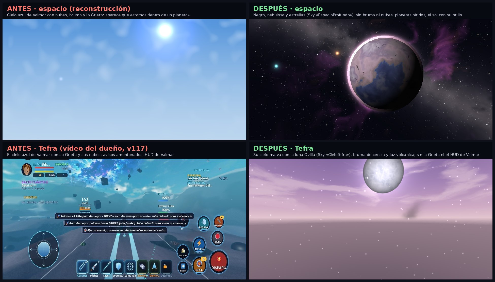

# Entorno por zona: el espacio negro, el cielo de cada planeta y el HUD de Valmar fuera de Valmar

Queja del dueño (vídeo en Tefra, v117, `docs/bugs/video-tefra/`): «Cuando llevamos la nave por el espacio
parece que estamos dentro de un planeta; tiene que verse todo negro, estrellas, planetas, como si
estuvieses en el universo. Y cuando estás pilotando un avión dentro de la atmósfera debe verse bien la
ciudad.» En los fotogramas, en Tefra se veía el cielo azul de Valmar con su Grieta y sus nubes, el GPS
de Valmar («Gira a la izquierda… 10,9 km»), su misión, su minimapa, Cosme a tu lado y cinco avisos a la vez.

(Maquetas hechas con los cielos de verdad del juego: `python3 -I scripts/espacio/entorno_mockup.py`.)

## Por qué pasaba

El cielo y la luz los tocaban seis sistemas a la vez, cada uno con su interruptor, y ganaba el último:

| Quién | Qué tocaba | El fallo |
|---|---|---|
| `DayLight` | la luz de la hora, la bruma, las nubes, el cielo de fotos | las capas de la historia se mezclaban en un orden cualquiera: la Grieta (etapa 7: bruma 0,22, nubes 0,84) se ponía ENCIMA de la del espacio |
| `SkyRift` | la Grieta y su capa de luz | un solo `setSuppressed(bool)`: al bajarte de la nave en Tefra, la arena (`AirCombatClient.stop`) la volvía a encender |
| `AirCombatClient` | `forceSky(nil)` al acabar el vuelo | borraba el cielo de Tefra que había puesto `PlanetClient` (que solo lo ponía al cambiar) |
| `SpaceClient` / `PlanetClient` | capas «SpaceSky» y «PlanetSky» | se pasaban el mando con `setSkyOwner` |
| `Weather`, `SkyExtras` | lluvia, tormenta, luna 3D, estrellas fugaces | no sabían del espacio |
| Roblox | `Atmosphere`, `Clouds` | con densidad 0 el horizonte seguía azulado; las nubes tienen un mínimo de cobertura de 0,35 |

## Cómo es ahora

Un solo dueño: **`Controllers/EnvDirector`** (cliente, cada jugador el suyo) con las cuentas puras de
**`shared/Cosmos/EnvZones`**.

* Zonas: `Valmar` (suelo y cielo de los aviones), `Transicion` (1800–3400: fundido), `Espacio`, `Entrada`
  (entrando o saliendo de un planeta), `Planeta` (superficie) y `Arena` (la de pruebas, con su cielo).
* 10 veces por segundo; el paso de una zona a otra va en fundido (`EnvZones.approach`, como mucho 1,6 por
  segundo: saltar de la nave a la superficie no da fogonazo) y los interruptores llevan histéresis
  (`EnvZones.flags`: en el borde no parpadean).
* `DayLight.setZone`: el cielo de la zona manda sobre todos (también sobre `forceSky` y los cielos
  especiales) y su luz se mezcla **la última**, encima del tiempo y de las capas de la historia.
* **Espacio**: `Atmosphere` fuera de `Lighting` (se guarda y vuelve tal cual), `Clouds.Enabled = false`,
  `ColorCorrection` de Valmar apagada, Sky «EspacioProfundo» (nebulosa y estrellas), `Sky.StarCount`
  según el nivel gráfico (1500 / 3000 / 5000), sombras casi negras, el sol con su brillo (rayos y el
  destello de `SkyExtras`), sin Grieta (motivo «Zona»), sin lluvia, ni tormenta, ni luna de Valmar.
  Más estrellas de piezas en Alto (420) que en Bajo (140). Sin bruma, los planetas (estrella de lejos,
  esfera de cerca) se ven nítidos.
* **Tefra**: su perfil (`EnvZones.Tefra`): Sky «CieloTefra» con la luna Ovilla, bruma malva de ceniza,
  nubes de ceniza (nunca las blancas de Valmar), sol cálido de luz volcánica, sombras moradas; sin la
  Grieta ni el tiempo de Valmar. Los otros 6 planetas tienen un perfil hecho con los colores de su
  cuerpo (`EnvZones.planet`), así nunca sale el cielo de Valmar.
* **Valmar**: la luz de la hora y el aire limpio desde el avión del paisaje (`DayLight.aerial`) no se
  tocan: la zona solo entra a partir de la transición.

## HUD de Valmar fuera de Valmar

* `UI/FlightFocus.setZone("Planeta")` (lo pone EnvDirector con el atributo `Planeta`): fuera el GPS, el
  minimapa, la tarjeta de misión de Valmar (`Hud.setZoneFocus`), los marcadores 3D y las pistas de
  primeros pasos, también a pie. Volar y la zona se suman: cada pantalla vuelve cuando ya nadie la
  quiere escondida. El GPS además no calcula rutas en otro planeta.
* Acompañantes (`SceneService`): en otro planeta nadie de Valmar te sigue (Cosme salía a tu lado en
  Tefra); si se quedó lejos, vuelve a su sitio. Una misión puede pedirlo con `Planetas = true` en el actor.
* Pistas (`Hud.toast("Hint", …)`): de una en una (la nueva sustituye a la de antes) y la misma no vuelve
  a salir en 25 s. Son pistas: despegar, posarse, «Fija un enemigo primero», «Estás en Tefra…», «Posada»,
  salir de la atmósfera… La de despegar ya no la dicen la nave y el servidor a la vez.
* «Fuera de la arena · oleada…» solo al salir de la arena de pruebas.
* «MUY LENTO: acelera» (`ShipHudClient.warnFor`) no sale al posarte (tren fuera, aterrizando, posada),
  frenando, con el motor bajado a propósito ni bajando a aterrizar encima de Valmar.

## Pruebas

`test-space` (zonas, transición, espacio negro, histéresis, DayLight con una `Lighting` de mentira,
EnvDirector), `test-planetas` (perfil de Tefra y de los 7, entrada, fundidos, HUD en Tefra, Cosme),
`test-espacio-aaa` (MUY LENTO, «Fuera de la arena», pistas), `test-hud` (pistas de una en una, HUD en un
planeta), `test-skyrift` (motivos para apagar la Grieta), `test-weather` y `test-gameplay` (acompañantes).

## v122: como la referencia del dueño (referencia-espacio-v121.png)

Captura de la v121 en el móvil (`docs/bugs/espacio-v121-actual.png`) en la órbita de Tefra: cenit azul
marino con estrellas que se aclara hacia el horizonte y, debajo, un azul claro **liso** (70, 165, 213)
hasta abajo; ni rastro de la nebulosa ni de la Vía Láctea del cielo del espacio; los planetas, bolas
pastel translúcidas.

* **Por qué el «suelo azul»:** es la bruma de Roblox (`Atmosphere`) con los colores de Valmar
  (Color 199, 216, 238 / Decay 90, 124, 170) vista desde muy arriba: con una `Atmosphere` en `Lighting`,
  Roblox pinta debajo del horizonte su color liso, aclara el cielo hacia el horizonte y vela todo lo
  lejano (los planetas impostores van a 1500 studs). Con la luz del espacio (`EnvZones.Space`) esa bruma
  sería negra y a densidad 0, así que en ese fotograma DayLight seguía con la zona de Valmar. Las pruebas
  no lo reproducen (EnvDirector funciona en el arnés) y no se ha podido ver el cliente de verdad.
  Arreglos, sin depender de una sola pieza:
  * `Controllers/DayLight`: si EnvDirector no ha dicho la zona en 0,6 s, DayLight la mira solo con la
    cámara (`DayLight.fallbackZone`). Aparta TODAS las `Atmosphere` de `Lighting` (y la que llegue
    estando arriba) y pone la niebla clásica (`FogColor`) negra y lejísimos; al bajar vuelve una.
  * `EnvZones.flags`: con el cielo del espacio puesto (también en la transición y al empezar a entrar en
    un planeta) nunca la bruma ni el etalonaje de Valmar.
* **Planetas translúcidos:** la cáscara de `ForceField` de la atmósfera iba al 90 % encima de la esfera y
  Tefra llevaba encima nubes casi opacas de color claro. Ahora la esfera (SmoothPlastic, su textura) va
  opaca (`Transparency 0`), la cáscara al 16 % (`PlanetBodies.AirAlpha`), el aro de fuera solo alrededor
  del disco, Tefra sin nubes, anillos con imagen (`anillos_<id>`) y Valmar con el aire al 16 %.
* **Texturas nuevas** (`scripts/espacio/gen_espacio_v122.py`, CC0, nombres nuevos: el juego usa la
  nueva si está subida y si no la de antes): `cielo_nebulosa_*` (6), `planeta_tefra` (lava),
  `planeta_vertice` (gigante gaseoso), `valmar_tierra` + `nubes_valmar` (Valmar como la Tierra con la
  isla de verdad arriba), `anillos_vertice`, `anillos_miasma`. Se suben con
  `bash scripts/upload-espacio.sh` (las que no tienen id). Maqueta (no es captura del juego):
  `comparacion-espacio-v122.jpg`.
* **Marcadores** (`UI/SpaceMarkers`): icono (rombo; aro si tiene anillos o es un destino; escudo las
  estaciones), nombre en blanco y negrita, distancia, señal «100%» y barrita verde, al lado del icono.
* **HUD:** los 3 contadores del perfil en la nave son 💎 cristales, cubo dorado (Chispas) y ⛏ bodega
  (`ShipHudLayout.resources`); cada planeta de su color en el aro del radar.
* **Escombros cerca** (`Controllers/SpaceDebris`): 6 (móvil) / 10 (ordenador) rocas pequeñas que solo se
  ven, hechas con `AsteroidBuild` (sin tocar los asteroides del juego).

Lo que Roblox no hace como el arte de IA: luces de ciudad y grietas de lava que brillan de verdad en el
lado de noche (la esfera con textura no emite), destellos del sol a pantalla completa, nebulosas con
volumen y una composición fija (la cámara va donde vuela el jugador).
