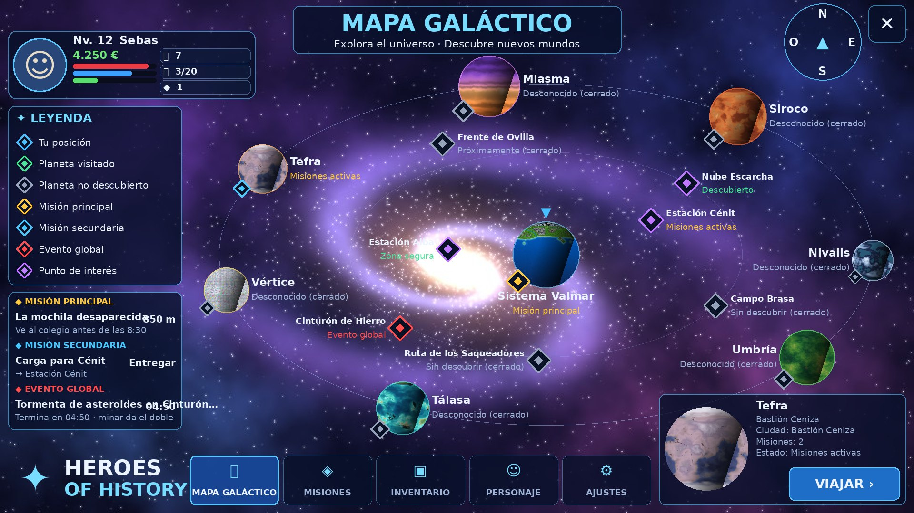
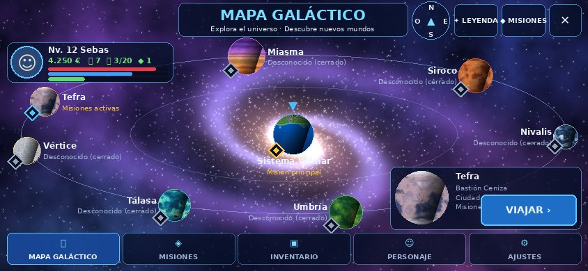
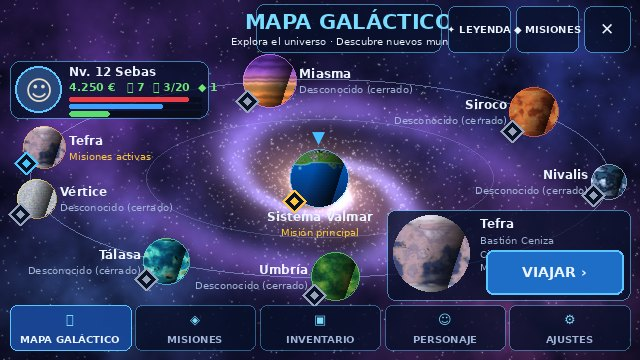

# Mapa galáctico

Pantalla completa pedida por el dueño («Y este sería el mapa galáctico»), a partir del dibujo
[`referencia-mapa-galactico.png`](referencia-mapa-galactico.png). Se hace con **nuestro** universo, no con las
estrellas del dibujo.

| Ordenador (1920x1080) | Móvil (844x390) | Móvil pequeño (640x360) |
|---|---|---|
|  |  |  |

*(Maquetas con las medidas reales del juego: `lune run scripts/test-mapagalactico.luau --dump` y
`python3 -I scripts/espacio/mapa_galactico_mock.py`. Las letras del juego son Gotham.)*

## Qué sale

- **Centro:** el **Sistema Valmar** (Valmar, su luna y las estaciones Alba y Cénit) con su marcador.
- **Anillo:** los 7 planetas de la Saga 2 en el orden del dueño: Tefra → Miasma → Siroco → Nivalis → Umbría →
  Tálasa → Vértice, con su textura de verdad (`assets/espacio/planeta_*.jpg`), su rombo de estado, su nombre y
  su estado sacado de **tu partida** (`Services/GalaxyMapService`):
  - «Desconocido 🔒» si aún está cerrado (Saga 1 sin terminar, otro episodio antes, o episodio próximamente);
  - «Por explorar», «Visitado» (se apunta en `data.Space.Visited` al llegar), «Explorado» (episodio terminado),
    «Misiones activas» (los episodios lo dicen con `GalaxyMapService.setPlanetMissions`).
- **Por dentro:** Estación Alba y Estación Cénit, Cinturón de Hierro, Campo Brasa, Nube Escarcha, Ruta de los
  Saqueadores (descubiertos o «Sin descubrir 🔒», como en el salto cuántico) y el Frente de Ovilla
  («Próximamente»: está en el diseño de Tefra, aún no existe). En el móvil salen al acercar (pellizco o tocar
  Valmar).
- **Evento global:** la Invasión de la Grieta pone Valmar en rojo; la tormenta de asteroides o la incursión
  pirata (`shared/Cosmos/SpaceEvents`) ponen su campo o sector en rojo, con el reloj en el panel de misiones.
- **Ficha** arriba a la izquierda (cara del avatar, Nv., nombre, dinero, vida/energía/experiencia y ✨ Chispas,
  ⛏ bodega, cristales), **título**, **brújula**, **LEYENDA**, **misiones** (principal, secundaria del tablón y
  evento), **tarjeta** con VIAJAR, **pestañas** y el logo.

## Cómo se abre

- **M** o la app **Mapa** en el espacio, en la nave o en un planeta (en Valmar a pie sigue saliendo el mapa
  grande de la ciudad).
- Botón **🌌 Galaxia** del mapa grande de Valmar.
- Tocar el panel **SALTO CUÁNTICO** («Toca para elegir destino») o su ranura en la nave. La tecla X sigue
  abriendo la lista rápida de siempre.

## VIAJAR (sin atajos)

`shared/Cosmos/GalaxyMap.travel` usa los caminos que ya hay y sus reglas:

| Dónde estás | Qué hace VIAJAR |
|---|---|
| En la nave, en el espacio | **Salto cuántico** al destino de siempre (`QuantumJump`: órbita del planeta, estación, campo); lo valida el servidor (`Services/ShipSystems`: energía, recarga, combate, alcance…) |
| En la nave, en un planeta | No: «sube hasta el espacio para saltar» |
| A Valmar desde la nave | **VALMAR** (remoto `Space` «Home») |
| A pie en Valmar | **RUTA AL PUERTO**: el GPS te lleva al puerto espacial (sin teletransporte) |
| Sin la Saga 1 terminada | No: el aviso de siempre de la nave |
| Mundo cerrado / sin descubrir | No, y dice por qué |

## Pestañas

MISIONES, INVENTARIO, PERSONAJE y AJUSTES abren los paneles que ya existían (`Hud.runCommand`: Misiones,
Mochila, Personaje y Menú).

## Archivos

- `src/shared/Cosmos/GalaxyMap.luau` (cuentas: qué sale, estados, viajar)
- `src/client/UI/GalaxyMapLayout.luau` (medidas de cada pantalla; nada se pisa)
- `src/client/UI/PlayerCard.luau` (la ficha, reutilizable)
- `src/client/Controllers/GalaxyMapUI.luau` (la pantalla)
- `src/server/Services/GalaxyMapService.luau` (tus datos y las visitas)
- `scripts/espacio/gen_mapa_galaxia.py` → `assets/espacio/mapa_galaxia.jpg` (fondo; **falta subirlo** con
  `scripts/upload-espacio.sh`; hasta entonces, degradado con estrellas)
- Prueba: `lune run scripts/test-mapagalactico.luau`
