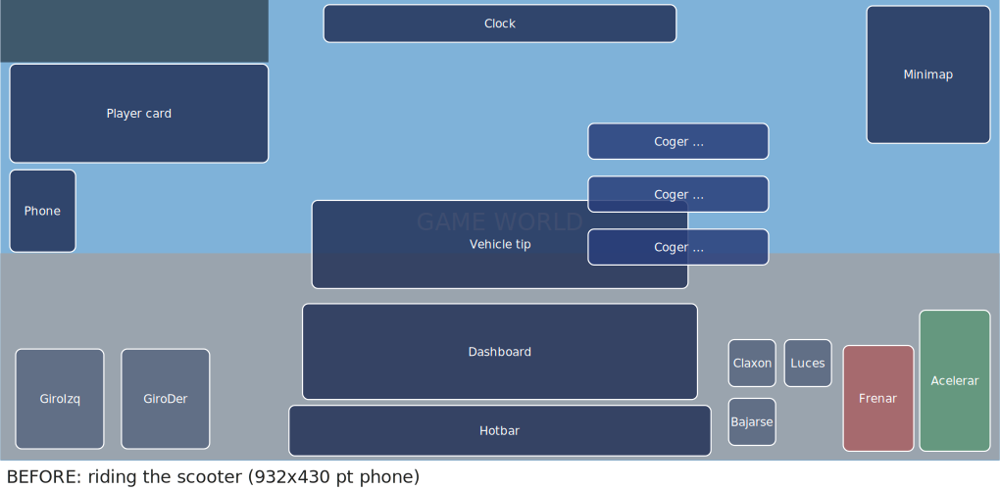
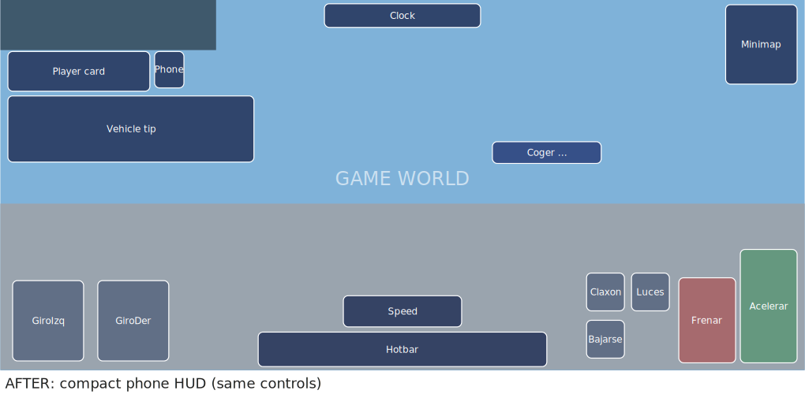

# HUD compacto en el móvil

Queja del dueño (móvil apaisado, ~932x430 pt): «aparece mucha información en pantalla que apenas deja
ver el juego». Y después: «No agrupes todos los botones ni los hagas más pequeños si así van a
perjudicar a la hora de jugar. Optimiza pero que todo esté a mano».

Regla: **lo que solo informa se encoge; los mandos no**. Joystick, racimo, ◀ ▶, FRENO / ACELERAR,
Luces, claxon (Timbre), Bajarse, Interactuar y Acciones tienen el mismo tamaño y el mismo sitio en
todos los modos (a pie, bici, patinete, coche). Todo se activa solo en pantallas táctiles sin teclado
(`HudLayout.compute(..., { Touch = true })`); el ordenador no cambia.

## Antes / después (932x430 pt, montado en el patinete eléctrico)

Medido con `HudLayout.compute` (antes = la versión anterior del archivo). Porcentaje = parte de la
pantalla que tapa cada pieza. Los carteles de la estación de bicis y la tarjeta «¿Qué hago?» son una
estimación sacada de las capturas.

| Pieza | Antes (pt) | Antes | Después (pt) | Después | Qué cambia |
|---|---|---|---|---|---|
| Tu estado | 241x92 | 5,5 % | 164x46 | 1,9 % | plegado: foto, nivel, dinero y 4 barritas; tocar = desplegar 6 s |
| Hora, fecha y tiempo | 329x35 | 2,9 % | 181x27 | 1,2 % | hora y tiempo; la fecha sigue en el ValPhone |
| Minimapa | 115x128 | 3,7 % | 83x92 | 1,9 % | x0,72 desde la esquina |
| ValPhone al volante | 61x77 | 1,2 % | 34x42 | 0,4 % | icono junto a tu estado |
| Barra rápida | 394x47 | 4,6 % | 335x40 | 3,3 % | x0,85; sigue a la vista y se puede tocar al volante |
| Cuadro de mandos (bici, patinete, monopatín) | 368x89 | 8,2 % | 137x36 | 1,2 % | solo km/h y batería: sin P R N D ni esferas |
| Cuadro de mandos (coche) | 368x89 | 8,2 % | 276x67 | 4,6 % | el mismo, x0,9 en vez de x1,2 |
| Consejo del vehículo | 351x82 (centro) | 7,2 % | 285x77 (izquierda) | 5,5 % | aviso a un lado, se va solo a los 5 s, una vez por jugador |
| Carteles de la estación de bicis (est.) | 3 × 168x33 | 4,2 % | 1 × 126x25 | 0,8 % | solo el del botón grande (o el más cercano) |
| **Total en el patinete** | | **37,6 %** | | **16,2 %** | **57 % menos** |
| «¿Qué hago ahora?» (al tocar ❓, est.) | 508x128 (centro) | 16,2 % | ~370x150 (derecha) | ~13,8 % | arriba a la derecha, bajo el minimapa |

Esquemas (mismos rectángulos, a escala): [antes](hud-movil/before.png) · [después](hud-movil/after.png)

## Dónde está cada cosa

- `UI/HudLayout.luau`: `HudLayout.Compact` (medidas del móvil) y `Placement.Shrink`: la pieza se dibuja
  a su tamaño de diseño y se encoge con el UIScale «PressScale» (el de `Theme.pressable`, con su
  atributo `Base`), así el minimapa, la barra rápida y el ValPhone no se rehacen por dentro.
  `rect()` ya da el rectángulo encogido. Piezas nuevas: `StatusOpen`, `DashCompact`, `HelpCard`.
- `UI/Hud.luau`: tu estado plegado (`buildCompactStatus`, botón «Expand»; se despliega solo unos
  segundos si una barra baja de 25 %) y la cápsula de la hora pequeña.
- `Controllers/VehicleHud.luau`: «SpeedChip» para lo que no tiene intermitentes (`VehicleControls`).
- `Controllers/Guide.luau`: pistas y consejos en `Items.Guide` (en el móvil, a la izquierda) y 5 s.
  Los consejos ya se guardaban por jugador (`TipsSeen`, OnboardingService).
- `Controllers/HelpUI.luau`: tarjeta en `Items.HelpCard` (móvil: arriba a la derecha, 480 de ancho).
- `Controllers/Prompts.luau`: en el móvil, un solo cartel (el del foco o el más cercano), más pequeño.
- Glifos que el móvil pintaba como «▯»: `✕` → `×` y `✓` → `✔` (p. ej. «Toca × para cerrar»).

Pruebas: `lune run scripts/test-hud.luau` (apartado «HUD compacto del móvil», en 932x430) y
`scripts/test-metro.luau`.
