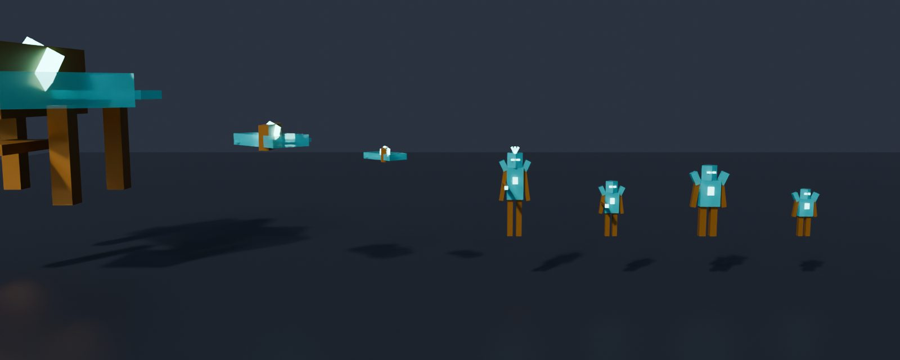
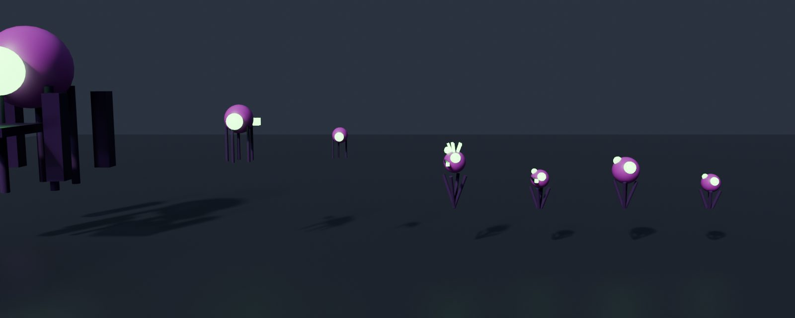
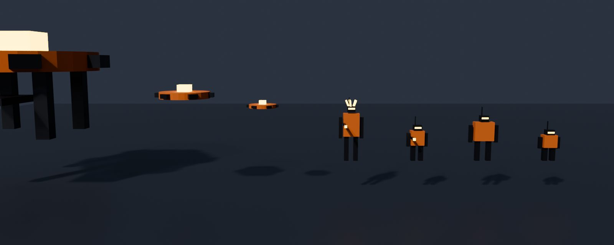
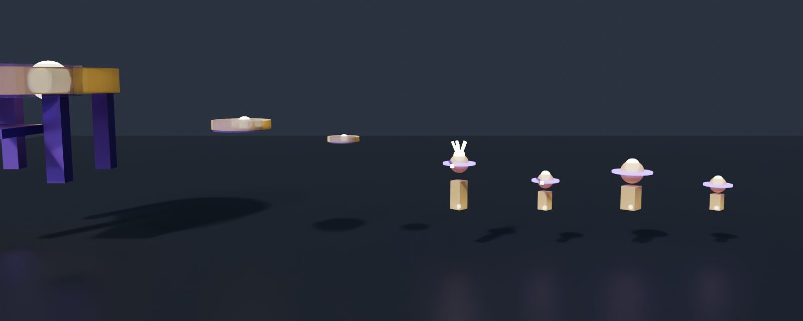
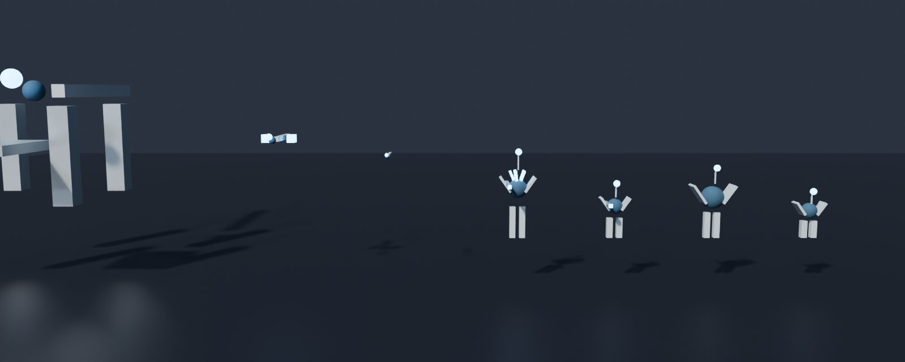
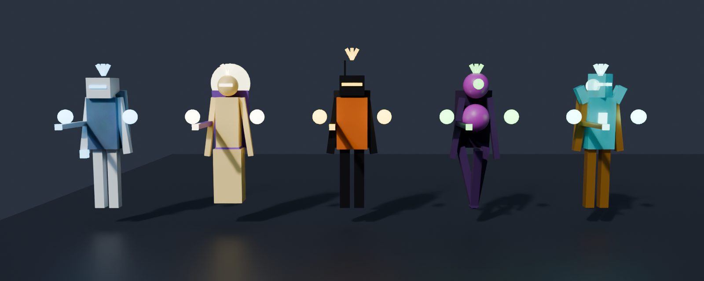
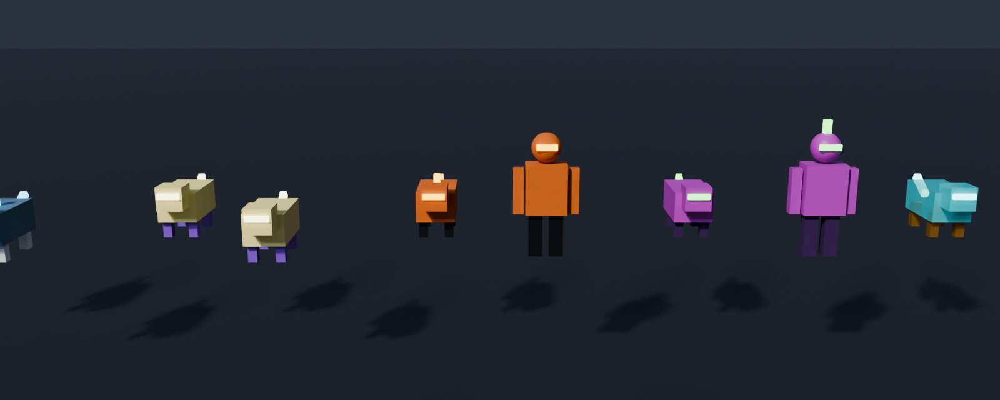

# Invasión de la Grieta

Un **evento global del servidor**: cuando la grieta del cielo se abre, por ella bajan seres de otras
galaxias en naves. Unos se quedan volando sobre Valmar y otros **aterrizan** en sitios abiertos y
sueltan tropas que intentan **conquistar** la ciudad. Hay que impedirlo a pie, en avioneta o en nave.
Al acabar, lo que dejan (gente transformada, destrozos, tiendas cerradas) se arregla con las misiones de
**«Recuperar la normalidad»** o, si nadie lo hace, solo con el tiempo.

Clasificación 13+ «Moderado»: violencia sí, **sangre no**. Los alienígenas estallan en trozos,
chispas y luz; la gente a la que «alcanzan» no muere: se **transforma** en una criatura y se puede curar.

## Cómo probarlo

1. Entra como tester (Studio, el dueño o `Config.Testers`) y escribe **`/pruebas`**.
2. Sección **INVASIÓN DE LA GRIETA**:
   - **🛸 Lanzar invasión** — para todo el servidor (aviso, sirenas y oleadas).
   - **👑 Invasión con su rey** — la misma, pero en la última oleada llega el rey de la raza.
   - **👽 Varias razas a la vez** — dos razas (si son rivales, se pelean entre ellas).
   - **⏭ Siguiente oleada** — salta la espera.
   - **🏳 Terminar la invasión** — acaba ya (con su recompensa y su recogida).
   - **🧪 Ciudad tocada aquí** — deja 3 criaturas y 3 destrozos a tu alrededor y te da muestras: para
     probar «Recuperar la normalidad» sin esperar a una invasión.
3. Sin botones: con el **ciclo de demostración** (`Config.SkyRift.DemoCycle = true`) la grieta se abre
   del todo dos veces por día de juego (etapas 5 a 7: de día hacia las 13:15–18:30 y de noche hacia las
   01:45–05:30), y en cuanto se abre empieza la invasión. Con «⏭ Siguiente etapa» de la sección GRIETA
   DEL CIELO se puede llegar a la etapa 5 en directo. Sin el ciclo, empieza cuando la grieta de la
   historia de algún jugador está abierta (fases Abierta, Rota, Inminente o Fusión).

## Cómo funciona

| Fase | Qué pasa |
|---|---|
| Aviso (14 s) | Aviso a todo el servidor con las razas que llegan; las sirenas de comisarías y bomberos (las de la transición de la grieta); la gente empieza a correr. |
| Oleadas (4, +1 si viene el rey) | Naves en el cielo de los aviones (cazas y drones que atacan avionetas, naves y gente a pie, y ametrallan las zonas), naves de desembarco que aterrizan y sueltan tropas, la élite desde la 3.ª. Cada oleada dura hasta 50 s o hasta que la limpias. |
| Final | **Victoria** si se limpia la última oleada (y el rey). **Derrota** si al cerrarse la grieta o acabarse el tiempo (5,5 min como mucho) los alienígenas tienen la mayoría de las zonas o el rey sigue vivo. Premio para cada uno según lo que haya hecho. |

- **Zonas** (8 sitios abiertos: plaza del centro, el parque, Playa Dorada, plaza financiera, campus,
  San Roque, el camping y el mirador): las naves aterrizan en el primer punto libre de verdad de cada una
  (suelo firme y casi plano, sin nada encima, lejos de las carreteras del plano y nunca en asfalto ni en
  agua; `shared/Invasion/Landing`). Con alienígenas y sin defensores, la zona **cae** (barra roja) y
  dos vecinos se transforman; los jugadores la **recuperan** estando dentro sin alienígenas.
- **Tropas de tierra** (4 tipos por raza: soldado, pesado, tirador y élite): van por las calles
  (grafo de `CityPlan.Roads` con A*), atacan al jugador más cercano, a veces a los de una raza rival,
  «alcanzan» a los vecinos atrapados (se transforman) y, en una zona conquistada, rompen cosas
  (destrozos con humo y cascotes que se reparan o se arreglan solos).
- **Policía y Defensa**: en cada zona en disputa llegan un agente y un soldado, ponen conos alrededor
  (cordón) y disparan a los alienígenas cercanos. Hay **vecinos atrapados** que se rescatan
  («Rescatar»).
- **La gente huye** (`shared/Invasion/Panic`): el servidor publica dónde están las amenazas y los sitios
  seguros (tiendas, comisarías, bomberos, metro, hoteles); los peatones de tu pantalla corren hacia el
  lado que aleja, tropiezan y se levantan, se esconden, llaman a la policía, los padres agarran a los
  niños, gritan (pocos, con topes) y se meten en los portales; los coches aceleran, pitan en los
  atascos o se paran; la gente de plazas y parques corre y se mete dentro; las tiendas cercanas bajan
  la persiana y las paradas de bus se suspenden. Al acabar vuelven poco a poco (2,5 min).
- **Las naves pueden bajar al cielo de la ciudad** solo mientras dura (hasta 140 studs, por encima de
  los tejados; el resto del tiempo su suelo sigue en 260: `Cosmos/Layers.setCityOpen`).

## Razas (una distinta cada vez)

Nunca llega la misma raza dos invasiones seguidas. Un 22 % de las veces llega una segunda (y un 5 %,
una tercera); un 12 % viene su **rey** (seguro: nunca más de 5 seguidas sin rey).

| Raza | Galaxia | Estilo | Cómo pelean | Arma que sueltan | Se transforma la gente en… | Rey |
|---|---|---|---|---|---|---|
| Vórtidos | Nebulosa Espiral de Kael | cristal turquesa y bronce | asedio: despacio y en grupo | Rifle prisma | caminantes de cristal, ciervos de cuarzo | Kael-Ithra, la Reina Geoda |
| Mórfagos | Cúmulo de Tharn | membrana magenta, ojos verdes | enjambre rápido | Lanzaesporas | bichos tentaculares (molestan), babosas brillantes | Tharn-Oo, la Gran Madre |
| Ferrocéfalos | Anillo de Ozzar | chatarra oxidada, visera amarilla | de lejos, tiradores | Remachadora | autómatas de chatarra, perros tostadora (molestan) | OZ-0, el Rey Engranaje |
| Lumínidos | Velo de Ilyra | luz dorada y violeta | saltos de teletransporte | Lanza solar | zorros de luz, búhos estelares | Ilyra, el Dios Sol |
| Brumáridos | Mar de Niebla de Oskun | caparazón de pizarra y farolillo | enjambre | Arpón de bruma | ranas de niebla (molestan), peces caminantes | Oskun, el Rey de la Marea |

Rivales (se pelean si coinciden): Vórtidos–Mórfagos, Mórfagos–Lumínidos, Ferrocéfalos–Lumínidos,
Brumáridos–Ferrocéfalos.

**El rey** (`shared/Invasion/King`): una élite enorme (46 studs) con tres **puntos débiles** que
brillan. Mientras quede alguno está blindado (le llega el 20 % del daño); rotos los tres, queda **al
descubierto** 12 s (daño doble) y, si no cae la fase, vuelven. Tres fases (100–66–33 %) con tropas de
refuerzo y ataques de área avisados con círculos en el suelo: **Onda** (a su alrededor), **Lluvia**
(sobre los jugadores) y **Rayo** (una franja, desde la fase 2). Vida: 5200 + 2600 por jugador de más
(tope 22 000). Aviso a todo el servidor al llegar y al caer.









(Vistas previas de Blender con las piezas de verdad: `scripts/invasion/preview-export.luau` +
`preview_render.py`. No son capturas de Roblox.)

## Pelear

- **A pie**: con las armas de siempre (y las alienígenas que caen). Disparar a un alienígena no es un
  delito, y durante la invasión disparar en la calle tampoco cuenta como «disparos en la vía pública».
  Si caes, el hospital no te cobra la factura.
- **En avioneta**: durante la invasión las avionetas llevan el **cañón** de la patrulla costera
  (botón **CAÑÓN** en el móvil, clic izquierdo, **RB** en el mando). Cadencia, calor, solo hacia delante
  (cono de 9°) y una pequeña ayuda a apuntar; lo decide el servidor. El avión de línea no lleva nada.
  Las naves alienígenas pueden dañar la avioneta (160 puntos; a 0, accidente: nadie muere).
- **En nave**: baja al cielo de la ciudad; el láser da a las naves y tropas alienígenas
  (`AirCombatService.ExternalHit`); sus disparos te dan con las reglas de tu escudo y casco.

## Botín (`shared/Invasion/Loot`)

| Objeto | Rareza | De dónde | Precio (Lab. Xeno) |
|---|---|---|---|
| Material de la raza (Cristal de Kael, Membrana de Tharn, Chatarra de Ozzar, Polvo de Ilyra, Perla de Oskun) | Común | tropas (75 %), drones | $28 |
| Muestra de la raza | Común | tropas (35 %), criaturas («Tomar una muestra») | — (para el inversor) |
| Celda de energía xeno (munición alienígena) | Común | tropas (50 %) | — |
| Xenita | Común | naves, élite | $18 |
| Aleación estelar | Rara | cazas (30 %), desembarco (60 %), élite | $65 |
| Núcleo de plasma | Épica | cazas (4 %), desembarco (20 %), rey | $190 |
| Arma alienígena de la raza | Épica | élite (30 %), pesado (3 %), rey (seguro) | no se vende |
| Pieza de nave (motor, escudo, cañón) | Épica | cazas (3 %), desembarco (8 %), rey | no se vende (astillero: `data.Space.Blueprints`) |
| Plano de nave alienígena | Legendaria | desembarco (2 %), rey (50 %) | no se vende (astillero) |
| Objetos de otras galaxias (10: brújula que apunta a casa, semilla de estrella, reloj de doce lunas…) | Épica | 1 % tropas, explorador, rey | $120 (colección: uno de cada; el repetido se cambia por mineral) |

Armas alienígenas: Rifle prisma (34 de daño, semiautomático), Lanzaesporas (6 perdigones), Remachadora
(automática), Lanza solar (con mira, 68) y Arpón de bruma (52). Solo adultos (como las de verdad), sin
licencia, no se venden, gastan celdas xeno; trazador de plasma.

**Reglas contra las granjas**: solo cuenta quien tumba (o, en naves de desembarco y el rey, quien
haya hecho al menos el 10 % del daño); topes por invasión (30 materiales, 12 muestras, 18 minerales, 1
arma, 1 plano, 2 piezas, 2 objetos de otras galaxias) y por hora real (2 armas, 1 plano, 4 piezas, 3
objetos). Lo que no cabe en la mochila va a la **Xenobodega** y se recoge en el **Laboratorio Xeno**
(puesto junto al hospital): ahí también se vende, se fabrica el **inversor de fase** (3 muestras + 1
material) y se habla con la doctora Arenas.

Premio por participar: 2 $ y 0,6 XP por punto (mínimo 15 puntos; ×1,25 si es victoria; tope $2500 y
700 XP). Puntos: soldado 10, tirador 15, pesado 25, élite 80, dron 12, caza 30, desembarco 60, rey 400,
punto débil 40, zona recuperada 60, rescate 35, defender una zona 20 s 20, y algo por el daño hecho.

## Misiones (`shared/Invasion/Missions`)

**Evento — «Defensa de Valmar»** (Comisaria Elena Robles; empieza sola en cada invasión): defiende o
recupera una zona → derriba 3 naves → rescata a 2 vecinos → destruye una nave de desembarco → vence a
la élite (o al rey). $600, 250 XP y Xenita. Lo que no acabes se pierde al terminar la invasión.

**Vuelo** (se cogen en la ventana de MISIONES, sección EVENTO GLOBAL, mientras dura la invasión):

| Misión | Quién | Qué | Pide |
|---|---|---|---|
| Ojos sobre la bahía | Inés Vidal, torre del aeroclub | Despega y derriba al **explorador** que da vueltas sobre la bahía antes de que vuelva a la grieta (4 min). | Avioneta (licencia de piloto) |
| Corredor de evacuación | Inés Vidal | Escolta el **vuelo EV-01** (40 personas del hospital) del aeropuerto hacia el mar mientras le atacan cazas (vuela a menos de 380 studs al menos 25 s). Si lo tocan demasiado, aterrizaje de emergencia (todos bien) y vuelve a salir. | Avioneta |
| La baliza nodriza | Capitana Nadia Okafor, Estación Alba | En lo alto del cielo de la ciudad (1560 studs: los aviones no llegan) hay una baliza que guía a la flota: rompe sus 3 pilones y luego el núcleo **con la nave**. | Nave (Saga 1 terminada) |
| Cazadores del cielo | Inés Vidal | 5 derribos desde el aire. | Avioneta o nave |

**Paz — «Recuperar la normalidad»** (doctora Sofía Arenas, Laboratorio Xeno; se ofrece al acabar una
invasión que deja la ciudad tocada a quien haya participado, o hablando con ella): 3 muestras → fabricar
el inversor de fase → curar a 2 vecinos transformados («Revertir») → reparar 3 destrozos → limpiar una
bolsa de alienígenas atrincherados → reabrir 2 servicios (subir persianas, reactivar paradas). Si la
ciudad se arregla sola antes, el paso que ya no tiene nada que hacer se da por hecho.

**Historia** (`LifeStory/Misiones/Invasion.luau`, secundarias que se ofrecen con los avisos
`InvasionStarted` / `InvasionEnded`): «Primer contacto» (desde adolescente), «Alas sobre Valmar» (desde
adulto joven: una misión de vuelo) y «La calma después» (curar y reparar). Los sistemas avisan con
`InvasionStarted`, `InvasionKill`, `InvasionMission`, `InvasionRescue`, `InvasionEnded`,
`InvasionCured` e `InvasionRepaired` (EventCatalog).

## La ciudad después (`shared/Invasion/Transform`)

- **Gente transformada** (hasta 24 en el servidor): criaturas de la raza que dan vueltas por su sitio;
  las molestas persiguen un poco y pican flojo (3 puntos). Se toman muestras sin hacerles daño y se
  curan con el inversor de fase: la persona vuelve, confundida y agradecida. Solas, en 15–25 min.
- **Destrozos**: «Reparar» (o solos en 5–10 min). **Bolsas**: en hasta dos zonas conquistadas se quedan
  3 alienígenas atrincherados (o se van en 20–30 min). **Servicios**: persianas y paradas, «Reabrir»
  al acabar (o solos en 4–7 min).
- Estado por servidor (no se guarda entre servidores); lo de cada jugador (misiones, Xenobodega,
  colección, contadores) se guarda en `data.Invasion`.

## HUD

- **EVENTO GLOBAL** arriba en el centro (`UI/InvasionHud`, en la columna de `UI/TopStack`): estado y
  oleada con el tiempo, quién viene, tu zona con su barra (verde = Valmar, ámbar = en disputa, rojo =
  conquistada) y, si hay rey, su fase y su vida. A los mandos de un avión va debajo de los instrumentos;
  en la nave, en la fila EVENTO del HUD de la nave (`SpaceService.infoFor`).
- La tarjeta de misión enseña **EVENTO GLOBAL** mientras dura; la ventana MISIONES tiene la sección
  «Evento global» con tus misiones de la invasión y las de vuelo para coger.
- Marcadores: cada zona (de lejos) y los alienígenas cercanos (flecha roja con su vida; menos en
  gráficos Bajo). Botón **CAÑÓN** de la avioneta (`HudLayout.Fly.CanonAvion`).

## Para el móvil y el servidor

- Topes: 10 naves, 22 tropas y 3 naves de desembarco a la vez; 24 criaturas; 6 policías/soldados; 6
  vecinos atrapados; 60 disparos alienígenas en vuelo. Modelos con pocas piezas (tropa ≤ 18, nave ≤ 18,
  desembarco ≤ 24), anclados y sin colisiones, `ModelStreamingMode = Atomic`.
- El servidor solo hace algo mientras hay invasión o quedan restos; el cliente limita marcadores,
  gritos, cláxones y efectos según el nivel gráfico (`Panic.Caps`, `FxBudget`).
- Sonidos: solo los de `Config.Sounds` (NaveLaser, NaveLaserEnemigo, NaveEstallido, NaveChispas,
  disparos de las armas, Olas, Multitud…): ningún id nuevo sin comprobar.

## Comprobaciones a mano (en Roblox)

1. `/pruebas` → «Lanzar invasión»: aviso a todos, sirenas, panel EVENTO GLOBAL sin tapar el reloj, el
   minimapa ni la misión (móvil del dueño y 640x360).
2. Las naves de desembarco bajan en plazas y parques (no en la carretera ni encima de un edificio) y
   sueltan tropas que van por las calles.
3. Pegar y disparar a las tropas: números, barras, estallan sin sangre, sueltan botín (aviso 🎁).
4. Dejar que caiga una zona (barra roja, criaturas nuevas) y recuperarla.
5. La gente de la calle corre, grita, se esconde y se mete en los portales; los coches pitan o se van;
   las tiendas cercanas bajan la persiana. Al acabar vuelve la gente poco a poco.
6. Avioneta (aeroclub) durante la invasión: botón CAÑÓN (móvil) sin pisar los mandos; derribar un dron.
   «Ojos sobre la bahía» de principio a fin. El avión de línea no dispara.
7. Nave (`/pruebas` → Ir al espacio) durante la invasión: bajar al cielo de la ciudad (hasta ~140 studs)
   y comprobar que sin invasión vuelve a subir a 260. «La baliza nodriza» de principio a fin.
8. «Invasión con su rey»: puntos débiles, AL DESCUBIERTO, círculos de aviso y fases.
9. Al terminar: se recoge todo (sin naves ni tropas, salvo las bolsas), premio, «Recuperar la
   normalidad»: muestras, Laboratorio Xeno junto al hospital (fabricar, vender, Xenobodega), curar,
   reparar, reabrir.
10. Rendimiento en el móvil con varias oleadas (FPS, marcadores, efectos).

## Pruebas

```
lune run scripts/test-invasion.luau   # todo lo de arriba (puro y el servidor con dobles), HUD en 4 pantallas
```
