# Invasión de la Grieta

Un **evento global del servidor**: cuando la grieta del cielo se abre, por ella bajan seres de otras
galaxias en naves. Unos se quedan volando sobre Valmar y otros **aterrizan** en sitios abiertos y
sueltan tropas que intentan **conquistar** la ciudad. Hay que impedirlo a pie, en avioneta o en nave.
Al acabar, lo que dejan (gente transformada, destrozos, tiendas cerradas) se arregla con las misiones de
**«Recuperar la normalidad»** o, si nadie lo hace, solo con el tiempo.

Clasificación 13+ «Moderado»: violencia sí, **sangre no**. Los alienígenas estallan en trozos,
chispas y luz; la gente a la que «alcanzan» no muere: se **transforma** en una criatura y se puede curar.

## Cómo probarlo

1. Entra como tester (Studio, el dueño o `Config.Testers`) y escribe **`/pruebas`**.
2. Sección **INVASIÓN DE LA GRIETA**:
   - **🛸 Lanzar invasión** — para todo el servidor (aviso, sirenas y oleadas).
   - **👑 Invasión con su rey** — la misma, pero en la última oleada llega el rey de la raza.
   - **👽 Varias razas a la vez** — dos razas (si son rivales, se pelean entre ellas).
   - **⏭ Siguiente oleada** — salta la espera.
   - **🏳 Terminar la invasión** — acaba ya (con su recompensa y su recogida).
   - **🧪 Ciudad tocada aquí** — deja 3 criaturas y 3 destrozos a tu alrededor y te da muestras: para
     probar «Recuperar la normalidad» sin esperar a una invasión.
3. Sin botones: con el **ciclo de demostración** (`Config.SkyRift.DemoCycle = true`) la grieta se abre
   del todo dos veces por día de juego (etapas 5 a 7: de día hacia las 13:15–18:30 y de noche hacia las
   01:45–05:30), y en cuanto se abre empieza la invasión. Con «⏭ Siguiente etapa» de la sección GRIETA
   DEL CIELO se puede llegar a la etapa 5 en directo. Sin el ciclo, empieza cuando la grieta de la
   historia de algún jugador está abierta (fases Abierta, Rota, Inminente o Fusión).

## Cómo funciona

| Fase | Qué pasa |
|---|---|
| Aviso (14 s) | Aviso a todo el servidor con las razas que llegan; las sirenas de comisarías y bomberos (las de la transición de la grieta); la gente empieza a correr. |
| Oleadas (4, +1 si viene el rey) | Naves en el cielo de los aviones (cazas y drones que atacan avionetas, naves y gente a pie, y ametrallan las zonas), naves de desembarco que aterrizan y sueltan tropas, la élite desde la 3.ª. Cada oleada dura hasta 50 s o hasta que la limpias. |
| Final | **Victoria** si se limpia la última oleada (y el rey). **Derrota** si al cerrarse la grieta o acabarse el tiempo (5,5 min como mucho) los alienígenas tienen la mayoría de las zonas o el rey sigue vivo. Premio para cada uno según lo que haya hecho. |

- **Zonas** (8 sitios abiertos: plaza del centro, el parque, Playa Dorada, plaza financiera, campus,
  San Roque, el camping y el mirador): las naves aterrizan en el primer punto libre de verdad de cada una
  (suelo firme y casi plano, sin nada encima, lejos de las carreteras del plano y nunca en asfalto ni en
  agua; `shared/Invasion/Landing`). Con alienígenas y sin defensores, la zona **cae** (barra roja) y
  dos vecinos se transforman; los jugadores la **recuperan** estando dentro sin alienígenas.
- **Tropas de tierra** (4 tipos por raza: soldado, pesado, tirador y élite): van por las calles
  (grafo de `CityPlan.Roads` con A*), atacan al jugador más cercano, a veces a los de una raza rival,
  «alcanzan» a los vecinos atrapados (se transforman) y, en una zona conquistada, rompen cosas
  (destrozos con humo y cascotes que se reparan o se arreglan solos).
- **Policía y Defensa**: en cada zona en disputa llegan un agente y un soldado, ponen conos alrededor
  (cordón) y disparan a los alienígenas cercanos. Hay **vecinos atrapados** que se rescatan
  («Rescatar»).
- **La gente huye** (`shared/Invasion/Panic`): el servidor publica dónde están las amenazas y los sitios
  seguros (tiendas, comisarías, bomberos, metro, hoteles); los peatones de tu pantalla corren hacia el
  lado que aleja, tropiezan y se levantan, se esconden, llaman a la policía, los padres agarran a los
  niños, gritan (pocos, con topes) y se meten en los portales; los coches aceleran, pitan en los
  atascos o se paran; la gente de plazas y parques corre y se mete dentro; las tiendas cercanas bajan
  la persiana y las paradas de bus se suspenden. Al acabar vuelven poco a poco (2,5 min).
- **Las naves pueden bajar al cielo de la ciudad** solo mientras dura (hasta 140 studs, por encima de
  los tejados; el resto del tiempo su suelo sigue en 260: `Cosmos/Layers.setCityOpen`).

## Razas (una distinta cada vez)

Nunca llega la misma raza dos invasiones seguidas. Un 22 % de las veces llega una segunda (y un 5 %,
una tercera); un 12 % viene su **rey** (seguro: nunca más de 5 seguidas sin rey).

| Raza | Galaxia | Estilo | Cómo pelean | Arma que sueltan | Se transforma la gente en… | Rey |
|---|---|---|---|---|---|---|
| Vórtidos | Nebulosa Espiral de Kael | armadura negra y cristal cian (hojas del dueño) | asedio: despacio y en grupo | Rifle prisma | caminantes de cristal, ciervos de cuarzo | Kael-Ithra, la Voz de la Geoda |
| Mórfagos | Cúmulo de Tharn | membrana magenta, ojos verdes | enjambre rápido | Lanzaesporas | bichos tentaculares (molestan), babosas brillantes | Tharn-Oo, la Gran Madre |
| Ferrocéfalos | Anillo de Ozzar | chatarra oxidada, visera amarilla | de lejos, tiradores | Remachadora | autómatas de chatarra, perros tostadora (molestan) | OZ-0, el Rey Engranaje |
| Lumínidos | Velo de Ilyra | luz dorada y violeta | saltos de teletransporte | Lanza solar | zorros de luz, búhos estelares | Ilyra, el Dios Sol |
| Brumáridos | Mar de Niebla de Oskun | caparazón de pizarra y farolillo | enjambre | Arpón de bruma | ranas de niebla (molestan), peces caminantes | Oskun, el Rey de la Marea |

Rivales (se pelean si coinciden): Vórtidos–Mórfagos, Mórfagos–Lumínidos, Ferrocéfalos–Lumínidos,
Brumáridos–Ferrocéfalos.

**El rey** (`shared/Invasion/King`): una élite enorme (46 studs) con tres **puntos débiles** que
brillan. Mientras quede alguno está blindado (le llega el 20 % del daño); rotos los tres, queda **al
descubierto** 12 s (daño doble) y, si no cae la fase, vuelven. Tres fases (100–66–33 %) con tropas de
refuerzo y ataques de área avisados con círculos en el suelo: **Onda** (a su alrededor), **Lluvia**
(sobre los jugadores) y **Rayo** (una franja, desde la fase 2). Vida: 5200 + 2600 por jugador de más
(tope 22 000). Aviso a todo el servidor al llegar y al caer.

## Alienígenas v2 (mallas de Blender)

El dueño: «los extraterrestres tienen una skin malísima, los NPC que se convierten también». Ahora cada
alienígena, rey, nave y criatura es una **malla hecha en Blender con Python** (el mismo camino que la
nave HX-7: `scripts/invasion/alien_blender.py` + `alien_diseno.py` + `alien_geo.py`, que reutiliza
`scripts/nave/`), con texturas PBR horneadas (color, normal, rugosidad, metal), versión lejana (LOD) y
menos de 20 000 triángulos por malla (tropa ≤ 10 000, rey ≤ 15 000, nave ≤ 12 000, desembarco ≤ 16 000,
criatura ≤ 5000; en total unos 135 000 para los 50 modelos).

| Raza | Silueta (de un vistazo) |
|---|---|
| Vórtidos | (rehechos con las hojas del dueño: ver «Vórtidos de cristal» abajo) humanoides delgados de armadura negra con corona y racimo de cristal cian; la nave «Clase: Guardián» |
| Mórfagos | sacos de membrana con venas sobre tentáculos, un ojo verde enorme, volantes; medusas y vainas |
| Ferrocéfalos | autómatas cuadrados de chatarra oxidada, visera amarilla, chimeneas y pistones; disco sierra y tolva |
| Lumínidos | túnicas de porcelana dorada que flotan, cabeza de luna creciente, halo; linternas que vuelan |
| Brumáridos | marineros encorvados con caparazón de pizarra y farolillo de pescador; raya, medusilla y vieira |

- **Segmentos animables** (sin huesos): Body, Head, ArmL/ArmR, LegL/LegR (y LegBL/LegBR, Tail, Halo,
  Wings, Cape, Rotor), cada uno con su pivote. En el juego (`World/Kit/AlienModels.mesh`) un raíz
  invisible anclado (el mismo de siempre: lo mueve el servidor) y los segmentos unidos con **Motor6D**;
  el cliente los anima (`Controllers/AlienAnim` + `shared/Invasion/AlienPose`): quieto, andar, correr,
  **cargar el ataque** (se ve venir: brilla y echa el brazo atrás), golpear o disparar, **respingo** al
  encajar un disparo y, al caer, **se deshace en luz y chispas** (nada de sangre). Andares: Biped, Crawl
  (tentáculos), Float (flotan), Quad, Slither, Hop y Ship (rotores que giran). De lejos, la malla LOD.
- **La gente transformada**: criaturas de malla por raza (muñeco de cristal y ciervo de cuarzo, bicho
  tentacular y babosa brillante, cubo de basura con escoba y perro tostadora, zorro de luz y búho
  estelar, rana de niebla y pez caminante). Dan vueltas, **a ratos se paran y miran alrededor** y las
  inofensivas **huyen** si te les echas encima (`Transform.wander`). La transformación ya no es cambiar
  piezas: una **silueta de luz** de la persona se retuerce en una espiral de chispas y un anillo, y la
  criatura aparece poco a poco; al curarla, al revés.
- **Subir** (solo la sesión que publica, con la clave de Open Cloud; nunca se enseña):
  `bash scripts/upload-invasion.sh` → `src/shared/Invasion/AlienAssetIds.luau`. Lo carga el servidor al
  arrancar (`World/AlienMeshLoader`). **Respaldo**: sin ids, si una descarga falla o si falta una pieza
  principal de un modelo, ese modelo sigue siendo el de piezas de siempre (nunca uno a medias).
- Generar de nuevo: `python3 scripts/invasion/alien_blender.py` (unos 25 min en CPU; `--no-bake` para
  probar la geometría, `--only Vortidos` para una raza).

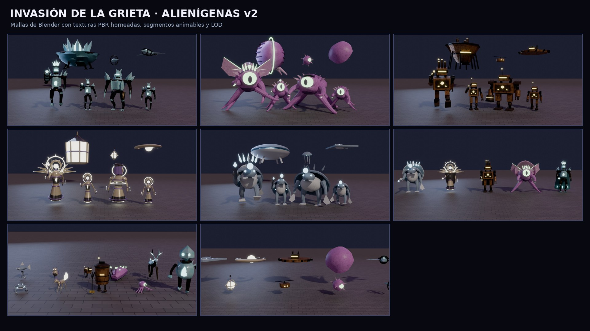
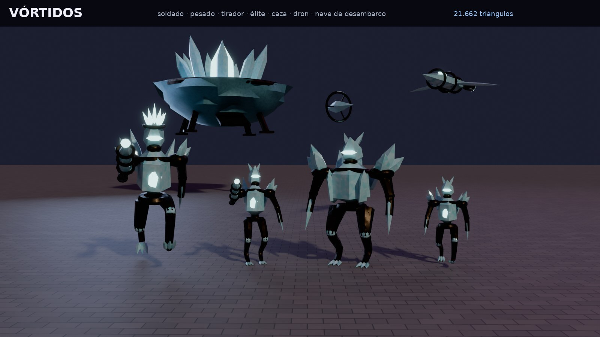
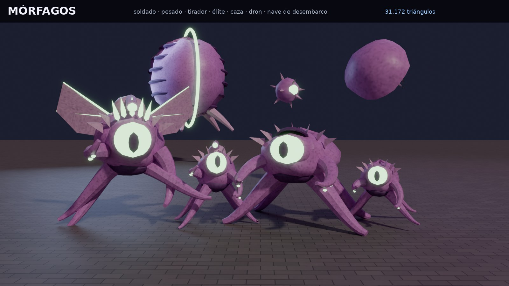
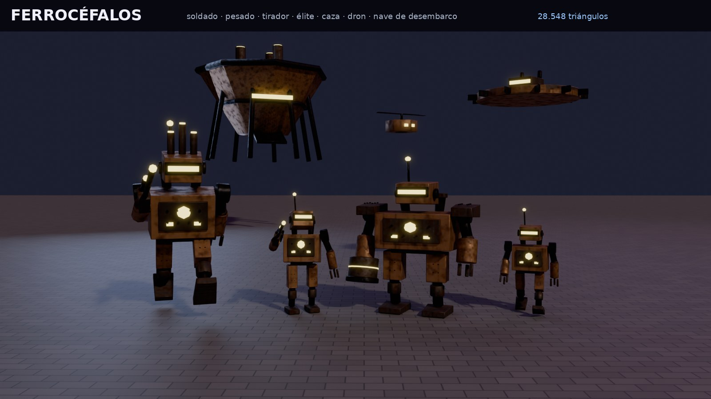
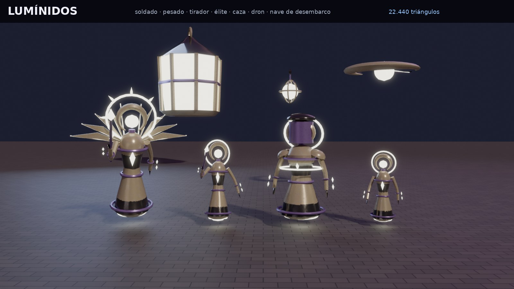
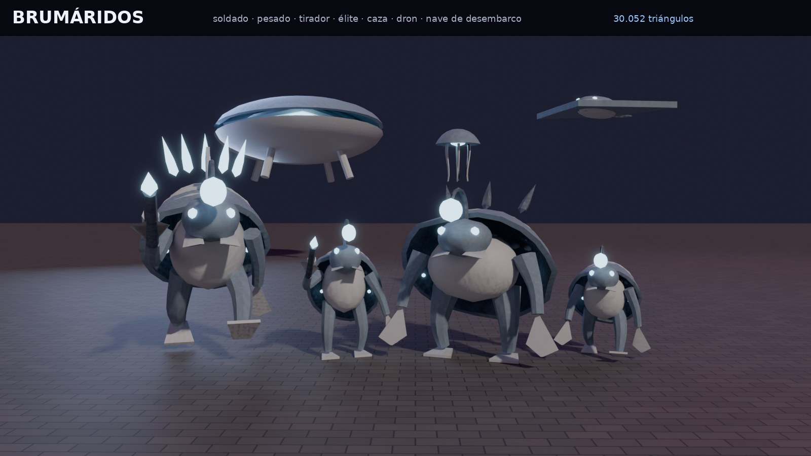
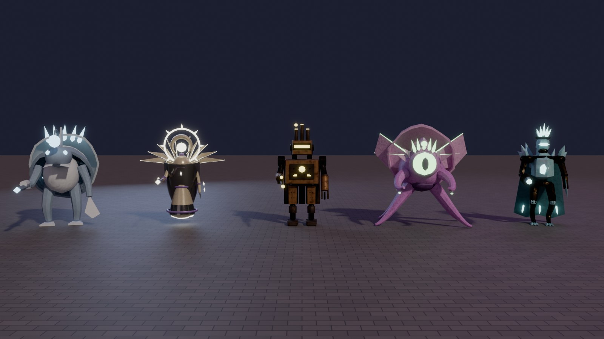
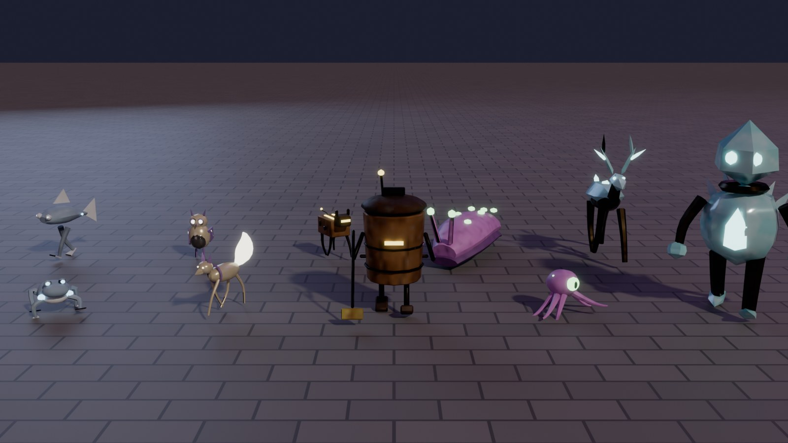
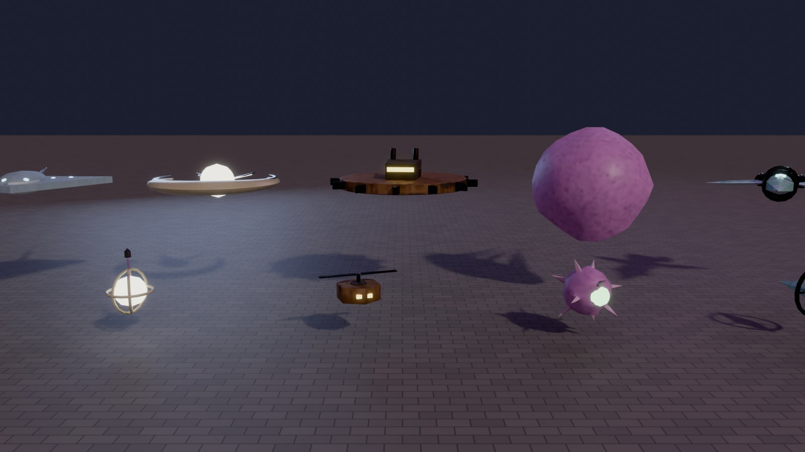
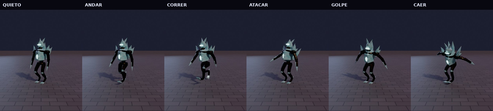

(Vistas previas de Blender con las mallas y texturas de verdad; no son capturas de Roblox. Las de la
versión de piezas, el respaldo, siguen en `docs/invasion/*.jpg`.)

### Vórtidos de cristal (las hojas del dueño)

El dueño mandó tres hojas (`docs/invasion/referencia-cristal/`): **el soldado en 8 vistas**
(`soldado-360.png`), **el líder y la nave «Clase: Guardián»** (`lider-y-nave.png`) y la captura de cómo se
veían en el juego (v123: tronco de bloque de cristal, patas cortas y dobladas, parecía una bestia). Pidió
«hazlo 1000 % igual». **Igual al 1000 % no es posible** (son dibujos, y en Roblox hay que bajar a ~10 000
triángulos, materiales de Roblox y sin postproceso), así que se hizo lo más parecido que se puede y se
deja **comparado vista por vista**, para que el dueño juzgue:

- `comparacion-soldado.png`: las 8 vistas de la hoja (frente, frontal derecha, perfil derecho, espalda,
  perfil izquierdo, frontal izquierda, superior e inferior) al lado de la malla en la misma vista.
- `comparacion-lider.png`: frente, lado y espalda del líder. `comparacion-nave.png`: frente, arriba,
  detrás, lado e isométrica de la nave.
- `vortidos-poses.jpg` (quieto, correr, garras y el Prisma apuntando), `vortidos-familia.jpg` y
  `vortidos-lider-y-geoda.jpg`.

**Qué se hizo** (`scripts/invasion/vortidos_blender.py` + `vortidos_diseno.py`, Blender con Python como
los demás): humanoide alto y delgado, sin género, de **armadura negra mate con costuras de neón cian**,
máscara negra sin cara con **visor en «V»**, **corona de esquirlas** cian pálido que se echa atrás como una
llama, **racimo de cristal en la espalda**, antebrazos con esquirla y **manos de 3 garras de cristal**,
rodilla con esquirla, **pies de cristal** (3 dedos y espolón) y el faldón negro en punta. Proporciones
medidas en la hoja (suela 0 · rodilla 1,2 · entrepierna 1,9 · cintura 2,7 · hombros 3,6 · barbilla 4 ·
visor 4,45 · corona hasta 6, en el soldado de 6 studs).

| Unidad (juego) | De la hoja | Diferencias |
|---|---|---|
| Esquirla (soldado) | el soldado tal cual | — |
| Monolito (pesado) | el soldado más ancho | hombreras y placas de cristal en el pecho, racimo y garras más grandes |
| Prisma (tirador) | el soldado | **rifle de cristal** en la mano derecha (cañón de esquirla con núcleo que brilla) |
| Custodio de Kael (élite) | el soldado | corona más alta, hombreras de cristal y emblema de cristal en el pecho |
| Kael-Ithra (rey) | el **líder** | más alto (cabeza más pequeña, piernas largas), hombreras y botas blancas, emblema en «V», **capa** blanca y azul con líneas de luz (3 bandas que se mecen en cadena) y **cetro** con la gema en una jaula de garras |
| Fragata Prisma (caza) | la **Guardián** | casco facetado blanco y negro, morro de hoja de cristal, cabina oscura, alas de 3 hojas con paneles y puntas de cristal, aletas en «V», motores redondos |
| Astilla (dron) | Guardián pequeña | sin cañones, con su anillo de cristal que gira |
| Geoda (desembarco) | Guardián enorme | la geoda de cristal en la panza, patas y rampa |

- **UNA malla con esqueleto por personaje** (desde la v125, `VortidosCristal2_*`; la v124 subía un
  segmento por malla y Roblox retiró un antebrazo y una pierna por moderación: `docs/bugs/moderacion/`):
  `Cuerpo` (textura PBR horneada: `VortidosCristal2_tropas` y `VortidosCristal2_naves`), `CuerpoCristal`
  (en Roblox **Glass** cian pálido algo transparente, facetada; dentro lleva núcleos de Neon que se ven a
  través) y `CuerpoBrillo` (Neon: costuras, visor, núcleos, motores), las tres con el mismo esqueleto. Más
  el LOD (`LOD`, `LODCristal`, `LODBrillo`). En el juego: Bone en vez de Motor6D (`AlienAnim.boneTransform`)
  y una caja invisible `Head` para los disparos a la cabeza.
- **Huesos** (los segmentos de antes): Body, Head, ArmL/ArmR, **ForeArmL/ForeArmR** (codo), LegL/LegR,
  **LowerLegL/LowerLegR** (rodilla); el líder además **Cape → Cape2 → Cape3** y **Scepter** (de la mano derecha).
  Los nombres siguen valiendo para las zonas de daño (Arm/Leg = extremidad, Head = cabeza; la corona
  cuenta como tronco, como antes).
- **Animación** (`AlienPose.crystal`, el cliente pasa el arma con el atributo `Attack`): respira quieto,
  **zancadas largas y encorvado** al correr con codos y rodillas, **zarpazo** con las garras, el Prisma
  **sube el rifle con las dos manos** y da un retroceso, el líder levanta y baja el **cetro**; la capa se
  mece en cadena (más abajo, más vaivén). El neón (cristal y motores de las naves) **late** despacio
  (atributo `Pulse`, `AlienPose.pulse`).
- Triángulos: soldado ~9 400, Monolito ~9 700, Prisma ~9 600, Custodio ~9 800, líder ~11 800, Fragata
  ~4 200, Astilla ~3 900, Geoda ~5 200 (cuentas exactas en `assets/invasion/manifest.json`).
- **Nombre**: la hoja dice que no tienen género, así que el título visible es **«Kael-Ithra, la Voz de la
  Geoda»** (antes «la Reina Geoda»). El Id interno del rey (`ReinaGeoda`) no cambia. Ninguna frase de la
  historia la llamaba reina (no hubo que tocar guiones).
- **Subir** (solo la sesión que publica; antes pasa la revisión de moderación): `bash scripts/upload-invasion.sh --solo VortidosCristal2` (8 FBX +
  8 texturas). Se suben con otro nombre (`VortidosCristal2_*`, campo `Asset` de `AlienMallas`) para que
  los ids viejos (`Vortidos_*` y los `VortidosCristal_*` de la v124) **no** se monten con los datos nuevos: hasta que se
  suban, los Vórtidos salen con el **respaldo de piezas**, que ya tiene la pinta nueva (cuerpo negro,
  visor cian, corona y racimo de cristal; la nave con morro de cristal y cabina).
- Las criaturas (caminante de cristal y ciervo de cuarzo) no cambian: no venían en las hojas.
- Generar de nuevo: `python3 scripts/invasion/vortidos_blender.py` (~20 min en CPU; `--no-bake` y
  `--views soldier` para probar). `alien_blender.py` ya no rehace las tropas ni las naves de los Vórtidos
  y conserva las de cristal en el manifest.

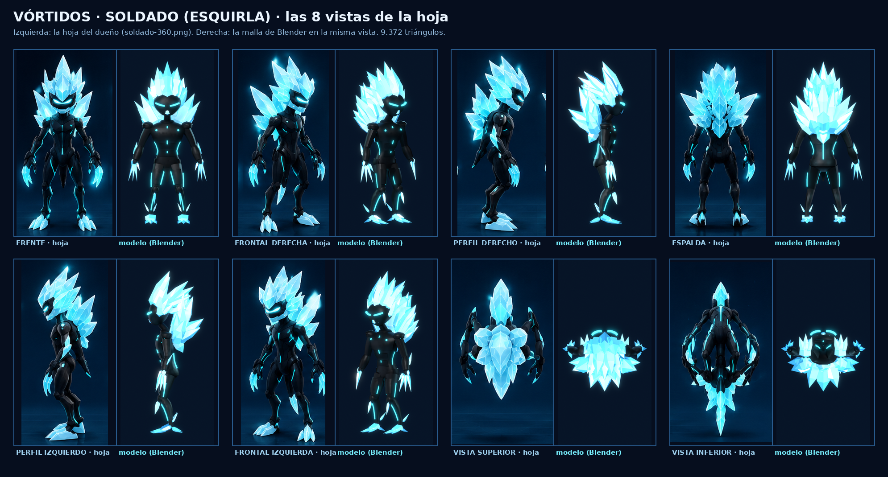
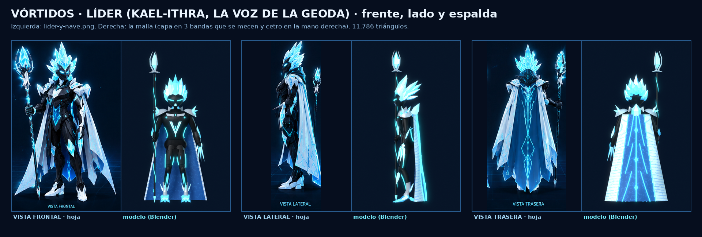
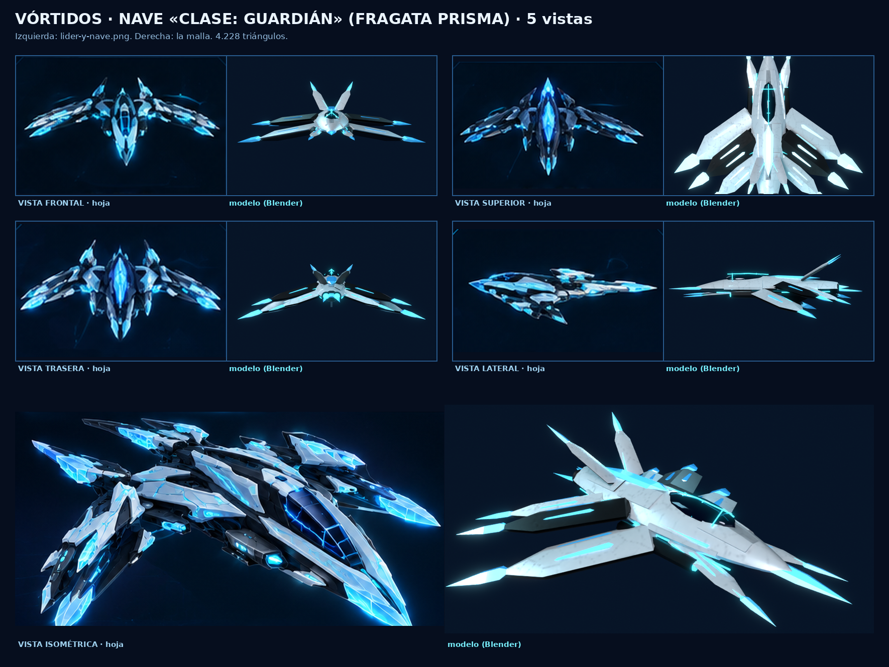
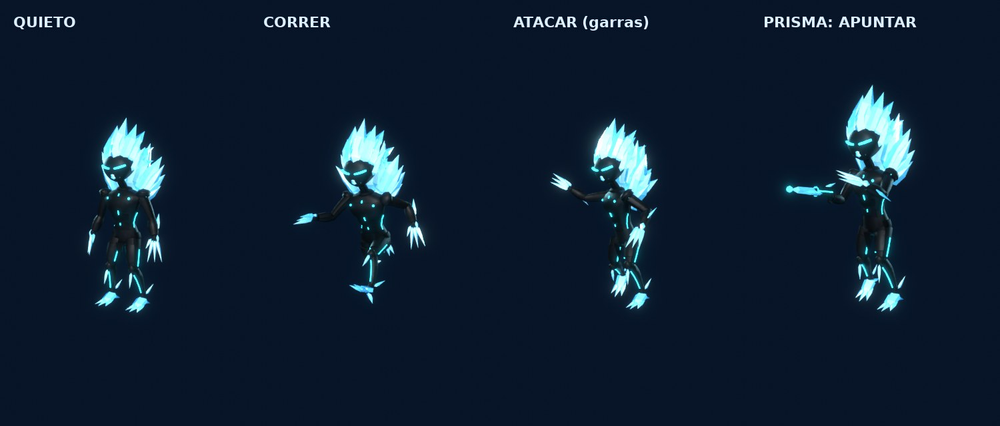

## Pelear

- **A pie**: con las armas de siempre (y las alienígenas que caen). Disparar a un alienígena no es un
  delito, y disparar cerca de los alienígenas tampoco cuenta como «disparos en la vía pública».
  Si caes, el hospital no te cobra la factura.
  - **Mira** con su dispersión, cámara al hombro y al hombro más cerca apuntando; **esquinas de fijado**
    encima del enemigo con ayuda; **aspa** al acertar (amarilla y más grande en la **cabeza**, roja si
    cae) con un chasquido distinto para cada cosa; **números de daño** (⚙️ «Números de daño»); impactos
    de chispas de luz del alienígena; **golpecito de cámara** del retroceso que vuelve solo; **barra de
    recarga** y aviso de pocas balas; **cambiar de arma** (botón «Cambiar», Q o la cruceta derecha).
  - **Ayuda al apuntar** (`shared/AimAssist`, ⚙️ «Ayuda al apuntar»: Auto / Sí / No; Auto = móvil y
    mando sí, ratón no): SOLO hacia alienígenas y enemigos de tu misión (nunca jugadores ni gente de la
    calle); fricción con la mira encima, imán suave SOLO mientras giras o andas (quieto, la cámara no se
    mueve sola) e imán de la bala de pocos grados. **Disparo automático** en el móvil (⚙️): con la mira
    encima de un enemigo que se ve, dispara solo. Botones del móvil: joystick a la izquierda, el pulgar
    derecho gira la cámara por la pantalla, Disparar grande abajo a la derecha y otro junto al joystick.
  - **Cabeza = punto débil**: la cabeza y lo que brilla en ella (`Head`, `HeadBrillo`) hacen el daño de
    cabeza del arma y **tambalean** al alienígena.
  - **El servidor decide** (`WeaponService` + `shared/Invasion/HitCheck`): rayo desde tu cabeza; si no da
    a ningún alienígena, prueba donde lo veías tú (**compensación de lag**: tu ping + la interpolación,
    como mucho 0,4 s, con una cápsula algo generosa), nunca a través de una pared ni más allá del alcance.
  - **IA justa y divertida** (`shared/Invasion/AlienAI`): cada ataque se **avisa** (cargan 0,55–0,85 s:
    brillan y echan el brazo atrás); el disparo va a donde estabas al empezar a cargar (moverte de lado lo
    esquiva) y el golpe solo da si sigues a su alcance; como mucho **3 cargando contra ti a la vez**
    (los demás se colocan o dan vueltas); un disparo fuerte o en la cabeza los **tambalea** y les corta el
    ataque; los tiradores se mueven **de lado** y, si les das, se **cubren** tras un banco o un quiosco de
    la zona y vuelven a asomarse.
- **A puñetazos y patadas** (`shared/Invasion/MeleeHit`, `InvasionService.meleeTargets`): el botón
  «Atacar» (X / RB / clic) también pega a las tropas, élites, el rey y las **criaturas hostiles**
  (nunca a las pacíficas). En el móvil con un arma en la mano, «Atacar» vuelve a salir cuando tienes
  uno al alcance del puño. El servidor decide: alcance y cono desde tu personaje en el servidor, con la
  caja del modelo de verdad, sin atravesar paredes y con la misma compensación de lag que los disparos;
  la pausa entre golpes de siempre; el daño es el del golpe (Fuerza, gimnasio) × 3 con tope de 60 (las
  armas pegan más por segundo) y el rey solo encaja el 40 %. Se aparta un poco (respingo de AlienAnim),
  chispas de su color y el sonido del golpe (nada de sangre). Cuenta para la oleada y el botín igual que
  a tiros (una vez). Las criaturas hostiles no mueren: a golpes o a tiros se **calman** (dejan de picar
  y se pueden revertir).
- **Números de daño** (`shared/DamageNumbers`, `Controllers/DamagePops`): un solo sistema para golpes,
  cada arma, el cañón de la avioneta y el láser de la nave. El servidor manda el daño HECHO solo a quien
  lo hace («Dmg»); blanco normal, amarillo cabeza, naranja cuerpo a cuerpo, cian en los puntos débiles
  acorazados del rey; un poco más grandes con más daño; las ráfagas al mismo objetivo (menos de 0,15 s
  entre golpes) suman un solo número; como mucho 5 a la vez en el móvil (10 en el ordenador); suben y
  se desvanecen en 0,8 s; ⚙️ «🔢 Números de daño: Sí/No».
- **Delitos** (`shared/Witness`): atacar a la invasión nunca es delito, ni las balas perdidas o los
  cristales rotos cerca de los alienígenas; los agentes del cordón no reciben daño de tus balas ni es
  delito darles; disparar a una persona sigue siéndolo. Quien solo tenía «disparos en la vía pública» y
  ayuda a tumbar alienígenas queda perdonado.
- **En avioneta**: durante la invasión las avionetas llevan el **cañón** de la patrulla costera
  (botón **CAÑÓN** en el móvil, clic izquierdo, **RB** en el mando). Cadencia, calor, solo hacia delante
  (cono de 9°) y una pequeña ayuda a apuntar; lo decide el servidor. El avión de línea no lleva nada.
  Las naves alienígenas pueden dañar la avioneta (160 puntos; a 0, accidente: nadie muere).
- **En nave**: baja al cielo de la ciudad; el láser da a las naves y tropas alienígenas
  (`AirCombatService.ExternalHit`); sus disparos te dan con las reglas de tu escudo y casco.

## Botín (`shared/Invasion/Loot`)

| Objeto | Rareza | De dónde | Precio (Lab. Xeno) |
|---|---|---|---|
| Material de la raza (Cristal de Kael, Membrana de Tharn, Chatarra de Ozzar, Polvo de Ilyra, Perla de Oskun) | Común | tropas (75 %), drones | $28 |
| Muestra de la raza | Común | tropas (35 %), criaturas («Tomar una muestra») | — (para el inversor) |
| Celda de energía xeno (munición alienígena) | Común | tropas (50 %) | — |
| Xenita | Común | naves, élite | $18 |
| Aleación estelar | Rara | cazas (30 %), desembarco (60 %), élite | $65 |
| Núcleo de plasma | Épica | cazas (4 %), desembarco (20 %), rey | $190 |
| Arma alienígena de la raza | Épica | élite (30 %), pesado (3 %), rey (seguro) | no se vende |
| Pieza de nave (motor, escudo, cañón) | Épica | cazas (3 %), desembarco (8 %), rey | no se vende (astillero: `data.Space.Blueprints`) |
| Plano de nave alienígena | Legendaria | desembarco (2 %), rey (50 %) | no se vende (astillero) |
| Objetos de otras galaxias (10: brújula que apunta a casa, semilla de estrella, reloj de doce lunas…) | Épica | 1 % tropas, explorador, rey | $120 (colección: uno de cada; el repetido se cambia por mineral) |

Armas alienígenas: Rifle prisma (34 de daño, semiautomático), Lanzaesporas (6 perdigones), Remachadora
(automática), Lanza solar (con mira, 68) y Arpón de bruma (52). Solo adultos (como las de verdad), sin
licencia, no se venden, gastan celdas xeno; trazador de plasma.

**Reglas contra las granjas**: solo cuenta quien tumba (o, en naves de desembarco y el rey, quien
haya hecho al menos el 10 % del daño); topes por invasión (30 materiales, 12 muestras, 18 minerales, 1
arma, 1 plano, 2 piezas, 2 objetos de otras galaxias) y por hora real (2 armas, 1 plano, 4 piezas, 3
objetos). Lo que no cabe en la mochila va a la **Xenobodega** y se recoge en el **Laboratorio Xeno**
(puesto junto al hospital): ahí también se vende, se fabrica el **inversor de fase** (3 muestras + 1
material) y se habla con la doctora Arenas.

Premio por participar: 2 $ y 0,6 XP por punto (mínimo 15 puntos; ×1,25 si es victoria; tope $2500 y
700 XP). Puntos: soldado 10, tirador 15, pesado 25, élite 80, dron 12, caza 30, desembarco 60, rey 400,
punto débil 40, zona recuperada 60, rescate 35, defender una zona 20 s 20, y algo por el daño hecho.

## Misiones (`shared/Invasion/Missions`)

**Evento — «Defensa de Valmar»** (Comisaria Elena Robles; empieza sola en cada invasión): defiende o
recupera una zona → derriba 3 naves → rescata a 2 vecinos → destruye una nave de desembarco → vence a
la élite (o al rey). $600, 250 XP y Xenita. Lo que no acabes se pierde al terminar la invasión.

**Vuelo** (se cogen en la ventana de MISIONES, sección EVENTO GLOBAL, mientras dura la invasión):

| Misión | Quién | Qué | Pide |
|---|---|---|---|
| Ojos sobre la bahía | Inés Vidal, torre del aeroclub | Despega y derriba al **explorador** que da vueltas sobre la bahía antes de que vuelva a la grieta (4 min). | Avioneta (licencia de piloto) |
| Corredor de evacuación | Inés Vidal | Escolta el **vuelo EV-01** (40 personas del hospital) del aeropuerto hacia el mar mientras le atacan cazas (vuela a menos de 380 studs al menos 25 s). Si lo tocan demasiado, aterrizaje de emergencia (todos bien) y vuelve a salir. | Avioneta |
| La baliza nodriza | Capitana Nadia Okafor, Estación Alba | En lo alto del cielo de la ciudad (1560 studs: los aviones no llegan) hay una baliza que guía a la flota: rompe sus 3 pilones y luego el núcleo **con la nave**. | Nave (Saga 1 terminada) |
| Cazadores del cielo | Inés Vidal | 5 derribos desde el aire. | Avioneta o nave |

**Paz — «Recuperar la normalidad»** (doctora Sofía Arenas, Laboratorio Xeno; se ofrece al acabar una
invasión que deja la ciudad tocada a quien haya participado, o hablando con ella): 3 muestras → fabricar
el inversor de fase → curar a 2 vecinos transformados («Revertir») → reparar 3 destrozos → limpiar una
bolsa de alienígenas atrincherados → reabrir 2 servicios (subir persianas, reactivar paradas). Si la
ciudad se arregla sola antes, el paso que ya no tiene nada que hacer se da por hecho.

**Historia** (`LifeStory/Misiones/Invasion.luau`, secundarias que se ofrecen con los avisos
`InvasionStarted` / `InvasionEnded`): «Primer contacto» (desde adolescente), «Alas sobre Valmar» (desde
adulto joven: una misión de vuelo) y «La calma después» (curar y reparar). Los sistemas avisan con
`InvasionStarted`, `InvasionKill`, `InvasionMission`, `InvasionRescue`, `InvasionEnded`,
`InvasionCured` e `InvasionRepaired` (EventCatalog).

## La ciudad después (`shared/Invasion/Transform`)

- **Gente transformada** (hasta 24 en el servidor): criaturas de la raza que dan vueltas por su sitio;
  las molestas persiguen un poco y pican flojo (3 puntos). Se toman muestras sin hacerles daño y se
  curan con el inversor de fase: la persona vuelve, confundida y agradecida. Solas, en 15–25 min.
- **Destrozos**: «Reparar» (o solos en 5–10 min). **Bolsas**: en hasta dos zonas conquistadas se quedan
  3 alienígenas atrincherados (o se van en 20–30 min). **Servicios**: persianas y paradas, «Reabrir»
  al acabar (o solos en 4–7 min).
- Estado por servidor (no se guarda entre servidores); lo de cada jugador (misiones, Xenobodega,
  colección, contadores) se guarda en `data.Invasion`.

## HUD

- **EVENTO GLOBAL** (`UI/InvasionHud`): es el ÚNICO aviso del evento. Al empezar cada oleada (y al
  llegar el rey o al acabar) se ve entero 3 s arriba en el centro (columna de `UI/TopStack`): estado y
  oleada con el tiempo, quién viene, tu zona con su barra (verde = Valmar, ámbar = en disputa, rojo =
  conquistada), lo que tienes que hacer y, si hay rey, su fase y su vida. Luego se encoge a una
  **píldora** («🛸 Oleada 1/4» y «⏱ 2:46») en la franja de arriba, junto al reloj (`InvasionHud.pillRect`:
  ni el centro ni el minimapa ni las balas). Tocándola se abre otra vez. A los mandos, siempre la
  píldora; en la nave, la fila EVENTO del HUD de la nave (`SpaceService.infoFor`). Con una ventana
  grande abierta (MISIONES, ValPhone, mochila, mapa…) no sale (`TopStack.panelOpen`).
- La tarjeta de misión sigue con TU misión (ya no repite el EVENTO GLOBAL); la ventana MISIONES tiene la
  sección «Evento global» con tus misiones de la invasión y las de vuelo para coger.
- Marcadores (`shared/Invasion/Marks`): solo las zonas en disputa o conquistadas cercanas, y una barra
  de vida pequeña encima de la cabeza de los alienígenas cercanos que ya están tocados (el rey siempre),
  sin pisarse, como mucho 3/5/7 (gráficos Bajo/Medio/Alto) y no a través de las paredes. Botón
  **CAÑÓN** de la avioneta (`HudLayout.Fly.CanonAvion`).

## Para el móvil y el servidor

- Topes: 10 naves, 22 tropas y 3 naves de desembarco a la vez; 24 criaturas; 6 policías/soldados; 6
  vecinos atrapados; 60 disparos alienígenas en vuelo. Modelos con pocas piezas (tropa ≤ 18, nave ≤ 18,
  desembarco ≤ 24), anclados y sin colisiones, `ModelStreamingMode = Atomic`.
- El servidor solo hace algo mientras hay invasión o quedan restos; el cliente limita marcadores,
  gritos, cláxones y efectos según el nivel gráfico (`Panic.Caps`, `FxBudget`).
- Sonidos: solo los de `Config.Sounds` (NaveLaser, NaveLaserEnemigo, NaveEstallido, NaveChispas,
  disparos de las armas, Olas, Multitud…): ningún id nuevo sin comprobar.

## Comprobaciones a mano (en Roblox)

1. `/pruebas` → «Lanzar invasión»: aviso a todos, sirenas, panel EVENTO GLOBAL sin tapar el reloj, el
   minimapa ni la misión (móvil del dueño y 640x360).
2. Las naves de desembarco bajan en plazas y parques (no en la carretera ni encima de un edificio) y
   sueltan tropas que van por las calles.
3. Pegar y disparar a las tropas: números, barras, estallan sin sangre, sueltan botín (aviso 🎁).
4. Dejar que caiga una zona (barra roja, criaturas nuevas) y recuperarla.
5. La gente de la calle corre, grita, se esconde y se mete en los portales; los coches pitan o se van;
   las tiendas cercanas bajan la persiana. Al acabar vuelve la gente poco a poco.
6. Avioneta (aeroclub) durante la invasión: botón CAÑÓN (móvil) sin pisar los mandos; derribar un dron.
   «Ojos sobre la bahía» de principio a fin. El avión de línea no dispara.
7. Nave (`/pruebas` → Ir al espacio) durante la invasión: bajar al cielo de la ciudad (hasta ~140 studs)
   y comprobar que sin invasión vuelve a subir a 260. «La baliza nodriza» de principio a fin.
8. «Invasión con su rey»: puntos débiles, AL DESCUBIERTO, círculos de aviso y fases.
9. Al terminar: se recoge todo (sin naves ni tropas, salvo las bolsas), premio, «Recuperar la
   normalidad»: muestras, Laboratorio Xeno junto al hospital (fabricar, vender, Xenobodega), curar,
   reparar, reabrir.
10. Rendimiento en el móvil con varias oleadas (FPS, marcadores, efectos).

## Pruebas

```
lune run scripts/test-invasion.luau   # todo lo de arriba (puro y el servidor con dobles), HUD en 4 pantallas,
                                      # alienígenas v2 (presupuesto, cargador y respaldo, poses, IA, HitCheck)
lune run scripts/test-shooter.luau    # ayuda al apuntar (cuentas y reglas), disparo automático, ajustes
```

## Arreglos tras captura del dueño

Sebastián (móvil, de noche en Valmar Centro, oleada 1 de 4 de los Lumínidos): «se ven fatal y aparte
está todo el rato la señal del evento global y molesta» (`docs/bugs/invasion-luminidos-banner.png`).

- **Lo que se veía** (comprobado comparando la captura con el código): NO era la malla de Blender sino
  el **respaldo de piezas** de la raza de luz: una bola de Neon casi blanca dentro de otra de ForceField
  (los «aros» amarillos), un aro morado de Neon que quedaba **tumbado** como un disco grande y una
  chispa blanca abajo. La figurita pálida era una criatura del respaldo, también de ForceField.
- **Por qué salía el respaldo** (lo más probable; no se puede ver el servidor de aquel momento): si la
  grieta ya estaba abierta al arrancar el servidor, la invasión empezaba a los ~8 s, antes de que
  `World/AlienMeshLoader` acabara de bajar los 50 modelos (18 s en un servidor vacío; más en uno lleno,
  porque comparte la cola de descargas con la ciudad). Todo lo que salía antes se quedaba de piezas.
  Otra posibilidad es un servidor viejo (anterior a v119). Ahora la invasión **espera a las mallas**
  (como mucho 150 s) y el servidor apunta qué usa en `workspace.AlienVisual` (y avisa de los modelos
  que se quedan con el respaldo).
- **El respaldo, rehecho**: todas las razas son ahora una criatura que se lee (piernas o túnica o
  tentáculos, tronco, brazos y cabeza con ojos que brillan poco); sin ForceField ni discos; la de luz es
  un sacerdote de porcelana con un aro fino detrás de la cabeza. Vistas: `docs/invasion/*.jpg`.
- **Las mallas, de noche**: el brillo (Neon) va más apagado (el casi blanco de los Lumínidos, bastante
  más) y cada tropa lleva una luz suave delante para que se vea su textura.
- **Barras de vida**: una por alienígena, pequeña, encima de la cabeza; solo cercanos y ya tocados,
  sin pisarse y con tope. Fuera las flechas rojas y los letreros verdes de las 8 zonas.
- **Un solo aviso del evento**: el panel 3 s y después la píldora (ver «HUD»). El botón «¿Qué hago?»
  sigue en su sitio, junto a la misión.
- No hace falta subir nada nuevo. Pruebas: `test-invasion` (sección «Arreglos tras la captura del
  dueño»), `test-hud` y `test-espacio-aaa`.

### La ventana MISIONES y la flecha morada

Segunda queja (`docs/bugs/misiones-actual-flecha.png`, y cómo la quiere: `misiones-referencia.png`):
«la flecha esa morada es muy grande incluido el mensaje, aparte debería desaparecer a los 2 o 3
segundos. Molesta muchísimo. Al igual que la misión que aparece en el centro de la pantalla.»

- **MISIONES** (`UI/Hud` + `UI/QuestPanel`): cada apartado es una tarjeta. EVENTO GLOBAL lleva una
  tarjeta con la raza, «Oleada 1 de 4», la barra y una línea de qué pasa; debajo, las misiones del
  evento (círculo, icono, título y «toca para cogerla» en gris). MISIÓN PRINCIPAL con su título y sus
  pasos. Opaca, del alto de lo que lleva y, si no cabe, se desplaza.
- **Con una ventana grande abierta** no sale nada arriba en el centro (ni el EVENTO GLOBAL, ni el aviso
  de la grieta, ni su flecha), ni los letreros de zona ni las barras de vida de la invasión.
- **El aviso «¡Mira al cielo!» y su flecha**: mucho más pequeños (flecha de 20 px, antes 56; mensaje de
  26 px de alto, antes 40) y se van solos a los 2,5 s (`shared/SkyRift.HintSeconds`). Vuelven a salir
  solo con un aviso nuevo (otra etapa de la grieta, la primera noche).
- **El panel del evento** en el centro: 3 s y a la píldora.
- Pruebas: `test-hud` (ventana MISIONES, nada encima con ella abierta), `test-skyrift` (tamaño y
  tiempo de la flecha) y `test-invasion` (los 3 s del panel).
