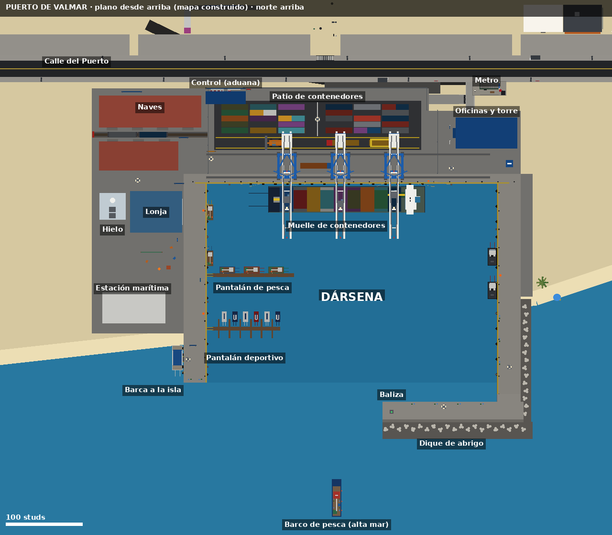
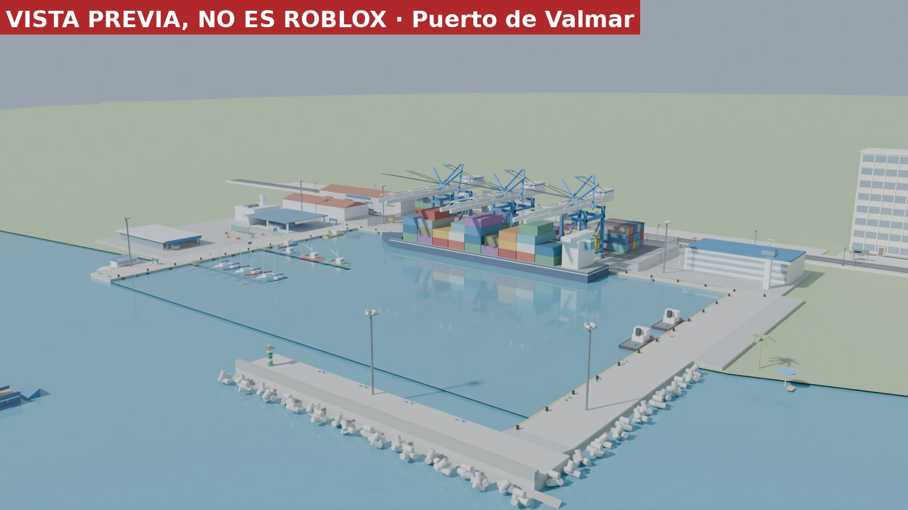

# Puerto de Valmar (Distrito Sur) — cómo es y por qué

**Queja del dueño (v123):** «El puerto de Valmar es una putísima mierda que no se parece nada a un puerto de
verdad» ([captura](../bugs/puerto-valmar-v123.png)). Se veía un descampado de tierra enorme, un cartel azul
tumbado en el suelo, una portería amarilla que hacía de grúa, unos barcos lejos en un pantalán fino, cajas
negras sueltas y nada más: sin muelles, sin agua junto a tierra, sin contenedores, sin naves, sin luces.

**Ahora:** un puerto de verdad en el mismo sitio, con la costa de siempre.




## Dónde está y qué no se toca

- Sitio de siempre: `CityPlan.Places.PuertoMercancias = (700, 3300)`, al sur de la **Calle del Puerto**
  (Z = 3150), en el Distrito Sur. El mar está al sur.
- **La costa no cambia** (`CityPlan.Coast`). La **dársena** se excava en la explanada de tierra que había
  (era tierra del puerto, sin casas ni parcelas) y se abre al mar por el sur. Los diques salen al mar
  sobre el fondo de siempre.
- No se mueve **ningún edificio con dueño** ni ninguna parcela (en el recinto del puerto no había).
- Se respetan: la **boca de metro del Puerto** (X 760–910, Z ≤ 3200), la **calle** y sus dos **paradas**
  de autobús, el **bosque** del oeste (X ≤ 305) y la **playa** del este (X ≥ 901). Lo comprueba
  `scripts/test-puerto.luau`.
- Debajo del agua (fondo del mar, corales, decoración de la orilla) es de **otro encargo**: aquí solo
  el puerto por encima del agua, los muelles y la dársena. El fondo del mar alrededor del puerto se
  queda como siempre (`Ocean.Keep`, −14).

## El plano (todo en `shared/Port/PuertoPlan.luau`)

```
            Calle del Puerto (Z = 3150) ──────────── boca de metro ──
     Z 3176 ┌ valla ── naves ── CONTROL ── patio de contenedores ─┐ oficinas
            │ (almacenes)      (aduana)   (5 filas × 2 bloques)   │ y torre
     Z 3262 │                  ═══ carril de las grúas (tierra) ═══════════
     Z 3292 │ lonja · hielo    ═══ carril de las grúas (mar) ══════════════
     Z 3300 │ muelle  ┌──────────── MUELLE DE CONTENEDORES (buque) ─────┐ muelle
            │ pesquero│ pantalán de pesca          DÁRSENA (agua)       │ este
            │         │ pantalán deportivo                              │ (remolcadores)
            │estación │                                                 │
            │marítima └─ dique oeste (Z 3560)    bocana    ┌── dique de abrigo ──┘
            │(barca al faro)                      Z 3586 ──┴ tetrápodos · baliza
```

| Parte | Qué es | Dónde |
|---|---|---|
| **Dársena** | Agua de verdad (terreno), dragada a −20, junto a los muros | X 470–850, Z 3300–3560 |
| **Muelles** | Bloques de hormigón con muro vertical (de −22 a +1), borde amarillo, bolardos, defensas de goma, neumáticos, escaleras de gato para salir del agua y salvavidas | norte, oeste y este de la dársena |
| **Terminal de contenedores** | 3 grúas pórtico (STS) con patas, pórtico arriostrado, pluma de celosía sobre el agua, castillete con tirantes, sala de máquinas, carro, cabina y spreader; carriles de las grúas; buque portacontenedores amarrado con sus amarras; patio con contenedores de colores en filas (de 20 y 40 pies, 1–3 alturas, códigos inventados sin navieras reales); pórtico apilador, grúa apiladora y camiones | muelle norte y explanada |
| **Puerto pesquero** | Pantalán de pesca con pesqueros abarloados, pesqueros junto al muelle, redes tendidas, cajas, boyas, **lonja** (subasta), **fábrica de hielo**, tablón de pescadores y el amarre del barco de pesca | muelle oeste |
| **Puerto deportivo pequeño** | Pantalán con fingers y veleros | muelle oeste, al sur |
| **Estación marítima** | Sala de espera acristalada, taquilla «Ir a la Isla del Faro», rampa al barco, la barca amarrada | oeste, junto a la orilla |
| **Dique de abrigo** | Dique con espaldón, escollera, tetrápodos y una **baliza verde** en la punta (luz de noche) | sale del muelle este |
| **Logística** | 2 naves con puertas enrollables, vía de carga con vagones, capitanía/oficinas con ventanas que se encienden, torre de control, control de acceso con garita y barreras, valla | norte |
| **Luces y carteles** | 7 torres de iluminación, focos en las grúas, «PUERTO DE VALMAR» **de pie** en el pórtico de entrada y junto a la calle, señales | todo |
| **Vida** | Gaviotas volando sobre el puerto (Controllers/Wildlife), estibadores, guardia, pescadera y marinero (WorkerSpot), la gente del sitio «Puerto» (PlaceLife) | todo |

### Faro: ojo con la historia

La historia habla del **Faro de la Punta**, que está en **Playa Dorada** y está **apagado** («porque llegó
el GPS», `QuestionBank`). Por eso en el puerto **no** hay un faro con ese nombre: en la punta del dique hay
una **baliza** de puerto (torre verde y blanca con luz verde), como en los puertos de verdad.

## Lo que usan otros sistemas (y sigue igual)

| Sistema | Qué busca | Ahora |
|---|---|---|
| Mapa (`MapInfo`, `MapLegend`, `WorldService.publishLandmarks`) | modelo «Puerto» | `Town.Puerto` (en el Distrito Sur) |
| Encargos (`CityErrands`: «Descargar el barco», «Pescado fresco») | modelo «Puerto» | igual; el modelo empieza a ras de suelo para que la gente pise la explanada |
| Gente del sitio (`PlaceLife.Puerto`) | modelo «Puerto» (zona) | igual |
| Pesca (`FishingService`) | `FishingSpot` (Mar), `FishingNpcSpot`, `FishingBoatDock`, `FishingBoatDeck`, `FishingBoatReturn` | 8 sitios + el del pescador NPC en muelles y dique; amarre en el muelle pesquero; el barco de alta mar sigue fondeado donde siempre (640, 3716) |
| Trabajo de pescador (`Config.Jobs.Pescador.Place = "Puerto"`) | `JobBoard` con `JobId = Pescador` | junto a la lonja |
| Barca a la isla (`WorldService`, etiqueta `Ferry`) | aviso con `Target` | taquilla de la estación marítima; la vuelta deja en el dique oeste (`PuertoPlan.FerryArrival`) |
| Barcos propios (`BoatService`) | puerto deportivo de la costa oeste | **sin cambios** (se sacan allí); ahora además pueden entrar en la dársena (`Boats.isLand`) |
| Pesqueros de la tienda (`CityAssets.harbour`) | pieza «Pier» | el pantalán de pesca (`PuertoDarsena/PantalanPesca/Pier`) |
| Eventos del mar (`SeaEvents`, tsunami en «el puerto») | punto (700, 3420) | ahora cae en la dársena (la ola llega por el agua); se puede subir a las grúas, naves o la torre |
| Metro (L2 «Puerto») y autobuses | boca y paradas en la Calle del Puerto | sin tocar |
| Relieve (`Relief`) | lo construido | la dársena queda llana (lo prueba test-puerto) |

## Mallas de Blender (opcionales)

Cuatro objetos se pueden cambiar por mallas hechas con Blender (`scripts/puerto/puerto_blender.py`):
**grúa pórtico**, **contenedor**, **tetrápodo** y **bolardo**. Llevan la etiqueta `PuertoMalla` y su
`Kind`. Mientras no se suban, el juego usa las piezas (se ve bien igual). Para subirlas:
`bash scripts/upload-puerto.sh` (escribe `shared/Port/PuertoAssetIds.luau`); luego commit y publicar.

## Piezas (móvil)

Ver el informe de `scripts/test-puerto.luau` (piezas, luces y modelos atómicos). Las grúas, el buque y los
edificios se cargan enteros (`ModelStreamingMode = Atomic`) y de lejos se ven en versión simple.

## Qué mirar en el juego (lista para el dueño)

Ver [puerto-checklist.md](puerto-checklist.md).
