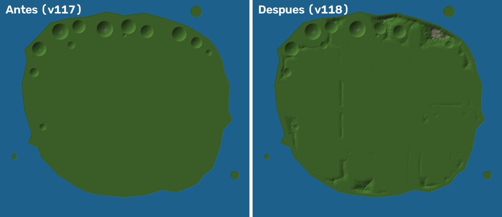
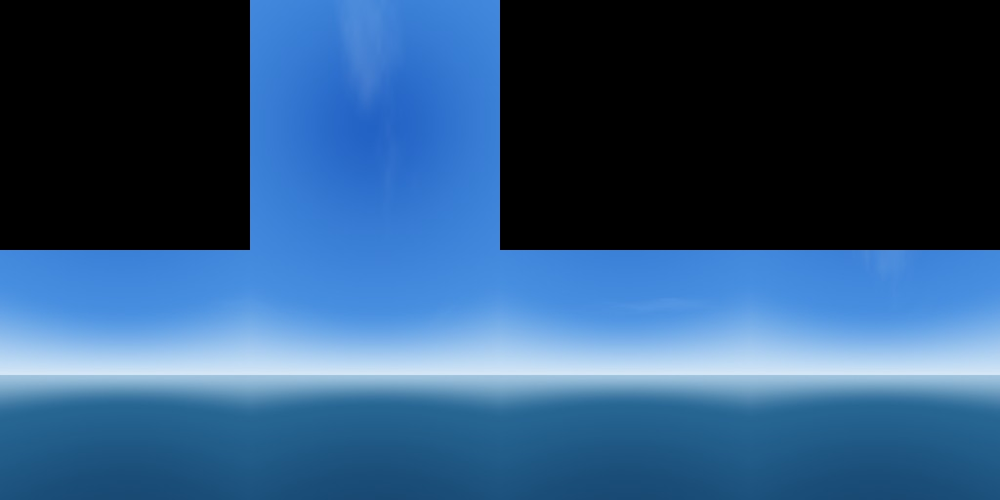

# Paisaje de Valmar (v118): relieve, bosques, luz, cielo y mar

Petición del dueño: «El mapa, la ciudad y todo el paisaje deben verse como en la imagen que te pedí y no
como en el juego». Referencia: `docs/espacio-aaa/referencia-hud-avion.png` (vista desde el avión de una
isla con colinas verdes y montes rocosos, mar azul con bajíos, nubes blancas, sol fuerte, bruma solo en el
horizonte y colores de cine). El juego (v117, `docs/espacio-aaa/captura-v117-avion-hud.png`) se veía
lavado de azul pálido, llano y sin vegetación.

## Antes y después

Vista aérea desde el noreste (avión sobre la costa, como la referencia), dibujada con Blender a partir del
mapa construido de cada versión:

| Antes (v117) | Después (v118) |
|---|---|
|  |  |

El relieve de la isla (alturas; verde = llano, gris = cumbres):

Cielo de día propio (6 caras de 1024 px, `scripts/paisaje/gen_cielo.py`):

**Cómo se han hecho las vistas** (no son capturas de Roblox):
`scripts/map/export.luau` (piezas) + `scripts/paisaje/export-relief.luau` (terreno y bosques) +
`scripts/paisaje/render_paisaje.py --look antes|despues`. Las dos usan la misma cámara, la misma ciudad y el
mismo motor; cambian el terreno (sin / con relieve y bosques) y los ajustes del juego de cada versión: la
bruma (Atmosphere), el color (ColorCorrection), el verde de la estación (invierno, como la captura del
dueño), el agua (Terrain.Water*) y el cielo. Sirven para ver el CAMBIO, no el render exacto de Roblox.

## Qué ha cambiado

### 1. Luz y aire (un solo perfil por hora y tiempo)
Quién toca `Lighting`: el archivo (`default.project.json`, valores de partida), `Services/WorldService`
(crea los efectos y el agua), `Controllers/DayLight` (cada 0,1 s pinta la hora con `shared/DayGrade`,
encima el tiempo con `DayGrade.weather`, las capas de la historia `shared/SkyMoods` —Grieta, sueño…— y
bajo el agua `SeaBiome`) y los mundos aparte (espacio, planetas, combate aéreo) que fuerzan su cielo. No
se ha añadido ningún sistema nuevo: se ha cambiado el perfil de cada hora en `DayGrade` (lo único que
manda), así la lluvia, la Grieta, la noche y el mar siguen funcionando igual encima.

- De día (`DayGrade`, 8:30-15:30 de sol): **aire limpio** (Atmosphere Density 0,28 en vez de 0,36 y Haze
  0,9 en vez de 1,5; la bruma solo azula el horizonte), **color vivo** (saturación +0,08, antes −0,08; hora
  dorada +0,14), contraste 0,17, sombras rellenas por el cielo (OutdoorAmbient más claro y azulado), **sol
  con resplandor** (Glare 0,3, Bloom 0,3 umbral 2,2, rayos 0,06) y nubes blancas con más cuerpo
  (Clouds.Density 0,62, Cover 0,56).
- Al amanecer y al atardecer: algo menos de bruma y más color.
- **Desde el aire** (avión, helicóptero; cámara a más de 80 studs): la bruma baja hasta un 30-35 %
  (`DayLight.aerial`), como en la referencia. Solo en Medio y Alto, con el cielo despejado y fuera del agua.
- Por nivel gráfico (`shared/Graphics`): Bajo −0,05 de saturación y 0,8 de bruma, Medio igual que la hora,
  Alto +0,05 y 1,05. Sombras, rayos y desenfoque como antes (Bajo sin sombras del sol).
- Iluminación: se queda **Future** (ya estaba, en el archivo) con `PrioritizeLightingQuality = false`
  (respeta la calidad gráfica de cada móvil); `EnvironmentDiffuse/SpecularScale` siguen en `DayGrade`.
- Lluvia, tormenta, niebla y nieve: igual que antes (se suman a la luz de la hora; las pruebas lo miran).

### 2. Cielo
- Cielo de día propio, hecho con código (`scripts/paisaje/gen_cielo.py` → `assets/paisaje/cielo_dia_*.jpg`):
  azul profundo arriba, horizonte claro, unos cirros finos y, bajo el horizonte, mar lejano en bruma (lo
  que queda más allá de lo cargado ya no es un vacío). Sin sol ni nubes pintadas: los pone el juego.
- **Sin subir todavía**: lo sube `bash scripts/upload-paisaje.sh` (en la sesión que publica; escribe
  `src/shared/PaisajeTextureIds.luau`). Hasta entonces `World/SkyLoader` usa el cielo de siempre (el del
  «Simple Lighting Pack»). Con las 6 caras, `SkyLoader.ownDay` lo pone de cielo de día.
- La Grieta, los cielos del tiempo y los especiales (`Controllers/SkyExtras`) siguen encima, como antes.

### 3. Terreno y relieve
- `shared/Relief` + `World/ReliefBake`: al construir el mapa (`TownBuilder.build`, lo último) se miran
  **todas las piezas de la ciudad** (294.000 huellas) y se hornea una máscara: junto a cualquier cosa
  construida (calles, edificios, aeropuerto y pistas, puertos, vía del tren, zonas verdes, ocio, marcas de
  la historia), el río, los lagos, la playa, los pueblos de la historia, los lugares del plano y las zonas
  de misión que se montan al arrancar, el suelo se queda **llano** (franja de 40 studs) y luego sube en
  200 studs. En lo salvaje: colinas, sierras de hasta 270 studs (ruido fractal con crestas, siempre igual)
  y **acantilados** en los tramos de costa rocosa (`CityPlan.Cliffs`).
- El mapa (86.310 caracteres) se guarda en `ServerStorage.ReliefMap` y `ReplicatedStorage.ReliefMap`.
  `TerrainBuilder.relief` lo escribe al arrancar **en su hilo, trozo a trozo** (256 × 256 studs) y **solo
  añade** terreno (lee y escribe en el mismo instante: no pisa el agua, el metro, la mina ni el mar).
- Materiales por pendiente y altura (`Relief.material`): hierba (Grass) en las lomas, pradera (LeafyGrass),
  tierra en los claros, **roca y pizarra** en lo empinado y las cumbres. Debajo, tierra o roca.
- El llano de la isla pasa a **LeafyGrass**, y la colina del mirador también: así el **césped 3D**
  (Terrain.Decoration, solo sale en Grass) vuelve en **Medio y Alto** sin asomar por calles y aceras (lo
  que lo quitó en v77); en Bajo sigue apagado.
- Colores del terreno más vivos (`TerrainBuilder.Colors`) y estaciones más verdes (`shared/Seasons`: el
  invierno mediterráneo es verde; antes dejaba el campo gris).
- MaterialVariant: el terreno ya usa los materiales PBR que eligió el dueño (Grass, LeafyGrass, Rock,
  Slate, Ground, Sand: `World/UserMaterials`, `shared/UserMaterialChoice`), también en las lomas nuevas.
- Mar: agua más azul y transparente (`WorldService`: WaterColor 18,98,138; transparencia 0,62; reflejo
  0,72): turquesa sobre la arena de los bajíos y azul hondo mar adentro. Las profundidades del mar
  (`OceanBuilder`, plataforma y fosa) no se tocan.

### 4. Vegetación
- `Kit/Forest`: **3.575 árboles** en manchas de bosque por las lomas (pinos arriba, encinas abajo, claros y
  pradera), ninguno en la roca ni en el llano junto a la ciudad. **2,6 piezas por árbol** (tronco que choca
  + 1 o 2 copas elipsoides sin choque). Van en 173 grupos (`Bosque`) que se cargan enteros y de lejos se
  ven en su versión simplificada (`ModelStreamingMode = Atomic`, `LevelOfDetail = StreamingMesh`).
- Los árboles del campo y del monte que han quedado en una loma (244) se suben a ras del suelo (con sus
  puntos de balanceo). `MeshLibrary` los cambia por los modelos 3D igual que antes.
- Las rocas grandes de `NatureAssets` esperan a que el relieve esté escrito (máx. 60 s) para apoyarse.

### 5. Paisaje lejano (lo que no se cargaba)
La carga por zonas (StreamingTargetRadius 768) solo trae el terreno y el agua a ~770 studs: desde el avión,
más allá **no había nada** y la bruma lo tapaba (el azul pálido de la captura). Ahora (`shared/Horizon`,
`Controllers/Horizon`, Medio y Alto):
- **Suelo lejano**: 943 losas planas por debajo del terreno de verdad (tierra a −2,4, agua a −2,6/−2,8):
  isla verde, ciudad gris, playa, bajíos turquesa y mar hondo, hasta 18 km. Solo desde el aire (cámara a
  más de 50 studs), sobre Valmar, fuera de los interiores (sus salas flotan en el cielo) y no en la isla del
  sueño del prólogo. Donde el terreno está cargado lo tapa él.
- **Lomas lejanas**: 155 siluetas (elipsoides) de las lomas del relieve que se esconden al acercarte, como
  las de las montañas de siempre.

### 6. Ciudad
No se ha tocado la distribución ni las piezas de la ciudad (las claves de los edificios y las partidas
siguen igual). Se ve mejor por la luz (color, sombras rellenas, reflejos) y por el agua; los materiales de
calles, aceras y fachadas siguen siendo los PBR del dueño (`UserMaterials`, `StreetDress`, `Buildings3D`).

## Rendimiento

| | Antes (v117) | Después (v118) |
|---|---|---|
| Piezas en `Town` | 364.750 | 374.132 (+9.382, +2,6 %: los bosques) |
| Terreno del relieve | — | ~5,9 millones de vóxeles en 9 km² de studs (565.743 columnas de 4 × 4), unos 150 trozos de 256 × 256 escritos en su hilo al arrancar |
| Mapa del relieve | — | 2 × 86 KB de texto (servidor y cliente) |
| Piezas solo del cliente (paisaje lejano) | 18 (montañas y sierra) | + 943 losas + 155 lomas (sin choque, sin sombra, sin consultas; escondidas en Bajo) |
| Arranque del servidor | — | relieve horneado en el archivo (no se calcula al arrancar); escribirlo: unos segundos en su hilo |

Presupuesto por nivel (objetivo: móvil medio ≥ 30 fps):
- **Bajo**: sin sombras del sol, sin césped 3D, sin paisaje lejano ni lomas lejanas, sin relleno de copas;
  bruma algo más plana (tapa el borde de lo cargado).
- **Medio**: sombras, césped 3D en las lomas, paisaje lejano, rayos de sol; desenfoque solo en cinemáticas.
- **Alto**: todo, sombras más nítidas, algo más de color.
- `StreamingEnabled` sigue igual (TargetRadius 768, MinRadius 96, MinimumRadiusPause): los bosques nuevos
  se cargan por grupos y de lejos se ven simplificados.

## Lo que no puede igualar a la imagen de referencia (y por qué)
- La referencia es un render «offline» de IA: luz global calculada al detalle, millones de árboles, nubes
  volumétricas con luz por dentro, agua con espuma y profundidad, texturas de satélite. Roblox dibuja en
  tiempo real en móviles: no hay luz global de verdad, la distancia de dibujo está limitada por la carga
  por zonas, las nubes (`Clouds`) son una sola capa y los árboles hay que contarlos pieza a pieza.
- La isla de Valmar está **casi toda construida** (ciudad, barrios, aeropuerto, zonas verdes): el relieve
  solo puede subir en lo que queda libre (sobre todo la costa norte y noreste y las franjas entre barrios y
  costa). Mover la ciudad para meter montañas rompería partidas, historia y misiones.
- Más allá de ~770 studs el juego no tiene el terreno de verdad: lo que se ve desde el avión a lo lejos son
  las losas y siluetas del paisaje lejano (planas y simplificadas) y la bruma.
- El cielo de día propio no se ve hasta subirlo (`scripts/upload-paisaje.sh`).
- Las vistas de comparación son de Blender, no de Roblox (ver arriba).

## Comprobaciones a mano (en Roblox, tras publicar)
1. **Avión**: despega en el aeropuerto y sube a 300-600 studs: la isla tiene que verse nítida (no lavada),
   con colinas y bosques al norte y noreste, el mar azul con bajíos turquesa y la bruma solo en el horizonte.
   En Medio/Alto, el suelo lejano no debe parpadear ni verse «por encima» del terreno cerca del avión.
2. **A pie** en el campo del norte: las lomas tienen hierba con briznas (Medio/Alto), roca en lo empinado y
   bosques; ninguna calle, casa, parada ni sitio de misión enterrado. Caminar por las laderas y bajar.
3. **Ciudad, aeropuerto, puertos, playa, zonas verdes**: todo igual que antes; sin briznas asomando por las
   aceras ni los suelos.
4. **Metro y mina**: entrar y salir (el relieve no los rellena). **Bucear** en el mar: sin losas encima.
5. **Interiores**: entrar en una casa y un edificio alto: por las ventanas no se ve el suelo lejano.
6. **Lluvia y tormenta**: el cielo se cierra gris como antes. **Noche**: igual que antes.
7. **Grieta del cielo** y cielos de la historia: encima de todo, como antes.
8. **Nivel Bajo** en un móvil modesto: fps como antes (sin césped 3D ni paisaje lejano).
9. Subir el cielo (`bash scripts/upload-paisaje.sh`, commit + push de `PaisajeTextureIds.luau`, publicar)
   y comprobar que no hay costuras entre las caras.

## Archivos
- `src/shared/Relief.luau` — forma, horneado, lectura y materiales del relieve
- `src/server/World/ReliefBake.luau` — máscara de lo construido, árboles a ras, bosques, guardado
- `src/server/World/Kit/Forest.luau` — bosques de pocas piezas
- `src/server/World/TerrainBuilder.luau` — colores, llano LeafyGrass, `relief`/`reliefChunk`
- `src/shared/DayGrade.luau`, `src/shared/Graphics.luau`, `src/client/Controllers/DayLight.luau`, `default.project.json` — luz
- `src/shared/Horizon.luau`, `src/client/Controllers/Horizon.luau` — paisaje lejano
- `src/shared/SkyChoice.luau`, `src/server/World/SkyLoader.luau`, `src/shared/PaisajeTextureIds.luau`,
  `scripts/paisaje/gen_cielo.py`, `scripts/upload-paisaje.sh` — cielo de día propio
- `scripts/test-paisaje.luau` — prueba (con `X.rbxl`, también el mapa construido)
- `scripts/paisaje/export-relief.luau`, `scripts/paisaje/render_paisaje.py` — vistas de comparación
