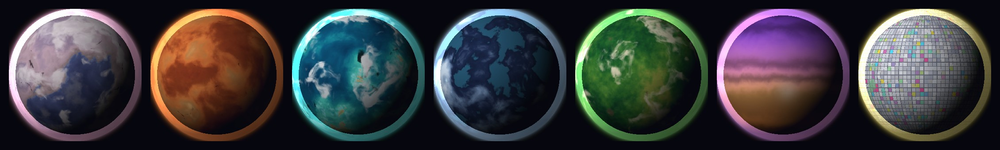
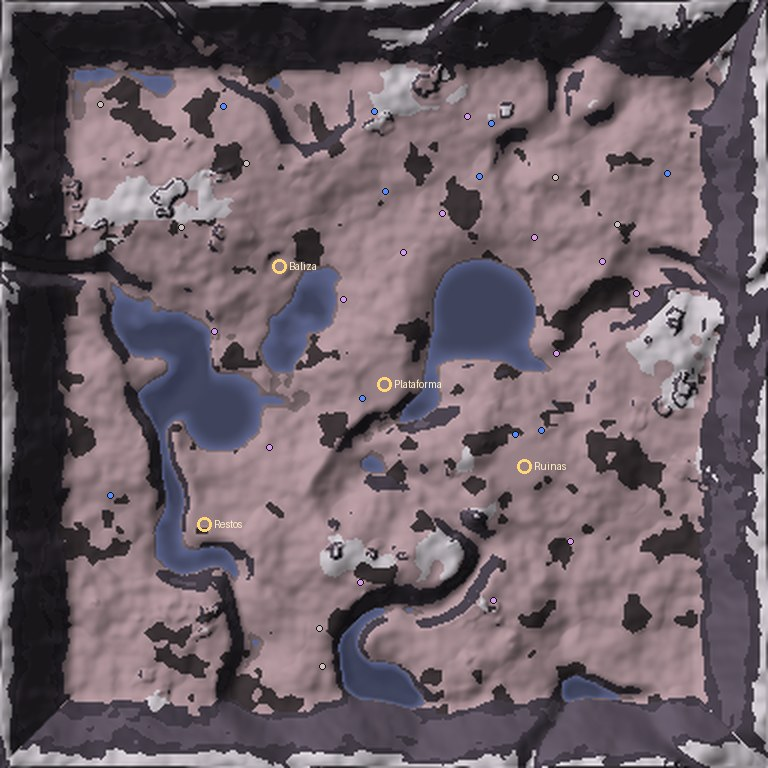
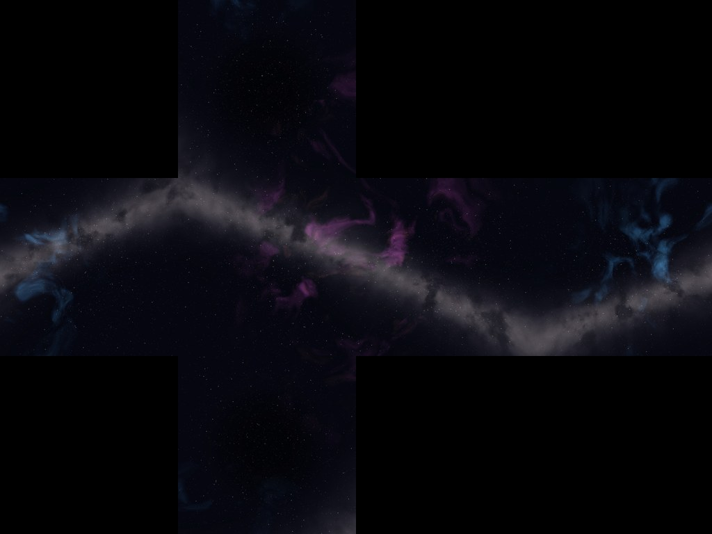
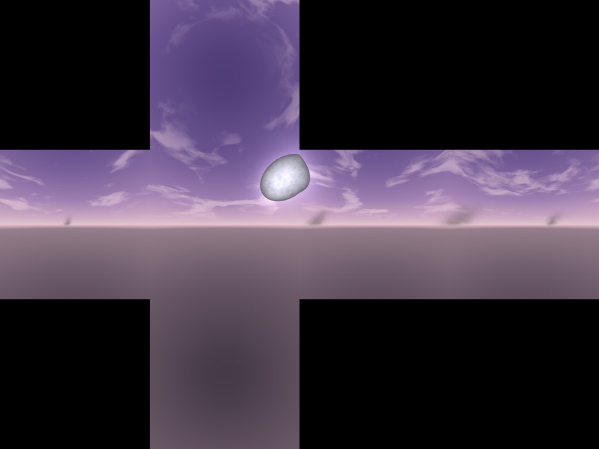
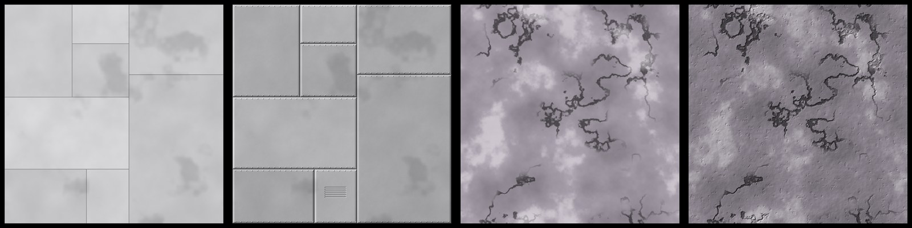

# Los planetas: bajar volando, sin pantalla de carga

Desde el espacio encima de Valmar (`docs/espacio.md`) ahora se ven los **7 planetas de la Saga 2** como
planetas de verdad: esferas enormes con su superficie, sus nubes y el brillo de su atmósfera. Y a
**Lontana** (el planeta de Cosme, episodio 1) **se puede bajar volando**: entras en la atmósfera, la nave
se calienta, atraviesas las nubes y sales sobre sus colinas, sin pantalla de carga y sin soltar los
mandos. Allí aterrizas, te bajas, caminas, minas, investigas, vuelves a subir a la nave y despegas otra
vez hasta el espacio. Los otros seis planetas dicen **«próximamente»**.

La idea de «bajar al planeta en tiempo real» está inspirada en los juegos de exploración espacial, pero
**solo como sensación de juego**: no hay nombres, diseños, interfaz, arte ni nada copiado de ningún
juego. Todo (planetas, cielos, texturas, nave) es nuestro.



## Cómo se juega

1. Sube a la nave (puerto espacial o estación) y vuela hacia arriba hasta el espacio.
2. Mira alrededor: los planetas están en el horizonte del espacio. **Lontana** es el malva con nubes.
   De muy lejos (desde Valmar, de noche) es una estrella; según te acercas, la estrella se apaga y crece
   la esfera.
3. Vuela hacia Lontana (o apunta con el morro y pulsa **VIAJAR** para ir directo a su órbita).
4. **Entrada en la atmósfera:** al llegar a su atmósfera el casco se pone al rojo, salen chispas de
   plasma delante del morro, la cámara tiembla, llegan las nubes y el cielo pasa del negro al malva de
   Lontana. **Los mandos siguen siendo tuyos** (si das la vuelta, sales de la atmósfera y se acaba).
5. Al fondo, entre las nubes que tapan toda la pantalla, la nave aparece sobre la superficie **con la
   misma velocidad y el mismo rumbo**, y las nubes se abren: estás a unos 400 m sobre Lontana.
6. **Aterrizar:** baja despacio cerca del suelo llano: **FRENO** (móvil), **Ctrl** (ordenador) o **LT**
   (mando), o quita motor. Al acercarte sale el tren de aterrizaje y, si vas despacio y bajo, la nave
   **se posa sola** (también en cualquier sitio llano, no solo en la plataforma; en el agua no).
7. **BAJAR** (el botón Salir, tecla **B**, mando **B**) con la nave posada: te bajas y caminas con tu
   personaje. La nave se queda aparcada con el aviso **«Subir a la nave»**.
8. **VISOR** (botón, tecla **I**, mando **L3**): durante unos segundos marca el mineral cercano y los
   puntos de interés con su distancia.
9. **Minar a pie:** junto a un mineral, mantén **«Extraer»**. Va a la bodega de tu nave (40 como mucho)
   y se vende en las estaciones. Hay **cuarzo malva** (solo en Lontana, $45), hierro y cobalto.
10. **Despegar:** sube a la nave y lleva la palanca **hacia arriba** (o **W**, o **TURBO**): la nave
    sube recta y sale volando.
11. **Volver al espacio:** sube y sube. Por encima de 1700 llegan las nubes y el cielo se oscurece; a
    2300 sales de la atmósfera y apareces junto a Lontana, en el espacio. **VALMAR** (tecla **V**) te
    lleva a casa desde cualquier sitio, también desde el planeta.

### Lo que hay en Lontana



- **Colinas suaves** de tierra malva («nada tiene esquinas»), valles, peñascos, cumbres con ceniza y
  manchas quemadas por la guerra (brasas en las grietas). El **Lago de las Lunas**, la Charca Gris y
  cauces con agua.
- **Cielo malva** con la luna **Ovilla** enorme y columnas de humo en el horizonte; bruma, luz y agua del
  color del planeta. Cae **ceniza mezclada con pelusa** (la «lluvia de pelusa» del documento de la
  Saga 2). Tono serio (13+), sin sangre.
- **Plataforma de aterrizaje** de Redonda (abandonada, con sus luces de emergencia).
- **Puntos de interés** (ganchos de la historia de la Saga 2; el primero de cada uno da $25 y se apunta):
  - **Baliza de señal:** «…aquí Redonda… el Muelle está tomado… no aterricéis en…».
  - **Ruinas de cúpulas:** casas de cúpula partidas, una torre en espiral sin terminar y una bufanda.
  - **Restos de una nave:** «Escuadrilla de Ovilla». La caja negra no está.
- **30 minerales**, plantas de pelusa, arbustos redondos y rocas.

## Por qué está hecho así (los límites de Roblox)

- **En Roblox la gravedad siempre tira hacia abajo** (no hay gravedad esférica): no se puede caminar
  alrededor de una bola gigante. Por eso hay **dos partes** del mismo planeta:
  - en el espacio, una **esfera que se ve** (con su textura, nubes y atmósfera);
  - y su **superficie**, una zona de terreno **plana** de 3 km × 3 km, en el **mismo juego**, muy lejos
    de Valmar (en X = −25 000, Z = 25 000), que solo le llega a quien está cerca (streaming).
- **El juego publica un solo place**, y no hay que crear más: cambiar de place SÍ tendría pantalla de
  carga. Todo pasa en el mismo place.
- El truco del «sin cortes»: al fondo de la entrada en la atmósfera, **las nubes tapan la pantalla**
  medio segundo y, justo entonces, el servidor mueve la nave de la esfera a la zona de la superficie,
  con la misma velocidad y el rumbo equivalente (el punto por donde entras en la esfera es el sitio
  por donde llegas a la superficie: la cara de Lontana que mira a Valmar es el centro de la zona). Lo
  mismo al revés al subir.
- **Las piezas de Roblox miden como mucho 2048 studs.** Un planeta mide 4000-6000 de diámetro: se
  dibuja como una esfera más pequeña y más cerca de la cámara, con el mismo tamaño en pantalla.
- **Sin ventanas de carga, pero con terreno de verdad:** el terreno de Lontana se crea la primera vez
  que alguien se acerca (poco a poco, unos segundos, mientras vuelas hacia allí) a partir de una
  semilla: sale siempre igual. Los choques de la nave con el suelo usan la misma cuenta del terreno.
- **Los materiales del terreno** de Lontana son los que el terreno de Valmar no usa (Limestone,
  Sandstone, Slate, Basalt, Salt y CrackedLava), así que teñirlos de malva no cambia la ciudad.

## Las texturas «realistas»

Las imágenes están en `assets/espacio/` y las licencias en `assets/espacio/LICENCIAS.md`.

- **Todas son nuestras**, hechas con código (`scripts/espacio/gen.py`: ruido fractal sobre la esfera,
  relieve y mapas PBR). La sesión que las hizo **no podía descargar** de Poly Haven, ambientCG ni la NASA
  (la red estaba cerrada), así que no hay ninguna foto de otros: se pueden usar sin pedir permiso
  (dominio público / CC0).
- Qué hay: el **cielo del espacio** (nebulosa, Vía Láctea y estrellas, 6 caras de 1024), el **cielo de
  Lontana** (malva con la luna Ovilla), la **superficie de los 7 planetas** (1024 × 512), **nubes** de
  Lontana, Marena y Fronda, el **aro de la atmósfera**, la **chapa de la nave** (color, relieve,
  rugosidad y metal) y la **roca de Lontana**. Todas ≤ 1024 px (el máximo de Roblox).

| Cielo del espacio | Cielo de Lontana |
|---|---|
|  |  |



Cómo se ponen en un juego hecho con Rojo (sin Studio a mano):

- **Cielos:** un `Sky` con sus 6 caras («EspacioProfundo» y «CieloLontana», en `SkyLibrary`): eso sí se
  puede crear desde un script. Se ponen en el espacio y en Lontana.
- **Planetas:** una bola con `SpecialMesh` de tipo esfera y su `TextureId` (se puede poner desde un
  script); las nubes, otra bola un poco mayor con la imagen transparente; la atmósfera, un aro
  (`BillboardGui`) del color del planeta.
- **Chapa de la nave y rocas:** `MaterialVariant` «NaveCasco» (sobre Metal) y «LontanaRoca» (sobre
  Basalt), **sin cambiar** el material en el resto del juego. `SurfaceAppearance` no se puede crear
  desde un script en un servidor de verdad, y los mapas de un `MaterialVariant` tampoco: por eso
  `scripts/build-place.luau` los deja ya puestos en el archivo del juego al publicar.
- **Mientras no se suban**, todo se ve con colores y materiales de Roblox (los planetas de su color
  con un aro dibujado, la nave como siempre): nada se rompe.

## Paso para la próxima publicación (lo hace la sesión que publica)

```
bash scripts/upload-espacio.sh        # sube assets/espacio/ y escribe src/shared/Cosmos/EspacioTextureIds.luau
git add src/shared/Cosmos/EspacioTextureIds.luau && git commit && git push
bash scripts/publish.sh               # build-place deja puestos NaveCasco y LontanaRoca
```

(Necesita la clave de Open Cloud en `ROBLOX_API_KEY`, igual que `upload-cosme.sh`; nunca se enseña.)
Si al verlo en el juego un cielo tiene una costura, se cambia la orientación de las caras en
`FACES` / `FACE_FLIP` de `scripts/espacio/gen.py` y se vuelve a subir.

## Cómo probarlo

1. Entra como tester y escribe **`/pruebas`** → sección **ESPACIO**:
   - **🪐 Ir a Lontana (órbita):** en la nave, encima de Lontana mirando hacia ella. Vuela recto y
     verás toda la entrada en la atmósfera.
   - **🛬 Aterrizar en Lontana:** directamente volando sobre la plataforma de aterrizaje: frena y se
     posa sola.
2. Para probar como jugador normal: hace falta haber terminado la Saga 1 (si no, el planeta te aparta
   y dice por qué). El orden de la saga (Lontana primero, Mercadia la última) sigue en
   `shared/Cosmos/Planets`.

## Cómo está hecho

| Archivo | Qué hace |
|---|---|
| `src/shared/Cosmos/PlanetBodies.luau` | Dónde están los planetas, su tamaño, sus capas (llegada, entrada, paso) y cómo se dibujan desde la cámara. |
| `src/shared/Cosmos/PlanetEntry.luau` | Las fases de entrar y salir, los efectos de cada una y el paso esfera ↔ superficie (sitio y rumbo). |
| `src/shared/Cosmos/Lontana.luau` | La superficie de Lontana: terreno por semilla, materiales, lagos, plataforma, puntos de interés, mineral, flora y choques. |
| `src/shared/Cosmos/Landing.luau` | Aterrizar solo, posado, despegue vertical. |
| `src/shared/Cosmos/EspacioLook.luau` / `EspacioTextureIds.luau` | Qué imagen va en cada sitio y el respaldo sin imágenes. |
| `src/server/Services/PlanetService.luau` | Bajar y subir (comprobado por el servidor), bajarse, aparcar, volver a subir, minar a pie, puntos de interés. |
| `src/server/World/PlanetWorld.luau` | Construye el terreno y lo de encima; cielos y materiales. |
| `src/server/Services/AirCombatService.luau` | `relocate`: la misma nave pasa a otro sitio sin cortar el vuelo; `World = "Planet"`. |
| `src/client/Controllers/PlanetClient.luau` | Las esferas en el espacio, los efectos de la entrada, la luz y el cielo del planeta, la ceniza, el VISOR. |
| `src/client/Controllers/AirCombatClient.luau` | La nave en el planeta (aterrizar, tren, «Relocate» con la misma velocidad). |
| `scripts/espacio/gen.py` | Las texturas y las vistas previas de esta página. |
| `scripts/upload-espacio.sh` | Subirlas a Roblox. |

**Rendimiento (móvil primero):** la superficie mide 3 km × 3 km (≈ 700 piezas encima), se construye una
vez y le llega por streaming solo a quien está cerca; la ceniza, las nubes de los planetas y el plasma
siguen el nivel gráfico (`shared/AirCombat/FxBudget`).

## Límites conocidos

- La superficie es una zona de 3 km, no un planeta entero: en el borde la nave gira hacia dentro (y la
  niebla tapa lo de detrás). Se pasa al espacio subiendo.
- La hora del día en Lontana es la de Valmar (de noche está oscuro allí también).
- Los otros 6 planetas solo se ven (próximamente). Para hacer otro: su módulo como `Lontana.luau`,
  añadirlo a `PlanetService.Surfaces` y a `PlanetClient`.
- Un jugador por nave; varios pueden estar en Lontana a la vez (cada uno con su nave aparcada).
- Las texturas se ven cuando se suban (`upload-espacio.sh`); hasta entonces, colores y materiales.

## Pruebas

```
lune run scripts/test-planetas.luau   # planetas, entrada/salida, paso esfera↔superficie, Lontana, aterrizar, servidor, terreno, texturas, VISOR
lune run scripts/test-space.luau
lune run scripts/test-aircombat.luau
```
