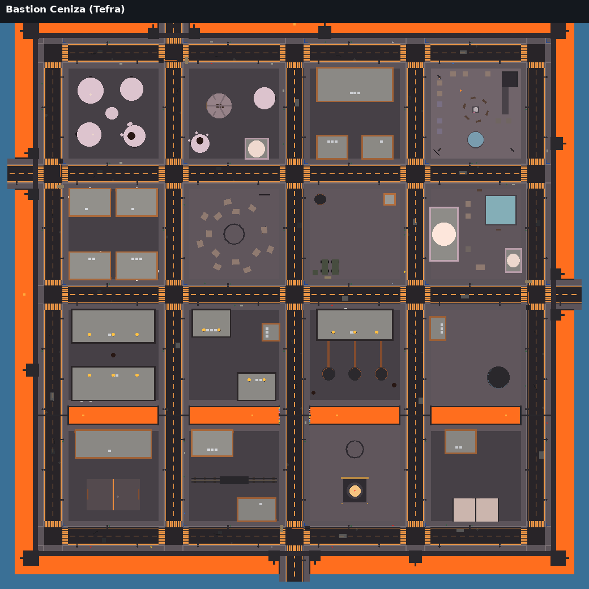

# Bastión Ceniza, la ciudad de Tefra

Tefra ya tiene ciudad. Cuando bajas con la nave, la plataforma de aterrizaje de siempre está ahora en
el centro de **Bastión Ceniza**: una ciudad-fortaleza sobre una meseta de basalto, rodeada por una
muralla y un foso de lava. Está hecha con código, igual que Valmar (no se ha tocado
`RealLifeSimulator.rbxl` a mano). El diseño completo está en
[diseno-mundos.md §3.1](diseno-mundos.md) («Tefra · Bastión Ceniza»).

*Vista desde arriba (norte arriba), dibujada con `scripts/map/vista_cenital.py` a partir de la ciudad
construida. Naranja: lava (el foso y el Canal de la Forja). Las calles cruzan el canal por puentes.*

## Cómo llegar

1. Termina la Saga 1 (o entra como tester) y vuela al puerto espacial.
2. Viaja a Tefra y entra en su atmósfera.
3. Debajo de ti está Bastión Ceniza. **Frena** encima de la plataforma del Muelle (o de una calle o
   una plaza) y la nave se posa sola. Pulsa **BAJAR** y ya estás andando por la ciudad.

La nave **no** se posa encima de los edificios, la muralla ni la lava, y si vuelas bajo **choca** con
ellos (antes los atravesaba).

## La forma de la ciudad

- **Lo antiguo es redondo, lo militar es de esquinas duras.** Las cúpulas de yeso malva del Barrio del
  Ovillo son del Tefra de antes de la guerra; los búnkeres de basalto, las torres y la muralla son del
  Ejército.
- **Colores:** negro basalto, naranja de lava, malva (del cielo y de lo antiguo) y gris de ceniza.
- **Lava con puentes seguros:** el foso rodea la muralla y el **Canal de la Forja** cruza la ciudad de
  lado a lado. Se cruza por **5 puentes de hierro** (las calles) y hay **barandillas** en todos los
  bordes. Si aun así te caes, te sacan a la acera más cercana («¡La lava quema!»), sin daño.
- **4 puertas** en la muralla (Norte, Este, Sur y Oeste), cada una con su puente sobre el foso y un
  **control de la policía militar** (garita, barrera y sacos terreros).
- **Calles** con aceras, farolas naranjas (luz de sodio), nombres en las esquinas y pasos de peatones.
  No hay semáforos: en Tefra no circulan coches.
- **Ambiente:** humo y brasas en las chimeneas de las fundiciones y en las fumarolas, vapor en los baños
  y en las torres de la central, luz de la lava de noche. La ceniza que cae es la de siempre de Tefra.

## Los 8 barrios

| Barrio | Qué hay ahora |
|---|---|
| 🏚 **Barrio del Ovillo** | Cúpulas del Tefra antiguo (algunas partidas por las bombas), el horno del barrio, **la casa de la familia de Cosme** (solo queda el armazón; en el marco de la puerta, las rayas de las alturas de Cosme y Ada) y la **Panadería del Ovillo** (se puede comprar pan). |
| 🛒 **Mercado Espiral** | Puestos en **espiral** alrededor de un **pozo de lava** (el de Madre Hollín vende medicinas, caras) y los cuatro **Bloques del Refugio** (viviendas de búnker). |
| 🛬 **Muelle Bastión** | La **plataforma de aterrizaje**, la torre de control, el **astillero**, los **calabozos de la policía militar**, la **armería** (cerrada: hace falta la cadena «Papeles»), camiones militares y un control. |
| 🔭 **Mirador de las Lunas** | La plaza de Tefra: la **estatua de la abuela Nilda**, el **lago templado** (estanque con vapor), las **tiendas de los refugiados**, una hoguera, bancos y la **terraza** con rampa para ver el Lago de Ceniza por encima de la muralla. |
| 🏥 **Campus Nilda** | La academia de la abuela, hoy **hospital de campaña**, los **baños termales** y el **puesto de sopa** (se puede comprar). |
| 🏭 **Las Fundiciones** | Fundición Norte y Sur (con chimeneas que echan brasas), la **Forja de Bastión**, el **Taller de blindaje** («se traspasa»), la **Oficina de trabajo**, las **viviendas obreras** y la **estación del tren de cremallera** blindado (hoy sin servicio). |
| 🌋 **Los Pozos de Magma** | La **central geotérmica** con sus tres torres de vapor, el **pozo de magma**, **la Lanza** (una torre en obras con una lente arriba: nadie sabe aún para qué es), el **refugio antibombas**, el **depósito de agua** (con su cola), el **reparto de raciones** (se puede comprar) y el **invernadero de setas de ceniza**. |
| 🎖 **La Muralla** | El anillo de muralla con **16 torres** con cañones, las 4 puertas, el **cuartel** y la **explanada de la pelota de ceniza**. |

Además: el **Puente de los Mil Candados** (la Avenida del Muelle sobre el canal), lleno de candados
de colores. Muchos sitios tienen un aviso **«Mirar»** que cuenta su pequeña historia.

## Lo de Valmar y lo de Tefra

| En Valmar | En Bastión Ceniza (ahora) |
|---|---|
| Distritos y barrios | 8 barrios con su color en el minimapa |
| Calles, aceras, farolas, cruces | Las mismas calles de Valmar con el estilo de Tefra (basalto, marcas y luces naranjas) |
| Edificios con planta baja jugable | 22 edificios con puerta y planta baja por la que se entra (búnkeres, fábricas, edificios redondos) |
| Plaza Mayor | Mirador de las Lunas (estatua de Nilda) |
| Hospital | Campus Nilda (hospital de campaña) |
| Policía y cárcel | Policía militar y calabozos del Muelle |
| Supermercado | Reparto de raciones + mercado negro |
| Tiendas | Panadería del Ovillo, puesto de sopa, puesto de Madre Hollín, raciones (todo más caro: escasea) |
| Metro y autobús | Estación del tren de cremallera (decorado; sin servicio todavía) |
| Puerto / aeropuerto | Muelle Bastión (la plataforma de la nave) |
| Casas y pisos | Bloques del Refugio, viviendas obreras y cúpulas (de momento no se compran) |
| Trabajos | Oficina de trabajo con el tablón de los oficios de Tefra (los oficios, en la fase siguiente) |
| Gente por la calle | Gente en aceras, plazas, colas y bancos, que habla de lo suyo («La cola del agua llega hasta el puente…») |
| Luces de noche | Farolas, ventanas de las casas, la lava, las hogueras y las franjas de emergencia de la muralla |
| Minimapa y reloj | Minimapa de Bastión Ceniza y el tiempo de Tefra en el reloj («Lluvia de ceniza», 25–37 °C) |

## Minimapa y reloj en Tefra

- **Minimapa:** a pie en Tefra enseña Bastión Ceniza: los barrios con su color, las calles, la muralla,
  el foso y el canal de lava, los edificios y los sitios con su icono. Debajo dice dónde estás
  («Mercado Espiral · Bastión Ceniza»). En Tefra no salen ni el objetivo, ni los ❗ ni tus casas de Valmar.
  El botón del mapa (o la tecla **M**) aleja el minimapa hasta ver la ciudad entera; otra vez, vuelve.
- **Reloj:** en Tefra enseña el tiempo de Tefra (siempre cae ceniza; más calor por la tarde), no el de
  Valmar. La hora es la misma del juego.

## Rendimiento (móvil)

- **≈ 6 900 piezas** en total (calles ≈ 2 700, edificios ≈ 3 400, muralla ≈ 280). Valmar entera tiene
  unas 365 000.
- ≈ 170 luces (la mitad son de farolas y casi todas sin sombras) y ≈ 40 emisores de partículas con muy
  poco ritmo.
- Se construye **solo cuando alguien va a Tefra**, poco a poco y después del terreno; el
  *streaming* solo la manda a quien está cerca. Los edificios se cargan enteros y de lejos se ven
  simplificados (como en Valmar).

## Qué falta (fases siguientes)

- ✅ **Hecho después** (ver [tefra-misiones.md](tefra-misiones.md)): el episodio «Ceniza en Bastión»
  (7 misiones), 3 cadenas secundarias, los 4 oficios de Tefra y 2 de la galaxia, el medidor de calor,
  los bombardeos con horario y sirenas, la Forja (fabricar) y el invernadero.
- Las otras 4 cadenas secundarias, la luna Ovilla y la batalla espacial de la Lanza.
- **Comprar o alquilar** casas y negocios en Tefra (puesto del mercado, taller de blindaje). Las claves
  ya están preparadas: todas empiezan por `Tefra_`, así que nunca se mezclan con las de Valmar.
- **Mapa grande** y **GPS con rutas** por Bastión Ceniza (ahora: minimapa, el minimapa alejado y la ★
  del objetivo de la misión o del oficio).
- El toque de queda con la policía militar (ahora solo cuenta en el correo de túnel); el tren de
  cremallera funcionando; la Caldera Roja (lago de lava) con barcazas; la pelota de ceniza jugable.
- Peatones andando por todas las calles como en Valmar (ahora: gente en sitios fijos y paseando por
  las plazas y el mercado).

## Para programadores

- Plano (cuentas puras, se prueba sin Roblox): `src/shared/Cosmos/TefraCity.luau`.
- Terreno de la meseta, muralla y foso: `Tefra.heightAt` usa `TefraCity.shape`.
- Construcción: `src/server/World/TefraCityBuilder.luau` (lo llama `World/PlanetWorld.buildCity`).
  Usa los kits de Valmar: `Kit/Street`, `Kit/Building`, `Kit/Props`, con `Palette.withTheme("Tefra")`
  y los estilos `TefraBunker`, `TefraFabrica` y `TefraCupula` de `Kit/Palette`.
- Avisos «Mirar»: tipo `City` (`PlanetService.cityInfo`). Gente: marcas `CrowdSpot` (grupo `Tefra_…`),
  bancos y `CrowdService.addArea`. Tiendas: `ShopItems` con claves `Tefra…` y `NoHeist` (no se atracan).
- Pruebas: `lune run scripts/test-planetas.luau` (sección «Bastión Ceniza»): barrios, calles conectadas,
  edificios sin pisarse ni tapar calles ni sobre la lava, puertas a las que se llega andando desde la
  plataforma, puertas de la muralla, choques de la nave, lava, piezas, minimapa y reloj.
