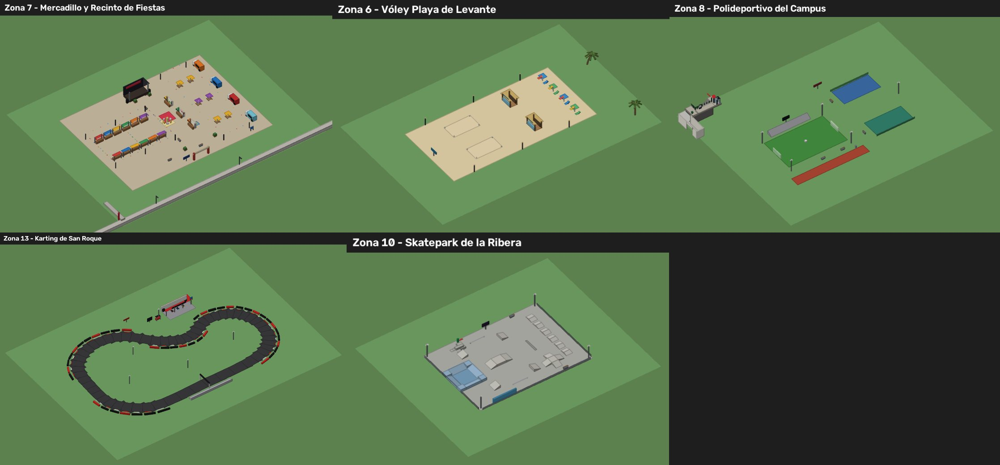
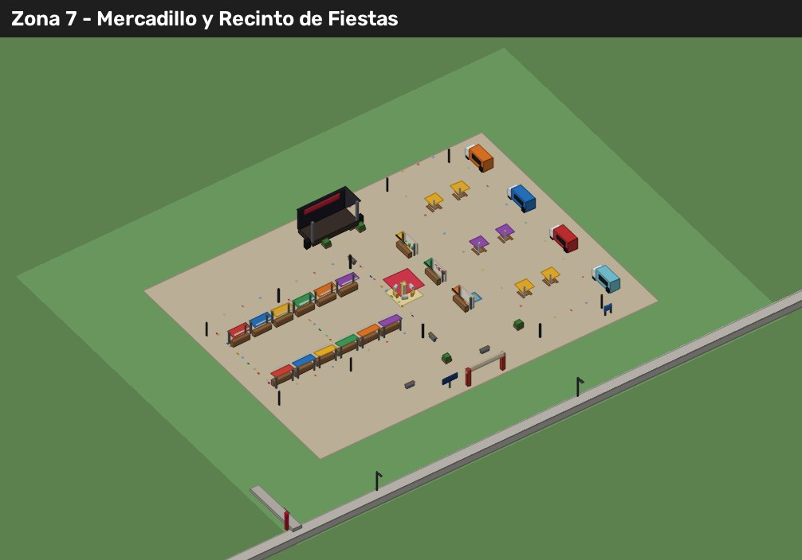
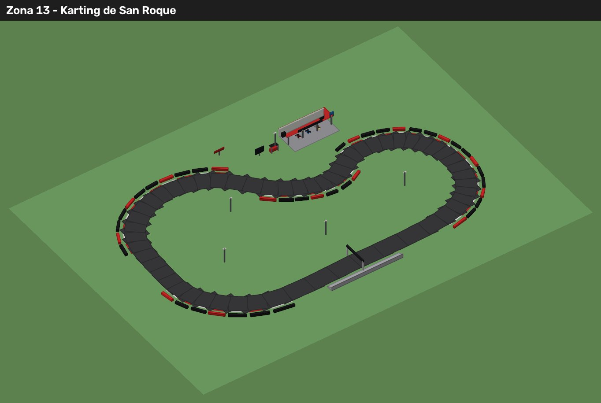
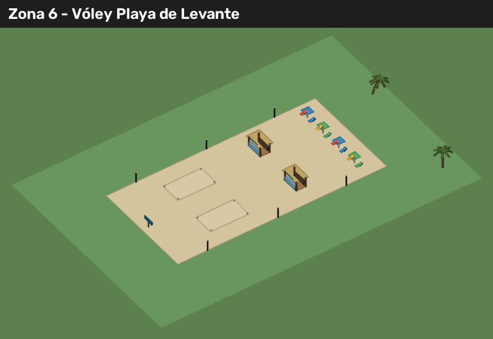
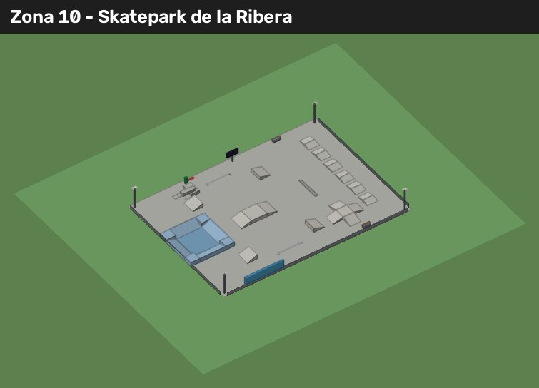
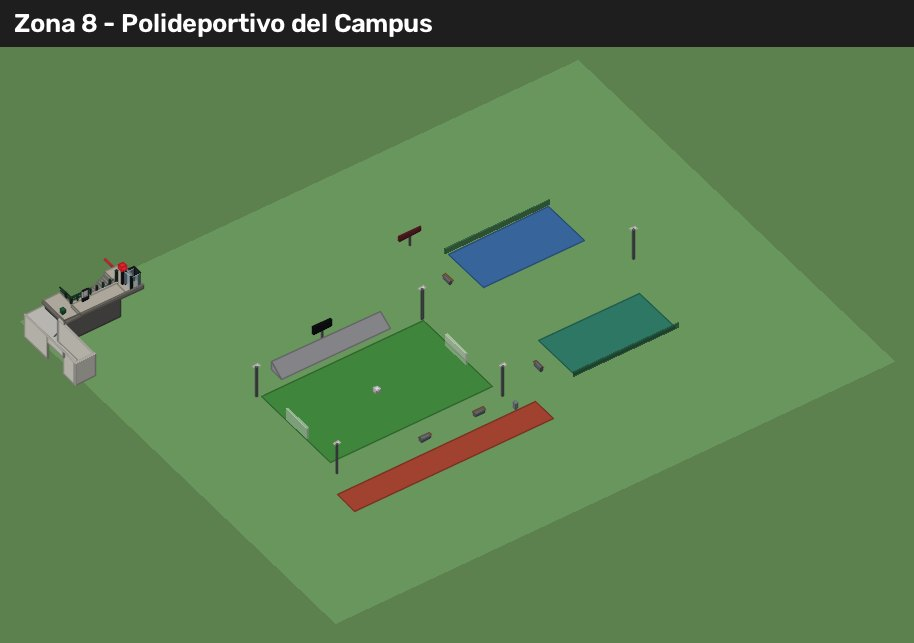

# Zonas verdes de ocio: lo que ya está construido

Parte del [plan de las zonas verdes](plan.md): mercadillo y fiesta del sábado (zona 7), vóley playa libre y
chiringuitos (zona 6), polideportivo del campus (zona 8), karting (zona 13) y skatepark (zona 10).



## Dónde está cada cosa

| Sitio | Zona | Código del mapa | Juego | Piezas (tope) |
|---|---|---|---|---|
| Mercadillo y Recinto de Fiestas | 7, Explanada del Este | `World/Kit/ZonasVerdes/Mercadillo` | `Services/FeriaService` | 325 (600) |
| Vóley Playa de Levante | 6, Costa de Levante | `World/Kit/ZonasVerdes/PlayaLevante` | `Services/ZonasDeporteService` | 83 (200) |
| Polideportivo del Campus | 8, Prado del Campus Norte | `World/Kit/ZonasVerdes/PolideportivoCampus` | `ZonasDeporteService` + fútbol, raqueta y atletismo de siempre | 41 (120) |
| Karting de San Roque | 13, Llanura de San Roque Sur | `World/Kit/ZonasVerdes/Karting` | `Services/KartService` | 283 (450) |
| Skatepark de la Ribera | 10, Ribera del Puerto | `World/Kit/ZonasVerdes/Skatepark` | `Services/SkateService` + `Controllers/OcioClient` | 75 (200) |

Los rectángulos de cada sitio están en `shared/OcioSitios` y salen de la máscara de huellas de la ciudad
(`scripts/map/zonas-verdes/1_mascaras.py`): todos caen al 100 % en zona libre (sin calles, aceras,
manzanas, edificios, agua ni playa, con 16 studs de margen). Lo construye `TownBuilder` al final, sin azar.

## Qué se puede hacer

- **Mercadillo** (todos los días de 8:00 a 14:00; el sábado hasta las 22:00): 12 puestos que se alquilan
  (40 € por 10 minutos). La gente de la ciudad y los demás jugadores te compran lo de la granja y el
  pescado de tu mochila, a un poco más que el supermercado. 4 food trucks (churros, bocadillos de
  calamares, pizza y helados) y el oficio «Cocinero/a de food truck».
- **Fiesta del sábado** (sábado de 17:00 a 2:00): casetas de aros, tiro con dianas de espuma y pesca de
  patitos (barra de precisión). Dan tickets de los recreativos, algo de dinero y diversión. Escenario para
  actuar (propinas). Tiovivo, guirnaldas y focos que se encienden de noche.
- **Vóley playa**: «Jugar · Vóley» en las dos pistas: partido 2 contra 2 fuera de la historia. Dos
  chiringuitos con bebidas y algo de picar, tumbonas para descansar.
- **Polideportivo**: fútbol 7 («Jugar · Fútbol», el de siempre), tenis y pádel («Jugar · Tenis / Pádel»)
  y carrera de velocidad en la recta («Correr · Carrera»). Las líneas se pintan al jugar.
- **Karting**: «Correr» (3 vueltas contra 3 karts de la máquina) o «Contrarreloj» (15 € la tanda), con el
  kart nuevo (pequeño, bajo y rápido). Semáforo, cronómetro por puertas (sin atajos), mejor vuelta,
  clasificación del servidor y récord personal. Oficio «Mecánico/a de boxes».
- **Skatepark**: monopatines gratis, rampas de salto, caja, bowl, pirámide, escaleras y barandillas.
  Trucos: salto y gran salto, kickflip (botón en el aire), giros de 180/360/540 y grind; combos con
  multiplicador. Reto de trucos: 6000 puntos en 60 s.

Todo da **diversión** con `NeedsService.addFun` si existe (si no, no hace nada: `Services/OcioFun`), y
además dinero, tickets o experiencia donde toca. Los sonidos van por `SoundFx` (🔔 Efectos, en 3D).

## Vistas

| | |
|---|---|
|  |  |
|  |  |
|  | |

## Cómo se comprueba y se rehace

```bash
lune run scripts/test-ocio.luau     # piezas por sitio, huellas, horario, cronómetro, trucos y carteles
# Ciudad construida y exportada (scripts/map/export.luau) en DIR:
python3 scripts/map/zonas-verdes/1_mascaras.py DIR
# Con la ciudad SIN los sitios de ocio: la máscara que usa la prueba (si cambia el mapa, hay que rehacerla)
python3 scripts/map/zonas-verdes/6_huellas_ocio.py DIR   # docs/zonas-verdes/huellas-ocio.json
# Con la ciudad CON los sitios: estas vistas
python3 scripts/map/zonas-verdes/7_vista_ocio.py DIR docs/zonas-verdes
```
