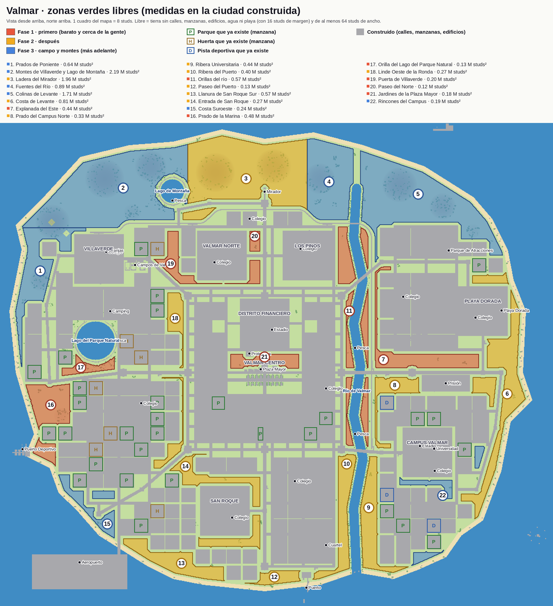
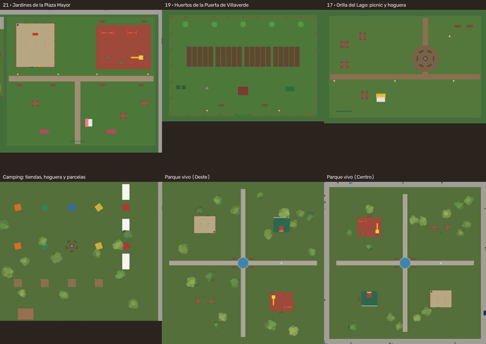

# Zonas verdes de Valmar: plan para llenarlas de cosas que se usan

> Idea del dueño: «Toda la zona verde del juego, implementamos cosas funcionales».
> Esto es la **fase 1: estudio y plan**. Todavía no se construye nada.

## 1. Cómo se ha medido

- Se construyó la ciudad igual que la del juego (`rojo build` + `scripts/build-place.luau`, semilla 2026: **414 654 piezas**)
  y se exportó con `scripts/map/export.luau` (401 661 piezas visibles).
- Cada pieza se pinta en un plano visto desde arriba (1 cuadro = 8 studs), igual que la máscara de huellas
  que usa el render del mapa para plantar árboles (`footprint_masks` en `scripts/map/blender_render.py`).
- **Libre** = tierra de la isla que **no** es calle, acera, manzana, parcela, edificio, río, lago, playa
  (70 studs de costa) ni aeropuerto, con 16 studs de margen, y de **al menos 64 studs de ancho**.
  Los árboles sueltos no cuentan como ocupado (se pueden mover). Los montes se calculan con
  `CityPlan.Mountains` (la misma fórmula que `TerrainBuilder`).
- Los parques, huertas y pistas que **ya existen** (manzanas `Parque`, `Campo` y `Deporte`) van aparte:
  hay **30 parques**, **7 huertas** y **3 campos de deporte**.
- Resultado: **~19,7 millones de studs² libres** de 51,9 millones de tierra (38 %). Casi la mitad está en los montes del norte.
- Scripts para repetirlo: `scripts/map/zonas-verdes/` (1 → 5). Datos de cada zona: `zonas.json`.

## 2. Mapa de las zonas

Las mismas zonas encima del render del mapa grande: [zonas-verdes-render.jpg](zonas-verdes-render.jpg).
Colores: rojo = fase 1, amarillo = fase 2, azul = fase 3.

| # | Zona | Distrito | Tamaño libre (studs²) | Caja (ancho × alto) | Llano | Carretera cerca | Al lado |
|---|---|---|---|---|---|---|---|
| 1 | Prados de Poniente | Oeste (costa) | 640 000 | 1144 × 2256 | 75 % | Paseo de Poniente (280) | hoteles de la costa |
| 2 | Montes de Villaverde y Lago de Montaña | campo (norte) | 2 190 000 | 2688 × 1352 | 65 %, cimas de 180 | Carretera de los Montes | lago con pesca, Cercanías |
| 3 | Ladera del Mirador | campo (norte) | 1 960 000 | 2016 × 1360 | 70 %, cimas de 200 | Avenida del Norte (fin) | Mirador, colegio de Valmar Norte |
| 4 | Fuentes del Río | campo (norte) | 890 000 | 744 × 1312 | 78 % | Carretera de los Montes | nacimiento del río, Cercanías |
| 5 | Colinas de Levante | campo (noreste) | 1 710 000 | 2312 × 1808 | 74 % | Carretera de Levante | Parque de Atracciones (800) |
| 6 | Costa de Levante | Este / Universitario | 810 000 | franja de 1040 × 4000 | 100 % | Paseo de Levante | Playa Dorada, Faro, prisión |
| 7 | Explanada del Este | Este | 440 000 | franja de 1680 × 1640 | 100 % | Avenida del Este (200) | Centro Comercial Valmar, armería, súper |
| 8 | Prado del Campus Norte | Universitario | 330 000 | 1968 × 1144 | 100 % | Avenida del Este (200) | Centro Penitenciario, súper |
| 9 | Ribera Universitaria | Universitario | 440 000 | 776 × 1880 | 100 % | Avenida Universitaria | río, Cuartel, Policía |
| 10 | Ribera del Puerto | Sur | 400 000 | 704 × 2032 | 100 % | Ronda Este (250) | río, naves, Policía, Bomberos |
| 11 | Orillas del río | entre Centro y Este | 570 000 | tiras de 480 × 3568 | 100 % | Carretera de Levante, Ronda Este | 2 zonas de pesca, Torre de Valmar |
| 12 | Paseo del Puerto | Sur | 130 000 | 904 × 232 | 100 % | Calle del Puerto (180) | Puerto de Valmar |
| 13 | Llanura de San Roque Sur | Sur | 570 000 | 2216 × 1064 | 100 % | calles de San Roque | San Roque, aeropuerto, costa |
| 14 | Entrada de San Roque | Sur | 270 000 | 1464 × 848 | 100 % | Carretera de la Costa Oeste (185) | Bomberos, centro comercial, gasolinera |
| 15 | Costa Suroeste | Oeste | 240 000 | 904 × 1024 | 100 % | Carretera de la Costa Oeste (210) | aeropuerto |
| 16 | Prado de la Marina | Oeste (lujo) | 480 000 | 728 × 1336 | 89 %, colina de 50 | Avenida del Oeste (380) | Puerto Deportivo, hoteles, villas |
| 17 | Orilla del Lago del Parque Natural | Oeste | 130 000 | 848 × 344 | 100 % | Avenida del Oeste (165) | lago, pesca, Camping |
| 18 | Linde Oeste de la Ronda | Oeste | 270 000 | tira de 472 × 2848 | 100 % | Ronda Oeste (200) | Museo, Ayuntamiento, súper |
| 19 | Puerta de Villaverde | Oeste | 200 000 | 1104 × 848 | 100 % | Carretera de Villaverde (190) | súper, Campos de Valmar, Granjas |
| 20 | Paseo del Norte | Norte | 120 000 | 568 × 848 | 100 % | Avenida del Norte (160) | recreativos, gimnasio, colegio, Valmar Norte |
| 21 | Jardines de la Plaza Mayor | Centro | 180 000 | 2 solares de ~470 × 220 | 100 % | calles de Valmar Centro | **Protectora**, Plaza Mayor, súper, Justicia |
| 22 | Rincones del Campus | Universitario | 190 000 | trozos sueltos | 100 % | Paseo de Levante | colegio, gimnasio, residencias |

Notas:
- «Llano» = parte con menos de 6 studs de altura. En `zonas.json` está también el círculo llano más grande de
  cada zona (sirve para saber si cabe un circuito o un campo).
- La zona 21 está dentro de **Valmar Centro**, el barrio de la historia: antes de construir hay que mirar que no tape
  ninguna marca de `LifeStory` (StorySpot, StoryArea).
- Las posiciones salen de la ciudad construida con la semilla 2026. Si cambia el orden de `math.random` en
  `Kit/Districts`, los parques pueden moverse: hay que repetir la medida antes de construir.

## 3. Lo que ya existe y se puede reutilizar

| Sistema | Qué hace hoy | Cómo sirve aquí |
|---|---|---|
| **Necesidades** (`NeedsService`) | Solo **hambre** y **energía**. No hay «diversión». | Pícnic y chiringuitos dan hambre; descansar en hamacas, energía. (Ver pregunta 1.) |
| **Comida** (`FoodService`, tag `FoodStand`) | Mostradores que venden comida con hambre/energía. | Food trucks, chiringuitos, puesto de malvaviscos: solo poner el tag. |
| **Negocios** (`BusinessService`) | Locales en venta: tienda, frutería, panadería, restaurante, cafetería, gasolinera, hotel. Los NPC compran solos. | Puestos del mercadillo y food trucks como «locales» pequeños de jugadores. |
| **Mercadillo** (`TradeService`) | Mercadillo en la app del teléfono (sin sitio físico). | El mercadillo de la zona 7 puede ser su versión física. |
| **Granjas** (`FarmService`, `Farming`) | Fincas con 4 bancales + corral, cooperativa, obrador (pan, queso…), nivel de agricultor. Busca **cualquier modelo «Granja»**. | Huertos urbanos y granja escuela: un modelo «Granja» más pequeño y funciona solo. |
| **Animales** (`AnimalKit`, `PetService`, `Wildlife`, `PetLife`) | Protectora (adoptar perro/gato), vagabundos, mascota que te sigue, **montar a caballo** en los Campos (`HorseStation`). Pájaros, patos, mariposas, luciérnagas. | Pipicán, ruta a caballo, granja escuela, observar aves. |
| **Pesca** (`FishingService`) | Pesca en cualquier orilla de los lagos y el río de `CityPlan`, sitios de pesca, niveles, oficio de pescador, tienda. | Un estanque nuevo en `CityPlan.Lakes` ya tiene pesca y agua (0 piezas). |
| **Deportes** | Fútbol (`Pitch` + postes), baloncesto (`Rim`/`Court`), tenis y pádel (en cualquier `Court`/`Pitch`/`PEArea`), vóley playa y atletismo (**solo en la historia**), carteles «Jugar» (`SportPrompts`). | Un campo cuesta **11 piezas** (manzana `Deporte`). Vóley y atletismo se pueden abrir para jugar libre. |
| **Gimnasio** (`GymService`) | Máquinas con barra de ritmo, fuerza y forma física. | Gimnasio al aire libre (calistenia) con las mismas máquinas, gratis y más suave. |
| **Juguetes** (`ToyService`) | Balones y conos con física (fútbol, playa, baloncesto). | Balones en parques, playa y pipicán. |
| **Vehículos** (`VehicleService`, `Gameplay`) | Bici, monopatín, patinete gratis en las estaciones; moto y coche; gasolina. | Skatepark (monopatín), carril bici, motocross, karts (vehículo nuevo «Kart»). |
| **Barcos** (`BoatService`) | Barcos en el mar. | Kayaks/barcas de alquiler en el río. |
| **Camping** (`Icons.Camping`) | 10 tiendas, hoguera y un monitor NPC… **pero no se puede hacer nada** (solo decorado). | Hacerlo funcional: dormir en la tienda, fogata de noche. |
| **Parque de Atracciones** (`Feria`) | Noria, montaña rusa y carrusel que giran (decorado). | Fuera de las zonas verdes; buena idea para más adelante. |
| **Parques** (`Lite.park`) | Caminos, fuente, árboles, 4 bancos y un balón. Sin juego. | «Parques vivos»: añadir un módulo de juego a cada uno. |
| **Encargos** (`CityErrandService`) | Gente con ❗ en parques, playa… que te pide cosas. | Encargos nuevos en cada sitio (perro perdido, recoger fruta…). |
| **Pase de temporada** (`BattlePassXPService`) | XP por eventos (`StoryEvents`): pesca, granja, gimnasio, explorar barrios… | Cada actividad nueva manda su evento (`ParkPlayed`, `KartLap`…) y da XP con tope diario. |
| **Estaciones y tiempo** (`Seasons`, `WeatherService`) | Lluvia, nieve, hojas; riega solo los huertos. | Fiestas de temporada, piscina en verano, hoguera en invierno. |
| **Reloj y calendario** (`GameClock`, `CalendarService`) | Día de 20 minutos, tu día de vida. | Eventos a hora fija (mercadillo el sábado, cine de noche). |
| **Historia** (`LifeStory`) | Misiones que ya hablan de columpios, huerto, excursión a la granja, festival. | Marcar los sitios nuevos con `StorySpot`/`StoryArea` para que la historia los use. |

## 4. Propuestas por zona

Coste en **piezas** (aprox.). Para comparar: un parque de hoy ≈ 250, el Camping 333, los Campos de Valmar 385,
una granja 150–430, un gimnasio 135, un campo de fútbol 11, un sitio de pesca 39.

| # | Zona | Qué ponemos | Qué hace el jugador | Sistemas que se reutilizan | Piezas | Fase |
|---|---|---|---|---|---|---|
| P | **Los 30 parques que ya existen** | **Parques vivos**: a cada parque, un módulo según el barrio: columpios y tobogán, pipicán, media pista de baloncesto o mesas de pícnic | Niños: columpiarse (animación + XP de etapa). Mascotas: lanzar la pelota. Comer de la mochila en la mesa (+hambre). Pachanga de basket | `Lite.park`, `ToyService`, `BasketService`, `PetService`, `SportPrompts` | +60–120 por parque (≈2 500 en total; se puede hacer en 15) | 1 |
| 21 | Jardines de la Plaza Mayor | **Parque infantil grande + pipicán de la Protectora** + quiosco de helados | Columpios, tobogán, balancín (etapa niño). Pasear al perro recién adoptado, jugar a la pelota, carrera de agilidad (vallas de la Protectora). Comprar helado | `PetService`, `AnimalKit` (obstáculos), `FoodService`, `CityErrands` | 400 | 1 |
| 7 | Explanada del Este | **Mercadillo y recinto de fiestas**: 12 puestos, 4 food trucks, escenario | Alquilar un puesto y vender lo de la granja o la pesca. Comer en los food trucks. Tocar en el escenario (`BuskPlayed`). Fiesta del sábado por la noche con minijuegos (tiro al bote, pesca de patitos) | `BusinessService`, `TradeService`, `FoodService`, `Farming`, `MiniGameService` (Timing) | 600 | 1 |
| 19 | Puerta de Villaverde | **Huertos urbanos** (4–6 fincas pequeñas) + frutales | Quedarte un huerto, plantar, regar, cosechar y vender en el súper de al lado o cocinar | `FarmService` (modelo «Granja» pequeño), `Farming`, `FridgeService` | 300 | 1 |
| 17 | Orilla del Lago del Parque Natural | **Pícnic y fogata nocturna** + **Camping que funciona** | De día: mesa de pícnic (comer +hambre, descansar +energía). De noche: fogata con malvaviscos, historias de miedo con el monitor, dormir en una tienda (como una cama) | `NeedsService`, `FoodService`, `SleepService`, `NatureAssets` (hogueras), NPC Monitor | 150 | 1 |
| 11 | Orillas del río | **Paseo fluvial**: carril bici con contrarreloj, 2 pantalanes de pesca más, calistenia, bancos | Coger la bici gratis y hacer la vuelta del río contra el reloj. Pescar. Hacer dominadas y flexiones | `VehicleService` (bici), `FishingService`, `GymService`, `RaceService` (crono) | 250 (camino pintado en el terreno: 0 piezas) | 1 |
| 20 | Paseo del Norte | **Gimnasio al aire libre + columpios** para Valmar Norte | Entrenar gratis (sube menos que en el gimnasio). Los niños del colegio de al lado juegan en el recreo | `GymService`, `GymKit`, `Toys` | 250 | 1 |
| 16 | Prado de la Marina | **Minigolf de 9 hoyos** + club de playa (barrio de lujo) | Jugar un recorrido (toque con fuerza y dirección), récord del día, retar a un amigo | Nuevo minijuego pequeño (física de `Toys`/`Ball`), `BattlePassXP` | 400 | 2 |
| 6 | Costa de Levante | **Vóley playa libre** (2 pistas) + 2 chiringuitos + hamacas | Jugar 2 contra 2 cuando quieras (no solo en la historia). Comer en el chiringuito. Tumbarse en la hamaca (+energía) | `VolleyService` (abrirlo al juego libre), `FoodService`, `BusinessService` | 200 | 2 |
| 10 | Ribera del Puerto | **Skatepark y pump track** (barrio industrial) | Monopatín y bici: saltos y trucos con puntos (giro en el aire, deslizar en barandilla) | `VehicleService` (monopatín), `Rides` | 200 (rampas en MeshPart) | 2 |
| 13 | Llanura de San Roque Sur | **Circuito de karts** (cabe un óvalo de 350 studs) | Alquilar un kart, carrera de 3 vueltas contra la máquina o amigos, récord del circuito. Trabajo de «Mecánico/a de boxes» | `VehicleService` + vehículo nuevo «Kart», `RaceService` (salida y meta), `JobService` | 450 | 2 |
| 18 | Linde Oeste de la Ronda | **Cine de verano** (pantalla + tumbonas) | De noche: sentarse y ver la película de la cartelera, con palomitas | `CinemaService`, `Cinema`, `FoodService` | 120 | 2 |
| 3 | Ladera del Mirador | **Mirador con puntos de foto + tirolina** cuesta abajo | Subir andando o en bici, foto en 3 puntos (álbum), bajar en tirolina | `Mirador` (Landmarks), `BattlePassXP` (Explorar), cámara del móvil | 150 | 2 |
| 8 | Prado del Campus Norte | **Polideportivo universitario**: fútbol 7, 2 pistas de pádel/tenis, pista de atletismo | Pachangas, tenis/pádel, carreras de 100 m libres | `FootballService`, `RacketService`, `RaceService` (abrirlo al juego libre) | 120 | 2 |
| 9 | Ribera Universitaria | **Kayaks y barcas de alquiler** en el río + embarcadero | Remar río arriba, carrera de kayaks, pescar desde la barca | `BoatService`, `FishingService` | 120 | 2 |
| 14 | Entrada de San Roque | **Granja escuela**: gallinas, cabras, conejos, pequeño huerto | Recoger huevos, dar de comer, cepillar a la cabra. Excursión del colegio (`Cole07_Excursion`). Trabajo de «Cuidador/a de la granja» | `FarmService`, `FarmAnimals`, `AnimalKit`, `JobService`, `LifeStory` | 350 | 2 |
| 12 | Paseo del Puerto | **Lonja y food trucks del puerto** | Vender el pescado recién pescado, comer pescaíto | `FishingService` (venta), `FoodService` | 150 | 2 |
| 1 | Prados de Poniente | **Ruta a caballo por la costa** desde los Campos de Valmar | Montar y seguir la ruta con postes de control (carrera a caballo con tiempo) | `PetService` (`HorseStation`), `RaceService` (crono) | 60 | 3 |
| 2 | Montes de Villaverde y Lago de Montaña | **Senderos con coleccionables** (setas, piñas, plumas, fósiles) + **refugio** con hoguera | Seguir el sendero, encontrar coleccionables (álbum con premio), observar aves, pescar en el lago | `Wildlife`, `Seasons` (cada estación salen otros), `FishingService` | 100 (lo que se recoge aparece solo cerca de ti) | 3 |
| 4 | Fuentes del Río | **Escuela de pesca y estanque de truchas** | Pescar truchas (peces nuevos), clases de pesca para niños | `FishingService`, `CityPlan.Lakes` (estanque nuevo: 0 piezas) | 80 | 3 |
| 5 | Colinas de Levante | **Circuito de motocross / BMX** con saltos de tierra | Moto o bici por la pista de tierra, contrarreloj | `VehicleService`, terreno (`TerrainBuilder`: los saltos son terreno, 0 piezas) | 80 | 3 |
| 15 | Costa Suroeste | **Mirador de aviones** junto al aeropuerto | Ver despegar los aviones, foto del avión (álbum) | `AviationService`, `FlightService` | 40 | 3 |
| 22 | Rincones del Campus | **Huerto y pista de frisbee de la universidad** | Club de estudiantes: frisbee y basket 3×3 | `ToyService`, `BasketService`, `FarmService` | 150 | 3 |

Lo que **no** proponemos poner en zonas verdes: un parque acuático o un estadio nuevo (muchas piezas) y nada
encima de las vías del Cercanías ni de la playa (la playa ya tiene su vida).

### Top 10 (diversión × coste)

| Puesto | Propuesta | Por qué |
|---|---|---|
| 1 | Parques vivos (los 30 parques) | Están en todos los barrios, junto a las casas. Muy barato y lo ven todos. |
| 2 | Parque infantil + pipicán (21, Plaza Mayor) | En el centro, junto a la Protectora: da algo que hacer con la mascota nada más adoptarla. |
| 3 | Mercadillo y fiesta del sábado (7) | Junta a los jugadores, da salida a lo de la granja y la pesca, y crea una cita fija. |
| 4 | Huertos urbanos (19) | FarmService ya hace todo: es poner un modelo «Granja» más cerca de la ciudad. |
| 5 | Pícnic, fogata y camping que funciona (17) | Arregla un sitio que hoy solo es decorado; da un plan de noche. |
| 6 | Paseo fluvial con carril bici y pesca (11) | Muy barato (camino pintado en el terreno) y está en medio de la ciudad. |
| 7 | Vóley playa libre y chiringuitos (6) | El juego de vóley ya existe: solo hay que abrirlo fuera de la historia. |
| 8 | Polideportivo universitario (8) | 120 piezas para tres deportes que ya funcionan. |
| 9 | Circuito de karts (13) | Lo más divertido para un móvil; algo más caro (vehículo nuevo). |
| 10 | Skatepark (10) | El monopatín ya existe; los trucos son la parte nueva. |

## 5. Presupuesto de rendimiento (móvil)

Hoy la ciudad tiene **~415 000 piezas** (Distritos 162 000, Región 117 000, calles 77 000, naturaleza 17 500).

- **Tope total para todo el plan: 8 000 piezas** (menos del 2 % de lo que hay). Fase 1 ≈ 4 500, fase 2 ≈ 2 500, fase 3 ≈ 600.
- **Tope por sitio: 600 piezas.** Si algo pasa de ahí, se divide o se simplifica.
- **Modelos con `Builder.model`** (ya los pone en `ModelStreamingMode.Atomic`): con StreamingEnabled
  (radio 768) solo llegan al móvil los sitios que tienes cerca.
- **El terreno en vez de piezas**: caminos, carril bici, pista de tierra, saltos de motocross y estanques se hacen
  con `TerrainBuilder` (`ReplaceMaterial`, `CityPlan.Lakes`): **0 piezas**. El agua nueva ya tiene pesca y nado.
- **Árboles**: no plantar árboles de piezas nuevos (cada uno son ~19 piezas). Usar las plantillas de `MeshLibrary`.
- **MeshParts** para lo que se repite (columpio, tobogán, rampa, kart, puesto): una malla en vez de 10–20 piezas.
- **Reutilizar con builders del Kit** (`Lite`, `Props`, `GymKit`, `AnimalKit`, `FishingKit`): un builder por cosa
  (`Lite.playground`, `Lite.dogPark`, `Lite.picnic`…) que se llama donde haga falta.
- **Lo que se pinta solo mientras se juega**: las pistas de tenis, pádel, vóley y atletismo ya se dibujan al
  empezar el partido (no ocupan piezas fijas). Los coleccionables y los karts aparecen solo cerca del jugador.
- **Detalle que se puede quitar**: lo pequeño con la etiqueta `PropDetail`/`LiteDetail` (se quita en el modo ligero
  del móvil). Lo decorativo, `CanCollide`/`CanQuery`/`CastShadow` apagados.
- **Medir antes y después**: repetir `scripts/map/zonas-verdes/` y `scripts/build-place.luau` (cuenta las piezas)
  en cada fase.

## 6. Orden de construcción

**Fase 1 — barato y cerca de la gente (≈4 500 piezas, reutiliza casi todo)**
1. Builders del Kit: columpios, pipicán, mesa de pícnic, calistenia (MeshParts).
2. Parques vivos en los 30 parques (o en 15, uno de cada dos).
3. Parque infantil + pipicán de la Plaza Mayor (21).
4. Huertos urbanos de la Puerta de Villaverde (19).
5. Pícnic, fogata y camping funcional (17).
6. Paseo fluvial con carril bici y pesca (11) y gimnasio al aire libre del Norte (20).
7. Mercadillo y fiesta del sábado en la Explanada del Este (7).
8. XP del pase y misiones diarias para todo lo nuevo.

**Fase 2 — deportes y ocio (≈2 500 piezas, algo de juego nuevo)**
1. Abrir vóley y atletismo al juego libre → vóley playa (6) y polideportivo (8).
2. Cine de verano (18), mirador con tirolina (3), lonja del puerto (12), kayaks (9).
3. Granja escuela (14) y skatepark (10).
4. Minigolf (16) y circuito de karts (13): los dos con minijuego nuevo.

**Fase 3 — el campo y los montes (≈600 piezas, sobre todo terreno)**
1. Senderos con coleccionables y refugio (2), escuela de pesca (4).
2. Ruta a caballo (1), motocross (5), mirador de aviones (15), rincones del campus (22).

## 7. Preguntas para el dueño

1. ¿Añadimos una necesidad nueva de **diversión** (que baja con el tiempo y sube en parques, deportes y fiestas), o basta con hambre, energía, dinero y XP?
2. ¿Prefieres **pocos sitios grandes** (karts, mercadillo, minigolf) o **muchos pequeños** repartidos por todos los barrios (parques vivos)?
3. Los parques que ya existen: ¿podemos cambiarlos (quitar algunos árboles para poner columpios o el pipicán)?
4. El mercadillo: ¿los puestos los alquilan los **jugadores** (como los locales de BusinessService) o solo hay vendedores NPC?
5. ¿Hacemos **eventos a hora fija** (fiesta el sábado por la noche, cine al anochecer) para que se junte la gente, aunque quien entre a otra hora no los vea?
6. Karts, kayaks y minigolf: ¿se pagan con **dinero del juego**, son gratis, o alguno va con Robux (pase)?
7. Los montes del norte: ¿los dejamos **naturales** (senderos, coleccionables) o quieres algo grande allí (estación de esquí en invierno, parque de aventura)?
8. ¿Te gusta el orden de las fases o hay algo que quieras **primero** (por ejemplo, los karts)?

## 8. Fase 1 construida: diversión, parques vivos y sitios 21, 19 y 17

(Vista desde arriba del mapa construido: `scripts/map/zonas-verdes/6_sitios.py`.)

- **🎈 Diversión** (respuesta a la pregunta 1): nueva necesidad junto al hambre y la energía (`NeedsService`,
  `data.Fun`; las partidas de antes la reciben llena). Baja 0,9 por minuto; con menos de 30 estás «aburrido»
  (atributo `Bored`): un aviso amable cada 10 minutos como mucho y la XP al 90 %. Nunca castiga más.
  Quinta barra del HUD (🎈; 😐 si te aburres); en el móvil, 3 + 2 barritas.
  API para los demás sistemas: `NeedsService.addFun(player, cantidad, "Motivo")` (como mucho 40 por minuto
  con el mismo motivo), `NeedsService.getFun(player)`, `NeedsService.isBored(player)`. Cantidades en `Config.Fun`.
  `FunService` la sube con lo que ya existía: deportes (`InSport`), monopatín, kart o caballo (`Riding`),
  pasear a la mascota, pescar, cine, recreativos, tocar en la calle, barco, adoptar y cosechar.
- **Parques vivos** (30): en cada cuarto del parque, según su tamaño, parque infantil (columpios que se
  mecen, tobogán, balancín), mesas de pícnic («Comer de la mochila»), pipicán («Lanzar la pelota» a tu
  mascota) y media pista de baloncesto (BasketService). 84–96 piezas cada uno; los árboles que caían
  encima se quitan.
- **21 · Jardines de la Plaza Mayor**: pipicán grande de la Protectora (agilidad y túnel), parque infantil
  grande, quiosco de helados y limonada, pícnic, bancos y farolas (162 piezas). Sin marcas de la historia.
- **19 · Puerta de Villaverde**: huertos urbanos (Model «Granja»: 4 fincas de FarmService con cooperativa),
  cocina del huerto, frutales, grifo y valla (115 piezas, más lo que pone FarmService al arrancar).
- **17 · Orilla del lago**: pícnic, limonada y hoguera de noche con troncos, malvaviscos y monitor (60 piezas).
- **Camping**: 9 tiendas que se alquilan (15 €) para dormir (SleepService), la hoguera con troncos y
  4 parcelas para montar tu tienda gratis (26 piezas).
- Código: `src/server/World/Kit/ZonasVerdes/` (Sitios, Juegos, Comun, Parques, Plaza, Huertos, Lago),
  `Services/ParkService` y `Services/FunService`. Prueba: `scripts/test-zonasverdes.luau [X.rbxl]`
  (con el mapa: piezas por sitio y nada encima de calles, aceras, edificios ni árboles).
